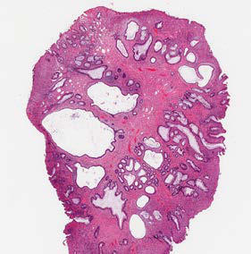

# Chapter 393: Tumors of the Digestive Tract — Active-Recall Flashcards
**Part XVI: The Digestive System** | [📖 Read Wiki Chapter](../chapters/393.md) | [📝 Chapter MCQs](../mcqs/393_mcqs.md) | [🏠 Course Master Index](../../index.md)

Total cards: **8** *(Click any card below to reveal the answer)*

### Card 1 (Syndrome & Clinical Profile)

<b>Q:</b> What are the hallmark clinical features and diagnostic profile of **Tumors of the Digestive Tract**?

**Answer:**
**Associated Gene(s):** `APC, BMPR1A, MEN1, NF1, PTEN` · **Category / Inheritance:** The Digestive System **Clinical Synthesis:** Juvenile, reten tion, or inflammatory polyps are hamartomatous polyps, which rep resent the most common intestinal tumors of childhood, occurring in 1–2% of children.

### Card 2 (Pediatric Genetics & Pathogenesis)

<b>Q:</b> In **Tumors of the Digestive Tract**, what clinical phenotype or molecular mechanism is associated with **`SMAD4`**?

**Answer:**
Patients with the SMAD4 pathogenic variant may have hereditary hemorrhagic telangiectasia and should be evaluated for brain and lung vascular malformations.

### Card 3 (Pediatric Genetics & Pathogenesis)

<b>Q:</b> In **Tumors of the Digestive Tract**, what clinical phenotype or molecular mechanism is associated with **`STK11`**?

**Answer:**
Genetic testing can reveal pathogenic vari ants in LKB1/STK11 (19p13.3), a serine-threonine kinase that acts as a tumor suppressor gene.

### Card 4 (Pediatric Therapeutics & Management)

<b>Q:</b> What is the clinical management or therapeutic approach for **Tumors of the Digestive Tract**?

**Answer:**
**Therapy / Protocol:** Octreotide **Clinical Application:** Symptomatic relief of carcinoid syndrome may be achieved with admin istration of somatostatin analogs (i.e., octreotide).

### Card 5 (Core Pediatric Concept)

<b>Q:</b> In the pediatric evaluation of **Tumors of the Digestive Tract** (*Tumors of the Digestive Tract*), how is **HAMARTOMATOUS TUMORS** characterized?

**Answer:**
HAMARTOMATOUS TUMORS Hamartomas are benign tumors composed of tissues that are normally found in an organ but that are not organized normally.

### Card 6 (Core Pediatric Concept)

<b>Q:</b> In the pediatric evaluation of **Tumors of the Digestive Tract** (*Tumors of the Digestive Tract*), how is **polypectomy** characterized?

**Answer:**
polypectomy by snare cautery, and visualization of synchronous lesions; up to 50% of children have one or more additional polyps, and approximately 20% may have more than five polyps.

### Card 7 (Core Pediatric Concept)

<b>Q:</b> In the pediatric evaluation of **Tumors of the Digestive Tract** (*Tumors of the Digestive Tract*), how is **Juvenile Polyposis Syndrome** characterized?

**Answer:**
Juvenile Polyposis Syndrome Patients with juvenile polyposis syndrome (JPS) present with multiple juvenile polyps—usually five or more—but typically 50-200 are pres ent within the GI tract.

### Card 8 (Visual Diagnosis & Clinical Spotter)

<b>Q:</b> Identify the pediatric clinical finding, imaging sign, or mechanism illustrated in **Fig. 393.1** (*Tumors of the Digestive Tract*):

**Answer:**
Representative histologic sections of commonly found polyps in pediatric patients. A, Juvenile polyp. Cystically dilated and irregular colonic crypts within an inflamed, expanded stroma. B, Peutz-Jeghers polyp. Small bowel with large arborizing bundles of smooth muscle and oth erwise normal epithelial component. C, Adenomatous polyp. Enlarged, hyperchromatic, and stratified nuclei confined to a tubular configuration.

