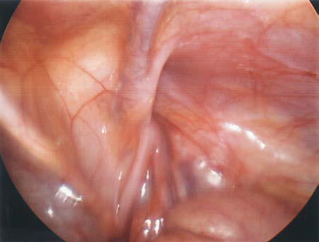

# Chapter 394: Inguinal Hernias — Active-Recall Flashcards
**Part XVI: The Digestive System** | [📖 Read Wiki Chapter](../chapters/394.md) | [📝 Chapter MCQs](../mcqs/394_mcqs.md) | [🏠 Course Master Index](../../index.md)

Total cards: **8** *(Click any card below to reveal the answer)*

### Card 1 (Syndrome & Clinical Profile)

<b>Q:</b> What are the hallmark clinical features and diagnostic profile of **Inguinal Hernias**?

**Answer:**
**Category / Inheritance:** The Digestive System **Clinical Synthesis:** Inguinal hernias are one of the most common conditions seen in pedi atric practice, with an overall incidence of 0.8–4.5% in term infants and children and increasing to nearly 30% in premature and low birth weight (<1 kg) infants.

### Card 2 (Pediatric Therapeutics & Management)

<b>Q:</b> What is the clinical management or therapeutic approach for **Inguinal Hernias**?

**Answer:**
**Therapy / Protocol:** Management **Clinical Application:** Initial management includes nasogastric intubation, intravenous flu ids, and administration of broad-spectrum antibiotics.

### Card 3 (Core Pediatric Concept)

<b>Q:</b> In the pediatric evaluation of **Inguinal Hernias** (*Inguinal Hernias*), how is **Vascular Tumors** characterized?

**Answer:**
Vascular Tumors Vascular malformations and hemangiomas are rare in children.

### Card 4 (Core Pediatric Concept)

<b>Q:</b> In the pediatric evaluation of **Inguinal Hernias** (*Inguinal Hernias*), how is **congenital indirect** characterized?

**Answer:**
congenital indirect hernias (99%) because of a patent processus vaginalis (PV), an evagination of peritoneum in the inguinal area important in testicular descent.

### Card 5 (Core Pediatric Concept)

<b>Q:</b> In the pediatric evaluation of **Inguinal Hernias** (*Inguinal Hernias*), how is **EMBRYOLOGY AND PATHOGENESIS** characterized?

**Answer:**
EMBRYOLOGY AND PATHOGENESIS Indirect inguinal hernias in infants and children are congenital and result from an arrest of embryologic development—failure of oblitera tion of the PV rather than a weakness in the abdominal wall muscula ture.

### Card 6 (Visual Diagnosis & Clinical Spotter)

<b>Q:</b> Identify the pediatric clinical finding, imaging sign, or mechanism illustrated in **Fig. 394.3** (*Inguinal Hernias*):

**Answer:**
Diagnostic laparoscopic image of obliterated processus vaginalis on left side.

### Card 7 (Visual Diagnosis & Clinical Spotter)

<b>Q:</b> Identify the pediatric clinical finding, imaging sign, or mechanism illustrated in **Fig. 394.2** (*Inguinal Hernias*):

**Answer:**
Laparoscopic image of patent processus vaginalis on right side.

### Card 8 (High-Yield Board Pearl)

<b>Q:</b> What is a high-yield clinical or diagnostic principle regarding **Inguinal Hernias** (*Inguinal Hernias*)?

**Answer:**
Inguinal hernias are one of the most common conditions seen in pedi atric practice, with an overall incidence of 0.8–4.5% in term infants and children and increasing to nearly 30% in premature and low birth weight (<1 kg) infants.

