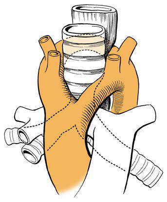

# Chapter 435: Foreign Bodies in the Airway — Active-Recall Flashcards
**Part XVII: The Respiratory System** | [📖 Read Wiki Chapter](../chapters/435.md) | [📝 Chapter MCQs](../mcqs/435_mcqs.md) | [🏠 Course Master Index](../../index.md)

Total cards: **8** *(Click any card below to reveal the answer)*

### Card 1 (Syndrome & Clinical Profile)

<b>Q:</b> What are the hallmark clinical features and diagnostic profile of **Foreign Bodies in the Airway**?

**Answer:**
**Category / Inheritance:** The Respiratory System **Clinical Synthesis:** Diagnosis and management of tracheal anomalies and tracheal stenosis.

### Card 2 (Syndrome & Clinical Profile)

<b>Q:</b> What are the hallmark clinical features and diagnostic profile of **Laryngeal Foreign Bodies (Foreign Bodies in the Airway)**?

**Answer:**
**Category / Inheritance:** The Respiratory System **Clinical Synthesis:** The most serious complication of foreign body aspiration is complete obstruction of the airway, which may be recognized in the conscious child as sudden respiratory distress followed by an inability to speak or cough.

### Card 3 (Syndrome & Clinical Profile)

<b>Q:</b> What are the hallmark clinical features and diagnostic profile of **Tracheal Foreign Bodies (Foreign Bodies in the Airway)**?

**Answer:**
**Category / Inheritance:** The Respiratory System **Clinical Synthesis:** The most serious complication of foreign body aspiration is complete obstruction of the airway, which may be recognized in the conscious child as sudden respiratory distress followed by an inability to speak or cough.

### Card 4 (Pediatric Therapeutics & Management)

<b>Q:</b> What is the clinical management or therapeutic approach for **Foreign Bodies in the Airway**?

**Answer:**
**Therapy / Protocol:** Management **Clinical Application:** Diagnosis and management of tracheal anomalies and tracheal stenosis.

### Card 5 (Core Pediatric Concept)

<b>Q:</b> In the pediatric evaluation of **Foreign Bodies in the Airway** (*Foreign Bodies in the Airway*), how is **CLINICAL MANIFESTATIONS** characterized?

**Answer:**
CLINICAL MANIFESTATIONS Foreign bodies of the airway have variable presentations and complica tions, depending on the characteristics, duration, and location of the foreign body.

### Card 6 (Core Pediatric Concept)

<b>Q:</b> In the pediatric evaluation of **Foreign Bodies in the Airway** (*Foreign Bodies in the Airway*), how is **DIAGNOSIS** characterized?

**Answer:**
DIAGNOSIS The clinical history is the most important factor in determining the need for operative bronchoscopy.

### Card 7 (Core Pediatric Concept)

<b>Q:</b> In the pediatric evaluation of **Foreign Bodies in the Airway** (*Foreign Bodies in the Airway*), how is **TREATMENT** characterized?

**Answer:**
TREATMENT The treatment of choice for airway foreign bodies is prompt endo scopic removal with rigid instruments by a specialist (otolaryngolo gist or pulmonologist).

### Card 8 (Visual Diagnosis & Clinical Spotter)

<b>Q:</b> Identify the pediatric clinical finding, imaging sign, or mechanism illustrated in **Fig. 434.6** (*Foreign Bodies in the Airway*):

**Answer:**
Vascular rings. A, Double aortic arch. B, Right aortic arch with aberrant left subclavian artery and left ligamentum arteriosum. C, Aber rant innominate artery. D, Left pulmonary artery sling. (From Green GF, Ohye RG. Diagnosis and management of tracheal anomalies and tracheal stenosis. In: Lesperance MM, ed. Cummings Pediatric Otolaryngology, 2nd ed. Philadelphia: Elsevier; 2022: Fig. 30.6, p. 445.)

