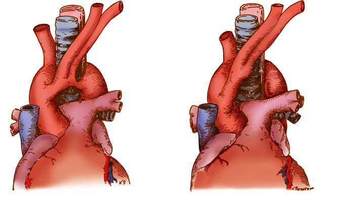

# Chapter 481: Other Congenital Heart and Vascular Malformations — Active-Recall Flashcards
**Part XVIII: The Cardiovascular System** | [📖 Read Wiki Chapter](../chapters/481.md) | [📝 Chapter MCQs](../mcqs/481_mcqs.md) | [🏠 Course Master Index](../../index.md)

Total cards: **8** *(Click any card below to reveal the answer)*

### Card 1 (Syndrome & Clinical Profile)

<b>Q:</b> What are the hallmark clinical features and diagnostic profile of **DOUBLE ARCH (Other Congenital Heart and Vascular Malformations)**?

**Answer:**
**Category / Inheritance:** The Cardiovascular System **Clinical Synthesis:** Stridor; Respiratory; distress; Swallowing; dysfunction; Reflex apnea; AP—wider base of; heart; Lat.—narrowed; trachea; displaced; forward at C3-C4; Bilateral indentation; of esophagus; Bilateral tracheal; compression—; both pulsatile; Diagnostic; Ligate and divide; smaller arch; (usually left)

### Card 2 (Syndrome & Clinical Profile)

<b>Q:</b> What are the hallmark clinical features and diagnostic profile of **RIGHT ARCH AND LIGAMENTUM/DUCTUS**?

**Answer:**
**Category / Inheritance:** The Cardiovascular System **Clinical Synthesis:** Respiratory; distress; Swallowing; dysfunction; AP—tracheal; deviation to left; (right arch); Bilateral indentation; of esophagus R > L; Bilateral tracheal; compression—; r. pulsatile; Diagnostic; Ligate ligamentum; or ductus

### Card 3 (Syndrome & Clinical Profile)

<b>Q:</b> What are the hallmark clinical features and diagnostic profile of **ANOMALOUS INNOMINATE**?

**Answer:**
**Category / Inheritance:** The Cardiovascular System **Clinical Synthesis:** Cough; Stridor; Reflex apnea; AP—normal; Lat.—anterior; tracheal; compression; Normal; Pulsatile anterior; tracheal; compression; Unnecessary; Conservative; apnea, then; suspend

### Card 4 (Pediatric Therapeutics & Management)

<b>Q:</b> What is the clinical management or therapeutic approach for **Other Congenital Heart and Vascular Malformations (481.2 Anomalous Origin of the Coronary Arter**?

**Answer:**
**Therapy / Protocol:** Management **Clinical Application:** The management of asymptomatic patients with ectopic coronary ori gin without obstruction remains controversial, as the ability to predict risk is still incompletely understood.

### Card 5 (Core Pediatric Concept)

<b>Q:</b> In the pediatric evaluation of **Other Congenital Heart and Vascular Malformations** (*Other Congenital Heart and Vascular Malformations*), how is **prognosis** characterized?

**Answer:**
prognosis and treatment of patients with one of the cardiac positional anomalies are deter mined by the underlying defects and are covered in their respec tive chapters.

### Card 6 (Core Pediatric Concept)

<b>Q:</b> In the pediatric evaluation of **Other Congenital Heart and Vascular Malformations** (*481.1 Anomalies of the Aortic Arch*), how is **RIGHT AORTIC ARCH** characterized?

**Answer:**
RIGHT AORTIC ARCH In this abnormality, the aorta curves to the right and, if it descends on the right side of the vertebral column, is usually associated with other cardiac malformations.

### Card 7 (Core Pediatric Concept)

<b>Q:</b> In the pediatric evaluation of **Other Congenital Heart and Vascular Malformations** (*481.1 Anomalies of the Aortic Arch*), how is **VASCULAR RINGS** characterized?

**Answer:**
VASCULAR RINGS Congenital abnormalities of the aortic arch and its major branches result in the formation of vascular rings around the trachea and esophagus with varying degrees of compression (Table 481.

### Card 8 (Visual Diagnosis & Clinical Spotter)

<b>Q:</b> Identify the pediatric clinical finding, imaging sign, or mechanism illustrated in **Fig. 481.1** (*Other Congenital Heart and Vascular Malformations*):

**Answer:**
Double aortic arch. A, Small anterior segment of the double aortic arch (most common type). B, Operative procedure for release of the vas cular ring. L., Left; a. and art., artery; ant., anterior; innom., innominate; duct. arterios., ductus arterio sus; pulm., pulmonary.

