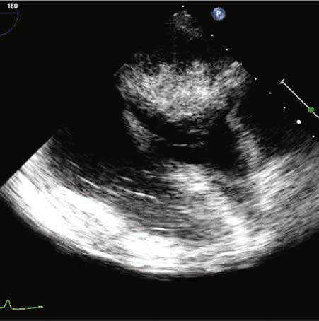

# Chapter 490: Tumors of the Heart — Active-Recall Flashcards
**Part XVIII: The Cardiovascular System** | [📖 Read Wiki Chapter](../chapters/490.md) | [📝 Chapter MCQs](../mcqs/490_mcqs.md) | [🏠 Course Master Index](../../index.md)

Total cards: **8** *(Click any card below to reveal the answer)*

### Card 1 (Syndrome & Clinical Profile)

<b>Q:</b> What are the hallmark clinical features and diagnostic profile of **Tumors of the Heart**?

**Answer:**
**Associated Gene(s):** `PRKAR1A, PTCH1` · **Category / Inheritance:** The Cardiovascular System **Clinical Synthesis:** Rhabdomyomas are the most common pediatric cardiac tumors and are associated with tuberous sclerosis in 70–95% of cases.

### Card 2 (Pediatric Genetics & Pathogenesis)

<b>Q:</b> In **Tumors of the Heart**, what clinical phenotype or molecular mechanism is associated with **`PRKAR1A`**?

**Answer:**
Pathogenic vari ants in the PRKAR1A gene are causative in some families.

### Card 3 (Pediatric Therapeutics & Management)

<b>Q:</b> What is the clinical management or therapeutic approach for **Tumors of the Heart**?

**Answer:**
**Therapy / Protocol:** Pediatric Clinical Management **Clinical Application:** The vast majority of tumors originating from the heart are benign.

### Card 4 (Core Pediatric Concept)

<b>Q:</b> In the pediatric evaluation of **Tumors of the Heart** (*Tumors of the Heart*), how is **Fibromas** characterized?

**Answer:**
Fibromas are the second most common pediatric cardiac tumor and, in contrast to rhabdomyomas, are usually solitary and intramyocardial.

### Card 5 (Core Pediatric Concept)

<b>Q:</b> In the pediatric evaluation of **Tumors of the Heart** (*Tumors of the Heart*), how is **Carney complex** characterized?

**Answer:**
Carney complex is a familial autosomal dominant multiple neoplasia (often endocrine: pituitary adenoma, thy roid, testis, ovarian) and lentiginosis syndrome in which cardiac myxomas can occur at a young age in any or all cardiac chambers.

### Card 6 (Visual Diagnosis & Clinical Spotter)

<b>Q:</b> Identify the pediatric clinical finding, imaging sign, or mechanism illustrated in **Fig. 490.1** (*Tumors of the Heart*):

**Answer:**
Echocardiograms demonstrating rhabdomyomas. A, Api cal four-chamber view showing multiple rhabdomyomas (arrows) within the septum and left ventricular myocardium. B, Short-axis view show ing a large rhabdomyoma (arrow) extending into the right ventricular outflow tract. Ao, Ascending aorta; LA, left atrium; LV, left ventricle; PA, pulmonary artery; RA, right atrium; RV, right ventricle.

### Card 7 (High-Yield Board Pearl)

<b>Q:</b> What is a high-yield clinical or diagnostic principle regarding **Tumors of the Heart** (*Tumors of the Heart*)?

**Answer:**
Rhabdomyomas are the most common pediatric cardiac tumors and are associated with tuberous sclerosis in 70–95% of cases.

### Card 8 (Pathophysiology & Diagnosis)

<b>Q:</b> What core clinical principle governs **Tumors of the Heart** in **Tumors of the Heart**?

**Answer:**
The vast majority of tumors originating from the heart are benign.

