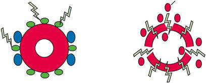

# Chapter 510: Paroxysmal Nocturnal Hemoglobinuria and Acanthocytosis — Active-Recall Flashcards
**Part XIX: Diseases of the Blood** | [📖 Read Wiki Chapter](../chapters/510.md) | [📝 Chapter MCQs](../mcqs/510_mcqs.md) | [🏠 Course Master Index](../../index.md)

Total cards: **8** *(Click any card below to reveal the answer)*

### Card 1 (Syndrome & Clinical Profile)

<b>Q:</b> What are the hallmark clinical features and diagnostic profile of **SUPPORTING INFORMATION**?

**Answer:**
**Category / Inheritance:** Diseases of the Blood **Clinical Synthesis:** Cytopenias; Patients for whom a bone marrow examination is; considered for otherwise unexplained cytopenia(s); Additional features such as elevated LDH, DAT-; negative hemolysis, history of unexplained TE,; and hemoglobinuria

### Card 2 (Syndrome & Clinical Profile)

<b>Q:</b> What are the hallmark clinical features and diagnostic profile of **AA/MDS (Paroxysmal Nocturnal Hemoglobinuria and Acanthocytosis)**?

**Answer:**
**Category / Inheritance:** Diseases of the Blood **Clinical Synthesis:** All patients with a diagnosis or suspicion of AA; Testing should be done at diagnosis and monitored at; least q6 months; Low or intermediate-1 risk MDS, and especially if; hypoplastic; Additional features such as elevated LDH, DAT-; negative hemolysis, history of unexplained TE,; and hemoglobinuria; Thrombosis; Unprovo

### Card 3 (Syndrome & Clinical Profile)

<b>Q:</b> What are the hallmark clinical features and diagnostic profile of **ECULIZUMAB (Paroxysmal Nocturnal Hemoglobinuria and Acanthocytosis)**?

**Answer:**
**Category / Inheritance:** Diseases of the Blood **Clinical Synthesis:** Classic clinical PNH; Florid (markedly abnormal; LDH, often with episodic; macroscopic; hemoglobinuria); Cellular marrow caused by; erythroid hyperplasia and; normal or near-normal; morphology†; Large population (>50%); of GPI-AP– PMNs§; Yes; Clinical PNH in the; setting of another; bone marrow failure; syndrome‡; Mild

### Card 4 (Pediatric Therapeutics & Management)

<b>Q:</b> What is the clinical management or therapeutic approach for **Paroxysmal Nocturnal Hemoglobinuria and Acanthocytosis**?

**Answer:**
**Therapy / Protocol:** Eculizumab **Clinical Application:** The predicted survival rate for children before the development of eculizumab was 80% at 5 years, 60% at 10 years, and 28% at 20 years.

### Card 5 (Core Pediatric Concept)

<b>Q:</b> In the pediatric evaluation of **Paroxysmal Nocturnal Hemoglobinuria and Acanthocytosis** (*Paroxysmal Nocturnal Hemoglobinuria and Acanthocytosis*), how is **Laboratory Findings** characterized?

**Answer:**
Laboratory Findings Hemoglobin levels can range from normal to markedly decreased.

### Card 6 (Core Pediatric Concept)

<b>Q:</b> In the pediatric evaluation of **Paroxysmal Nocturnal Hemoglobinuria and Acanthocytosis** (*Paroxysmal Nocturnal Hemoglobinuria and Acanthocytosis*), how is **Treatment** characterized?

**Answer:**
Treatment Eculizumab therapy has resulted in sustained survival in the major ity of patients.

### Card 7 (Visual Diagnosis & Clinical Spotter)

<b>Q:</b> Identify the pediatric clinical finding, imaging sign, or mechanism illustrated in **Fig. 510.1** (*Paroxysmal Nocturnal Hemoglobinuria and Acanthocytosis*):

**Answer:**
Complement-mediated lysis in paroxysmal nocturnal hemoglobinuria (PNH). Red circles are hemoglobin. Blue circles are decay accelerating factor (CD55). Green circles are membrane in hibitor of reactive lysis (CD59). Bb, activated factor B; C3b, activated C3; C5b, activated C5; MAC, membrane attack complex (consisting of C5b, C6, C7, C8, and several molecules of C9 [9n]). (From Park er C. Eculizumab for paroxysmal nocturnal haemoglobinuria. Lancet 2009;373:759–767.)

### Card 8 (High-Yield Board Pearl)

<b>Q:</b> What is a high-yield clinical or diagnostic principle regarding **Paroxysmal Nocturnal Hemoglobinuria and Acanthocytosis** (*Paroxysmal Nocturnal Hemoglobinuria and Acanthocytosis*)?

**Answer:**
Hypoplastic or aplastic pancy topenia can precede or follow the diagnosis of PNH; rarely, PNH may progress to acute myelogenous leukemia.

