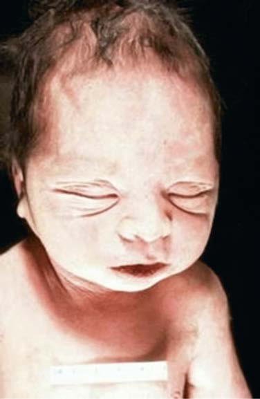

# Chapter 574: Congenital Anomalies and Dysgenesis of the Kidneys — Active-Recall Flashcards
**Part XXII: Urologic Disorders in Infants and Children** | [📖 Read Wiki Chapter](../chapters/574.md) | [📝 Chapter MCQs](../mcqs/574_mcqs.md) | [🏠 Course Master Index](../../index.md)

Total cards: **8** *(Click any card below to reveal the answer)*

### Card 1 (Syndrome & Clinical Profile)

<b>Q:</b> What are the hallmark clinical features and diagnostic profile of **INHERITABLE (Congenital Anomalies and Dysgenesis of the Kidneys)**?

**Answer:**
**Category / Inheritance:** AR **Clinical Synthesis:** Autosomal recessive (infantile) polycystic kidney disease (ARPKD); Autosomal dominant (adult) polycystic kidney disease (ADPKD); Juvenile nephronophthisis and medullary cystic disease complex; Juvenile nephronophthisis (autosomal recessive); Medullary cystic disease (autosomal dominant); Congenital nephrosis (familial

### Card 2 (Syndrome & Clinical Profile)

<b>Q:</b> What are the hallmark clinical features and diagnostic profile of **NONHERITABLE (Congenital Anomalies and Dysgenesis of the Kidneys)**?

**Answer:**
**Category / Inheritance:** Urologic Disorders in Infant **Clinical Synthesis:** Multicystic kidney (multicystic dysplastic kidney); Benign multilocular cyst (cystic nephroma); Simple cysts; Medullary sponge kidney; Sporadic glomerulocystic kidney disease; Acquired renal cystic disease; Calyceal diverticulum (pyelogenic cyst); Modified from Glassberg KI, Stephens FD, Lebowitz RL, et al. Renal dysge

### Card 3 (Pediatric Therapeutics & Management)

<b>Q:</b> What is the clinical management or therapeutic approach for **Congenital Anomalies and Dysgenesis of the Kidneys**?

**Answer:**
**Therapy / Protocol:** Pediatric Clinical Management **Clinical Application:** By the 20th week of gestation, when the collecting system is devel oped, approximately 30% of the nephrons are present.

### Card 4 (Core Pediatric Concept)

<b>Q:</b> In the pediatric evaluation of **Congenital Anomalies and Dysgenesis of the Kidneys** (*Congenital Anomalies and Dysgenesis of the Kidneys*), how is **RENAL AGENESIS** characterized?

**Answer:**
RENAL AGENESIS Renal agenesis, or absent kidney development, can occur secondary to a defect of the Wolffian duct, ureteric bud, or metanephric blastema.

### Card 5 (Core Pediatric Concept)

<b>Q:</b> In the pediatric evaluation of **Congenital Anomalies and Dysgenesis of the Kidneys** (*Congenital Anomalies and Dysgenesis of the Kidneys*), how is **ster-Hauser (MRKH) syndrome** characterized?

**Answer:**
ster-Hauser (MRKH) syndrome (1 in 4,000 to 1 in 5,000 female births) is a group of associated findings that may include vaginal aplasia, uterine maldevelopment, and normal ova ries.

### Card 6 (Core Pediatric Concept)

<b>Q:</b> In the pediatric evaluation of **Congenital Anomalies and Dysgenesis of the Kidneys** (*Congenital Anomalies and Dysgenesis of the Kidneys*), how is **Zinner syndrome** characterized?

**Answer:**
Zinner syndrome is considered the male counterpart of MRKH syndrome (Fig.

### Card 7 (Visual Diagnosis & Clinical Spotter)

<b>Q:</b> Identify the pediatric clinical finding, imaging sign, or mechanism illustrated in **Fig. 574.2** (*Congenital Anomalies and Dysgenesis of the Kidneys*):

**Answer:**
Stillborn infant with renal agenesis exhibiting characteristic Potter facies.

### Card 8 (High-Yield Board Pearl)

<b>Q:</b> What is a high-yield clinical or diagnostic principle regarding **Congenital Anomalies and Dysgenesis of the Kidneys** (*Congenital Anomalies and Dysgenesis of the Kidneys*)?

**Answer:**
The increase in the glomerular filtration rate is caused by a reduction in intrarenal vascular resistance and redistribution of intrarenal blood flow to the cortex, where more nephrons are located.

