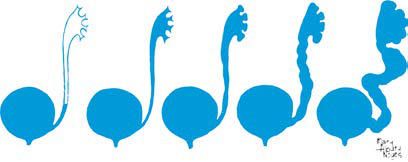

# Chapter 576: Vesicoureteral Reflux — Active-Recall Flashcards
**Part XXII: Urologic Disorders in Infants and Children** | [📖 Read Wiki Chapter](../chapters/576.md) | [📝 Chapter MCQs](../mcqs/576_mcqs.md) | [🏠 Course Master Index](../../index.md)

Total cards: **8** *(Click any card below to reveal the answer)*

### Card 1 (Syndrome & Clinical Profile)

<b>Q:</b> What are the hallmark clinical features and diagnostic profile of **CAUSE (Vesicoureteral Reflux)**?

**Answer:**
**Category / Inheritance:** Urologic Disorders in Infant **Clinical Synthesis:** Primary; Congenital incompetence of; the valvular mechanism of the; vesicoureteral junction; Primary associated with other; malformations of the; ureterovesical junction; Ureteral duplication; Ureterocele with duplication; Ureteral ectopia; Paraureteral diverticula; Secondary to increased; intravesical pressure; Neurop

### Card 2 (Syndrome & Clinical Profile)

<b>Q:</b> What are the hallmark clinical features and diagnostic profile of **Vesicoureteral Reflux**?

**Answer:**
**Category / Inheritance:** Urologic Disorders in Infant **Clinical Synthesis:** With greater attention to the management of UTIs and a better understanding of VUR, end-stage renal disease secondary to reflux nephropathy is uncommon.

### Card 3 (Pediatric Therapeutics & Management)

<b>Q:</b> What is the clinical management or therapeutic approach for **Vesicoureteral Reflux**?

**Answer:**
**Therapy / Protocol:** Management **Clinical Application:** With greater attention to the management of UTIs and a better understanding of VUR, end-stage renal disease secondary to reflux nephropathy is uncommon.

### Card 4 (Core Pediatric Concept)

<b>Q:</b> In the pediatric evaluation of **Vesicoureteral Reflux** (*Vesicoureteral Reflux*), how is **CLASSIFICATION** characterized?

**Answer:**
CLASSIFICATION VUR severity is graded using the International Reflux Study (IRS) clas sification of I-V and is based on the appearance of the urinary tract on a contrast voiding cystourethrogram (VCUG) (Figs.

### Card 5 (Core Pediatric Concept)

<b>Q:</b> In the pediatric evaluation of **Vesicoureteral Reflux** (*Vesicoureteral Reflux*), how is **Bladder-bowel dysfunction (BBD)** characterized?

**Answer:**
Bladder-bowel dysfunction (BBD) can worsen preexisting VUR if there is a margin ally competent ureterovesical junction.

### Card 6 (Core Pediatric Concept)

<b>Q:</b> In the pediatric evaluation of **Vesicoureteral Reflux** (*Vesicoureteral Reflux*), how is **duplication** characterized?

**Answer:**
duplication of the upper urinary tract, in which two ureters rather than one drain the kidney.

### Card 7 (Visual Diagnosis & Clinical Spotter)

<b>Q:</b> Identify the pediatric clinical finding, imaging sign, or mechanism illustrated in **Fig. 576.1** (*Vesicoureteral Reflux*):

**Answer:**
Normal and abnormal configuration of the ureteral ori fices. Shown from left to right, progressive lateral displacement of the ureteral orifices and shortening of the intramural tunnels. Top, Endo scopic appearance. Bottom, Sagittal view through the intramural ureter.

### Card 8 (High-Yield Board Pearl)

<b>Q:</b> What is a high-yield clinical or diagnostic principle regarding **Vesicoureteral Reflux** (*Vesicoureteral Reflux*)?

**Answer:**
With greater attention to the management of UTIs and a better understanding of VUR, end-stage renal disease secondary to reflux nephropathy is uncommon.

