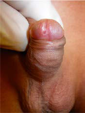
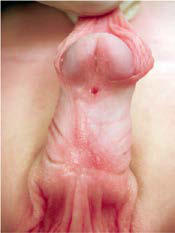

# Chapter 581: Anomalies of the Penis and Urethra — Active-Recall Flashcards
**Part XXII: Urologic Disorders in Infants and Children** | [📖 Read Wiki Chapter](../chapters/581.md) | [📝 Chapter MCQs](../mcqs/581_mcqs.md) | [🏠 Course Master Index](../../index.md)

Total cards: **8** *(Click any card below to reveal the answer)*

### Card 1 (Syndrome & Clinical Profile)

<b>Q:</b> What are the hallmark clinical features and diagnostic profile of **Anomalies of the Penis and Urethra**?

**Answer:**
**Category / Inheritance:** Urologic Disorders in Infant **Clinical Synthesis:** The drug is one of the most common causes of poisoning by prescription medication, so it is also important to emphasize safe storage.

### Card 2 (Pediatric Therapeutics & Management)

<b>Q:</b> What is the clinical management or therapeutic approach for **Anomalies of the Penis and Urethra**?

**Answer:**
**Therapy / Protocol:** Caffeine **Clinical Application:** Avoiding extraneous sugar and caffeine after 5 pm is also beneficial.

### Card 3 (Core Pediatric Concept)

<b>Q:</b> In the pediatric evaluation of **Anomalies of the Penis and Urethra** (*Anomalies of the Penis and Urethra*), how is **Treatment** characterized?

**Answer:**
Treatment The best approach to treatment is to reassure the child and parents that the condition is self-limited and to avoid punitive measures that can affect the child’s psychologic development adversely.

### Card 4 (Core Pediatric Concept)

<b>Q:</b> In the pediatric evaluation of **Anomalies of the Penis and Urethra** (*Anomalies of the Penis and Urethra*), how is **motivational therapy** characterized?

**Answer:**
motivational therapy and includes a star chart for dry nights.

### Card 5 (Core Pediatric Concept)

<b>Q:</b> In the pediatric evaluation of **Anomalies of the Penis and Urethra** (*Anomalies of the Penis and Urethra*), how is **Conditioning therapy** characterized?

**Answer:**
Conditioning therapy involves use of a loud auditory or vibratory alarm attached to a mois ture sensor in the underwear.

### Card 6 (Visual Diagnosis & Clinical Spotter)

<b>Q:</b> Identify the pediatric clinical finding, imaging sign, or mechanism illustrated in **Fig. 581.1** (*Anomalies of the Penis and Urethra*):

**Answer:**
Varying forms of hypospadias. A, Glanular hypospadias. B, Subcoronal hypospadias. Note the dorsal hood of foreskin. C, Penoscrotal hypospadias with chordee. D, Perineal hypospadias with chordee and partial penoscrotal transposition. E, Megameatal variant of hypospadias diag nosed following circumcision; note absence of hooded foreskin. F, Complete penoscrotal transposition with scrotal hypospadias.

### Card 7 (Visual Diagnosis & Clinical Spotter)

<b>Q:</b> Identify the pediatric clinical finding, imaging sign, or mechanism illustrated in **Fig. 581.2** (*Anomalies of the Penis and Urethra*):

**Answer:**
A and B, Two examples of chordee without hypospadias. Note hooded foreskin and normal location of urethral meatus.

### Card 8 (High-Yield Board Pearl)

<b>Q:</b> What is a high-yield clinical or diagnostic principle regarding **Anomalies of the Penis and Urethra** (*Anomalies of the Penis and Urethra*)?

**Answer:**
The drug is one of the most common causes of poisoning by prescription medication, so it is also important to emphasize safe storage.

