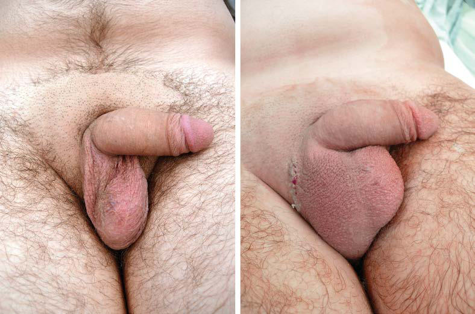

# Chapter 582: Disorders and Anomalies of the Scrotal Contents — Active-Recall Flashcards
**Part XXII: Urologic Disorders in Infants and Children** | [📖 Read Wiki Chapter](../chapters/582.md) | [📝 Chapter MCQs](../mcqs/582_mcqs.md) | [🏠 Course Master Index](../../index.md)

Total cards: **8** *(Click any card below to reveal the answer)*

### Card 1 (Syndrome & Clinical Profile)

<b>Q:</b> What are the hallmark clinical features and diagnostic profile of **Disorders of Sex Development (DSD)**?

**Answer:**
**Category / Inheritance:** Urologic Disorders in Infant **Clinical Synthesis:** Sex chromosome DSD; 47,XXY (Klinefelter syndrome and variants); 45,X/46,XY (mixed gonadal dysgenesis); 46,XX/46,XY (chimerism)

### Card 2 (Syndrome & Clinical Profile)

<b>Q:</b> What are the hallmark clinical features and diagnostic profile of **46,XY DSD (Disorders and Anomalies of the Scrotal Contents)**?

**Answer:**
**Associated Gene(s):** `AR, NR5A1, HSD3B2, HSD17B3, SOX9` · **Category / Inheritance:** X-Linked **Clinical Synthesis:** Disorders of testicular development; Complete or partial gonadal dysgenesis; Variations in ARX, ATRX, CBX2, DAX1 (NROB1), DHH, DHX37, DMRT1, EMX2, ESR2, FGFR2, GATA4, HHAT, MAP3K1, NR5A1, SF1, SOX9, SRY,; TSPYL1, WNT4, WT1(WAGR syndrome, Denys-Drash syndrome, Frasier syndrome), ZFPM2, and ZNRF3 genes; Disorders in andr

### Card 3 (Syndrome & Clinical Profile)

<b>Q:</b> What are the hallmark clinical features and diagnostic profile of **46,XX DSD (Disorders and Anomalies of the Scrotal Contents)**?

**Answer:**
**Associated Gene(s):** `SOX9, SRY` · **Category / Inheritance:** Urologic Disorders in Infant **Clinical Synthesis:** Ovotesticular DSD; Testicular DSD (e.g. SRY+, dup SOX9, RSP01); 46,XX male

### Card 4 (Pediatric Therapeutics & Management)

<b>Q:</b> What is the clinical management or therapeutic approach for **Disorders and Anomalies of the Scrotal Contents**?

**Answer:**
**Therapy / Protocol:** Insulin **Clinical Application:** Insulin-like factor 3 controls the transabdominal phase.

### Card 5 (Core Pediatric Concept)

<b>Q:</b> In the pediatric evaluation of **Disorders and Anomalies of the Scrotal Contents** (*Disorders and Anomalies of the Scrotal Contents*), how is **Epidemiology** characterized?

**Answer:**
Epidemiology An undescended (cryptorchid) testis is the most common congenital genitourinary tract disorder in males.

### Card 6 (Core Pediatric Concept)

<b>Q:</b> In the pediatric evaluation of **Disorders and Anomalies of the Scrotal Contents** (*Disorders and Anomalies of the Scrotal Contents*), how is **Pathogenesis** characterized?

**Answer:**
Pathogenesis The process of testicular descent is regulated by an interaction among genetic, hormonal, and mechanical factors, including testosterone, dihy drotestosterone, müllerian-inhibiting factor, the gubernaculum, intraab dominal pressure, and the genitofemoral nerve (Table 582.

### Card 7 (Core Pediatric Concept)

<b>Q:</b> In the pediatric evaluation of **Disorders and Anomalies of the Scrotal Contents** (*Disorders and Anomalies of the Scrotal Contents*), how is **abdominal** characterized?

**Answer:**
abdominal (which are nonpal pable), peeping (abdominal but can be pushed into the upper part of the inguinal canal), inguinal, gliding (can be pushed into the scrotum but retracts immediately to the pubic tubercle), and ectopic (superficial inguinal pouch or, rarely, perineal).

### Card 8 (Visual Diagnosis & Clinical Spotter)

<b>Q:</b> Identify the pediatric clinical finding, imaging sign, or mechanism illustrated in **Fig. 582.1** (*Disorders and Anomalies of the Scrotal Contents*):

**Answer:**
Management algorithm for undescended testis. aIf blind-ending vas deferens vessels are unequivocally iden tified, then there is no need for further exploration. bBaseline FSH and LH levels are elevated if values are 3 SD above the mean. c, Increased suspicion of anorchia with elevated baseline FSH and LH levels; however, exploration is still warranted. d, Testicular remnant tissue may be pre sent despite a negative hCG stimulation test; therefore exploration for testicular remnant tissue should still be performed. (From Bowlin PR, Lorenzo AJ. Undescend ed testes and testicular tumors. In: Hol comb III GW, Murphy JP, St. Peter SD, eds. Holcomb and Ashcraft’s Pediatric Surgery, 7th ed. Philadelphia: Elsevier; 2020: Fig. 51-2, p. 808.)

