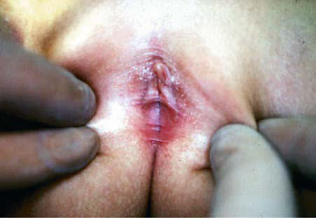
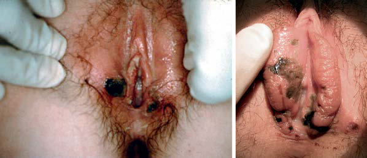

# Chapter 586: Vulvovaginitis — Active-Recall Flashcards
**Part XXIII: Gynecologic Problems of Childhood** | [📖 Read Wiki Chapter](../chapters/586.md) | [📝 Chapter MCQs](../mcqs/586_mcqs.md) | [🏠 Course Master Index](../../index.md)

Total cards: **8** *(Click any card below to reveal the answer)*

### Card 1 (Syndrome & Clinical Profile)

<b>Q:</b> What are the hallmark clinical features and diagnostic profile of **Vulvovaginitis**?

**Answer:**
**Category / Inheritance:** Gynecologic Problems of Chil **Clinical Synthesis:** After the examination, it is appropriate to review the exam find ings with the teen (and parents or caregivers as appropriate) and initiate a collaborative discussion of the management plan.

### Card 2 (Pediatric Therapeutics & Management)

<b>Q:</b> What is the clinical management or therapeutic approach for **Vulvovaginitis**?

**Answer:**
**Therapy / Protocol:** Management **Clinical Application:** After the examination, it is appropriate to review the exam find ings with the teen (and parents or caregivers as appropriate) and initiate a collaborative discussion of the management plan.

### Card 3 (Core Pediatric Concept)

<b>Q:</b> In the pediatric evaluation of **Vulvovaginitis** (*Vulvovaginitis*), how is **ETIOLOGY Vulvitis** characterized?

**Answer:**
ETIOLOGY Vulvitis refers to external genital pruritus, burning, redness, or rash.

### Card 4 (Core Pediatric Concept)

<b>Q:</b> In the pediatric evaluation of **Vulvovaginitis** (*Vulvovaginitis*), how is **Vaginitis** characterized?

**Answer:**
Vaginitis denotes inflammation of the vagina, which can manifest as a discharge with or without an odor or bleeding.

### Card 5 (Core Pediatric Concept)

<b>Q:</b> In the pediatric evaluation of **Vulvovaginitis** (*Vulvovaginitis*), how is **sexually transmitted infections** characterized?

**Answer:**
sexually transmitted infections requires close cooperation between clinicians and child-protection authorities.

### Card 6 (Visual Diagnosis & Clinical Spotter)

<b>Q:</b> Identify the pediatric clinical finding, imaging sign, or mechanism illustrated in **Fig. 586.1** (*Vulvovaginitis*):

**Answer:**
Labial adhesions. (Photo courtesy Diane F. Merritt, MD.)

### Card 7 (Visual Diagnosis & Clinical Spotter)

<b>Q:</b> Identify the pediatric clinical finding, imaging sign, or mechanism illustrated in **Fig. 586.2** (*Vulvovaginitis*):

**Answer:**
Aphthous ulcers. (Photo courtesy Diane F. Merritt, MD.)

### Card 8 (High-Yield Board Pearl)

<b>Q:</b> What is a high-yield clinical or diagnostic principle regarding **Vulvovaginitis** (*Vulvovaginitis*)?

**Answer:**
After the examination, it is appropriate to review the exam find ings with the teen (and parents or caregivers as appropriate) and initiate a collaborative discussion of the management plan.

