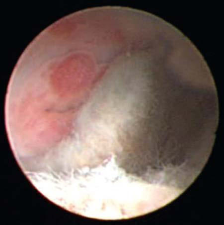
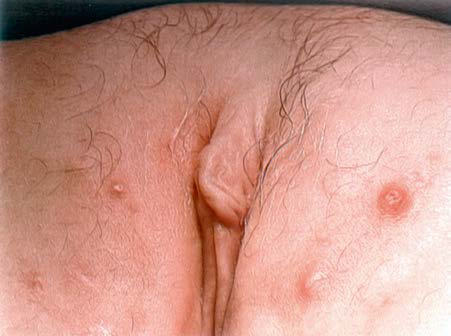

# Chapter 587: Vaginal Bleeding in the Prepubertal Child — Active-Recall Flashcards
**Part XXIII: Gynecologic Problems of Childhood** | [📖 Read Wiki Chapter](../chapters/587.md) | [📝 Chapter MCQs](../mcqs/587_mcqs.md) | [🏠 Course Master Index](../../index.md)

Total cards: **8** *(Click any card below to reveal the answer)*

### Card 1 (Syndrome & Clinical Profile)

<b>Q:</b> What are the hallmark clinical features and diagnostic profile of **Vaginal Bleeding in the Prepubertal Child**?

**Answer:**
**Category / Inheritance:** Gynecologic Problems of Chil **Clinical Synthesis:** Lichen sclerosus is characterized by chronic inflammation, intense pruritus, loss of normal architecture, and thin ning and whitening of vulvar and perianal skin, often in a butterfly or keyhole distribution.

### Card 2 (Pediatric Therapeutics & Management)

<b>Q:</b> What is the clinical management or therapeutic approach for **Vaginal Bleeding in the Prepubertal Child**?

**Answer:**
**Therapy / Protocol:** First-line **Clinical Application:** The first-line treatment is ultrapotent topical steroids (e.g., clobetasol propionate 0.05%).

### Card 3 (Core Pediatric Concept)

<b>Q:</b> In the pediatric evaluation of **Vaginal Bleeding in the Prepubertal Child** (*Vaginal Bleeding in the Prepubertal Child*), how is **vulvovaginitis** characterized?

**Answer:**
vulvovaginitis stemming from transmission of respiratory, oral, fecal, or sexually communi cated pathogens.

### Card 4 (Core Pediatric Concept)

<b>Q:</b> In the pediatric evaluation of **Vaginal Bleeding in the Prepubertal Child** (*Vaginal Bleeding in the Prepubertal Child*), how is **Vaginal foreign bodies** characterized?

**Answer:**
Vaginal foreign bodies are a common finding in children pre senting with blood-tinged and foul-smelling discharge.

### Card 5 (Core Pediatric Concept)

<b>Q:</b> In the pediatric evaluation of **Vaginal Bleeding in the Prepubertal Child** (*Vaginal Bleeding in the Prepubertal Child*), how is **gross hematuria** characterized?

**Answer:**
gross hematuria and urethral prolapse (Fig.

### Card 6 (Visual Diagnosis & Clinical Spotter)

<b>Q:</b> Identify the pediatric clinical finding, imaging sign, or mechanism illustrated in **Fig. 586.7** (*Vaginal Bleeding in the Prepubertal Child*):

**Answer:**
Vaginal foreign body as seen through vaginoscope. (Photo courtesy Diane F. Merritt, MD.)

### Card 7 (Visual Diagnosis & Clinical Spotter)

<b>Q:</b> Identify the pediatric clinical finding, imaging sign, or mechanism illustrated in **Fig. 586.8** (*Vaginal Bleeding in the Prepubertal Child*):

**Answer:**
Molluscum contagiosum. (Photo courtesy Diane F. Merritt, MD.)

### Card 8 (High-Yield Board Pearl)

<b>Q:</b> What is a high-yield clinical or diagnostic principle regarding **Vaginal Bleeding in the Prepubertal Child** (*Vaginal Bleeding in the Prepubertal Child*)?

**Answer:**
Lichen sclerosus is characterized by chronic inflammation, intense pruritus, loss of normal architecture, and thin ning and whitening of vulvar and perianal skin, often in a butterfly or keyhole distribution.

