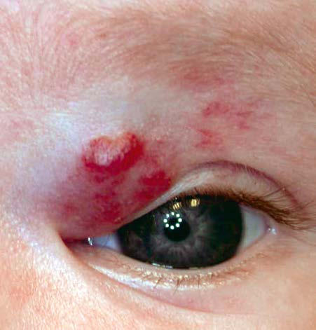
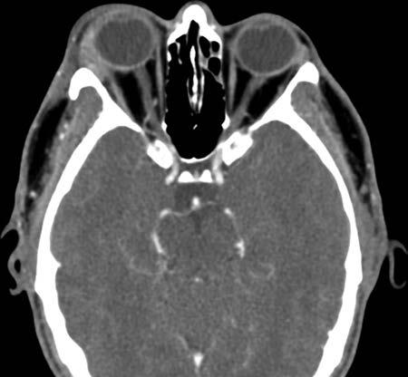

# Chapter 665: Disorders of the Lacrimal System — Active-Recall Flashcards
**Part XXVII: Disorders of the Eye** | [📖 Read Wiki Chapter](../chapters/665.md) | [📝 Chapter MCQs](../mcqs/665_mcqs.md) | [🏠 Course Master Index](../../index.md)

Total cards: **8** *(Click any card below to reveal the answer)*

### Card 1 (Syndrome & Clinical Profile)

<b>Q:</b> What are the hallmark clinical features and diagnostic profile of **Disorders of the Lacrimal System**?

**Answer:**
**Category / Inheritance:** Disorders of the Eye **Clinical Synthesis:** CHALAZION A chalazion is a granulomatous inflammation of a meibomian gland characterized by a firm, nontender nodule in the upper or lower lid.

### Card 2 (Pediatric Therapeutics & Management)

<b>Q:</b> What is the clinical management or therapeutic approach for **Disorders of the Lacrimal System**?

**Answer:**
**Therapy / Protocol:** Azithromycin **Clinical Application:** Patients who experience frequent chalazia formation, or those who have significant corneal changes secondary to the underlying blephari tis, may benefit from systemic, low-dose erythromycin or azithromycin treatment.

### Card 3 (Core Pediatric Concept)

<b>Q:</b> In the pediatric evaluation of **Disorders of the Lacrimal System** (*Disorders of the Lacrimal System*), how is **Treatment** characterized?

**Answer:**
Treatment is frequent warm compresses and, if necessary, surgical incision and drainage.

### Card 4 (Core Pediatric Concept)

<b>Q:</b> In the pediatric evaluation of **Disorders of the Lacrimal System** (*Disorders of the Lacrimal System*), how is **CHALAZION** characterized?

**Answer:**
CHALAZION A chalazion is a granulomatous inflammation of a meibomian gland characterized by a firm, nontender nodule in the upper or lower lid.

### Card 5 (Core Pediatric Concept)

<b>Q:</b> In the pediatric evaluation of **Disorders of the Lacrimal System** (*Disorders of the Lacrimal System*), how is **COLOBOMA OF THE EYELID** characterized?

**Answer:**
COLOBOMA OF THE EYELID This cleftlike deformity may vary from a small indentation or notch of the free margin of the lid to a large defect involving almost the entire lid.

### Card 6 (Visual Diagnosis & Clinical Spotter)

<b>Q:</b> Identify the pediatric clinical finding, imaging sign, or mechanism illustrated in **Fig. 664.6** (*Disorders of the Lacrimal System*):

**Answer:**
Capillary hemangioma of the eyelid. (Courtesy Amy Nop per, MD, and Brandon Newell, MD.)

### Card 7 (Visual Diagnosis & Clinical Spotter)

<b>Q:</b> Identify the pediatric clinical finding, imaging sign, or mechanism illustrated in **Fig. 665.2** (*Disorders of the Lacrimal System*):

**Answer:**
Noncontrast axial CT study exhibiting right acute dacry oadenitis with inflammation adjacent to the lateral orbital wall and lat eral rectus muscle. (From Maamari RN, Couch SM. Nonspecific orbital inflammation. Adv Ophthalmol Optom. 2018;3[1]:315-335, Fig. 3.)

### Card 8 (High-Yield Board Pearl)

<b>Q:</b> What is a high-yield clinical or diagnostic principle regarding **Disorders of the Lacrimal System** (*Disorders of the Lacrimal System*)?

**Answer:**
CHALAZION A chalazion is a granulomatous inflammation of a meibomian gland characterized by a firm, nontender nodule in the upper or lower lid.

