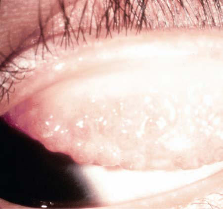

# Chapter 666: Disorders of the Conjunctiva — Active-Recall Flashcards
**Part XXVII: Disorders of the Eye** | [📖 Read Wiki Chapter](../chapters/666.md) | [📝 Chapter MCQs](../mcqs/666_mcqs.md) | [🏠 Course Master Index](../../index.md)

Total cards: **8** *(Click any card below to reveal the answer)*

### Card 1 (Syndrome & Clinical Profile)

<b>Q:</b> What are the hallmark clinical features and diagnostic profile of **Disorders of the Conjunctiva**?

**Answer:**
**Associated Gene(s):** `AR` · **Category / Inheritance:** Disorders of the Eye **Clinical Synthesis:** Ophthalmia Neonatorum This form of conjunctivitis, occurring in infants younger than 4 weeks of age, is the most common eye disease of newborns.

### Card 2 (Pediatric Therapeutics & Management)

<b>Q:</b> What is the clinical management or therapeutic approach for **Disorders of the Conjunctiva**?

**Answer:**
**Therapy / Protocol:** Ceftriaxone **Clinical Application:** Treatment Treatment of infants in whom gonococcal ophthalmia is suspected where the Gram stain shows the characteristic intracellular Gramnegative diplococci should be initiated immediately with ceftriaxone, 25-50 mg/kg/24 hr for one dose IV or IM, not to exceed 125 mg.

### Card 3 (Core Pediatric Concept)

<b>Q:</b> In the pediatric evaluation of **Disorders of the Conjunctiva** (*Disorders of the Conjunctiva*), how is **Ophthalmia Neonatorum** characterized?

**Answer:**
Ophthalmia Neonatorum This form of conjunctivitis, occurring in infants younger than 4 weeks of age, is the most common eye disease of newborns.

### Card 4 (Core Pediatric Concept)

<b>Q:</b> In the pediatric evaluation of **Disorders of the Conjunctiva** (*Disorders of the Conjunctiva*), how is **Epidemiology** characterized?

**Answer:**
Epidemiology Conjunctivitis during the neonatal period is usually acquired during vaginal delivery and reflects the sexually transmitted infections preva lent in the community.

### Card 5 (Core Pediatric Concept)

<b>Q:</b> In the pediatric evaluation of **Disorders of the Conjunctiva** (*Disorders of the Conjunctiva*), how is **Clinical Manifestations** characterized?

**Answer:**
Clinical Manifestations The clinical manifestations of the various forms of ophthalmia neona torum are not specific enough to allow an accurate diagnosis.

### Card 6 (Visual Diagnosis & Clinical Spotter)

<b>Q:</b> Identify the pediatric clinical finding, imaging sign, or mechanism illustrated in **Fig. 666.1** (*Disorders of the Conjunctiva*):

**Answer:**
Acute hemorrhagic conjunctivitis (AHC) is a highly conta gious conjunctivitis that presents with symptoms of pain, redness, and tearing. Ocular findings include extensive subconjunctival hemorrhag es, follicles, and chemosis. Causative agents include coxsackie group A24 (CA24) and enterovirus E70 (EV70). (From Krachmer JH, Palay DA. Cornea Atlas. 3rd ed. London: Elsevier, 2014: Fig 7-23))

### Card 7 (Visual Diagnosis & Clinical Spotter)

<b>Q:</b> Identify the pediatric clinical finding, imaging sign, or mechanism illustrated in **Fig. 666.2** (*Disorders of the Conjunctiva*):

**Answer:**
Vernal conjunctivitis.

### Card 8 (High-Yield Board Pearl)

<b>Q:</b> What is a high-yield clinical or diagnostic principle regarding **Disorders of the Conjunctiva** (*Disorders of the Conjunctiva*)?

**Answer:**
Ophthalmia Neonatorum This form of conjunctivitis, occurring in infants younger than 4 weeks of age, is the most common eye disease of newborns.

