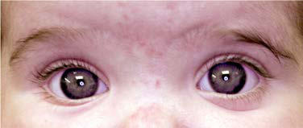

# Chapter 674: Orbital Infections — Active-Recall Flashcards
**Part XXVII: Disorders of the Eye** | [📖 Read Wiki Chapter](../chapters/674.md) | [📝 Chapter MCQs](../mcqs/674_mcqs.md) | [🏠 Course Master Index](../../index.md)

Total cards: **8** *(Click any card below to reveal the answer)*

### Card 1 (Syndrome & Clinical Profile)

<b>Q:</b> What are the hallmark clinical features and diagnostic profile of **CLINICAL AND CT IMAGING DESCRIPTION**?

**Answer:**
**Category / Inheritance:** Disorders of the Eye **Clinical Synthesis:** 1: Inflammatory; edema; Eyelid edema and erythema; eye may be; swollen shut; Fever; Painless extraocular muscle movement; full; range of motion; Visual acuity normal; Edema of orbit without abscess formation; 2: Orbital cellulitis; Inflammation of orbital contents without; discrete abscess formation; Fever, malaise; 3:

### Card 2 (Syndrome & Clinical Profile)

<b>Q:</b> What are the hallmark clinical features and diagnostic profile of **Orbital Infections**?

**Answer:**
**Associated Gene(s):** `STS` · **Category / Inheritance:** Disorders of the Eye **Clinical Synthesis:** Dacryocystitis may occur in newborns as a complication of a con genital dacryocystocele.

### Card 3 (Pediatric Genetics & Pathogenesis)

<b>Q:</b> In **Orbital Infections**, what clinical phenotype or molecular mechanism is associated with **`STS`**?

**Answer:**
Axial contrast-enhanced computed tomography (CECT) shows left preseptal periorbital soft tissue swelling (STS) and left ethmoid air cell opacifica tion.

### Card 4 (Pediatric Therapeutics & Management)

<b>Q:</b> What is the clinical management or therapeutic approach for **Orbital Infections**?

**Answer:**
**Therapy / Protocol:** Cefotaxime **Clinical Application:** Most recommend intra venous ampicillin with sulbactam or intravenous clindamycin plus cefotaxime (or ceftriaxone) for hospitalized patients.

### Card 5 (Core Pediatric Concept)

<b>Q:</b> In the pediatric evaluation of **Orbital Infections** (*Orbital Infections*), how is **DACRYOCYSTITIS** characterized?

**Answer:**
DACRYOCYSTITIS Dacryocystitis is an infection of the lacrimal sac and generally requires obstruction of the nasolacrimal system to allow its development.

### Card 6 (Core Pediatric Concept)

<b>Q:</b> In the pediatric evaluation of **Orbital Infections** (*Orbital Infections*), how is **PRESEPTAL CELLULITIS** characterized?

**Answer:**
PRESEPTAL CELLULITIS Inflammation of the lids and periorbital tissues without signs of true orbital involvement (such as proptosis or limitation of eye movement) is generally referred to as periorbital or preseptal cellulitis and is a form of facial cellulitis.

### Card 7 (Core Pediatric Concept)

<b>Q:</b> In the pediatric evaluation of **Orbital Infections** (*Orbital Infections*), how is **lack of** characterized?

**Answer:**
lack of proptosis, with normal pain less ocular movements, normal vision, and normal pupil responses.

### Card 8 (Visual Diagnosis & Clinical Spotter)

<b>Q:</b> Identify the pediatric clinical finding, imaging sign, or mechanism illustrated in **Fig. 673.5** (*Orbital Infections*):

**Answer:**
Orbital hemangioma. A, Note the proptosis. B, CT scan. (Courtesy Amy Nopper, MD, and Brandon Newell, MD.)

