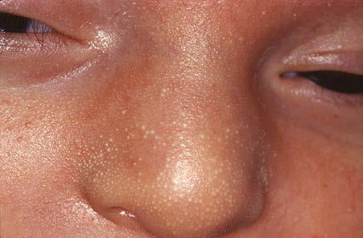
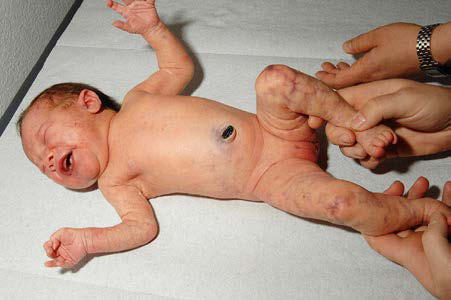

# Chapter 688: Dermatologic Diseases of the Neonate — Active-Recall Flashcards
**Part XXIX: The Skin** | [📖 Read Wiki Chapter](../chapters/688.md) | [📝 Chapter MCQs](../mcqs/688_mcqs.md) | [🏠 Course Master Index](../../index.md)

Total cards: **8** *(Click any card below to reveal the answer)*

### Card 1 (Syndrome & Clinical Profile)

<b>Q:</b> What are the hallmark clinical features and diagnostic profile of **Dermatologic Diseases of the Neonate**?

**Answer:**
**Category / Inheritance:** The Skin **Clinical Synthesis:** At times, splotchy erythema is the only manifestation.

### Card 2 (Pediatric Therapeutics & Management)

<b>Q:</b> What is the clinical management or therapeutic approach for **Dermatologic Diseases of the Neonate**?

**Answer:**
**Therapy / Protocol:** Pediatric Clinical Management **Clinical Application:** SEBACEOUS HYPERPLASIA Minute, profuse, yellow-white papules are frequently found on the forehead, nose, upper lip, and cheeks of a term infant; they represent hyperplastic sebaceous glands.

### Card 3 (Core Pediatric Concept)

<b>Q:</b> In the pediatric evaluation of **Dermatologic Diseases of the Neonate** (*Dermatologic Diseases of the Neonate*), how is **SEBACEOUS HYPERPLASIA** characterized?

**Answer:**
SEBACEOUS HYPERPLASIA Minute, profuse, yellow-white papules are frequently found on the forehead, nose, upper lip, and cheeks of a term infant; they represent hyperplastic sebaceous glands (Fig.

### Card 4 (Core Pediatric Concept)

<b>Q:</b> In the pediatric evaluation of **Dermatologic Diseases of the Neonate** (*Dermatologic Diseases of the Neonate*), how is **MILIA** characterized?

**Answer:**
MILIA Milia are superficial epidermal inclusion cysts that contain laminated keratinized material.

### Card 5 (Core Pediatric Concept)

<b>Q:</b> In the pediatric evaluation of **Dermatologic Diseases of the Neonate** (*Dermatologic Diseases of the Neonate*), how is **SUCKING BLISTERS** characterized?

**Answer:**
SUCKING BLISTERS Solitary or scattered superficial bullae present at birth on the upper limbs of infants are presumably induced by vigorous sucking on the affected part in utero.

### Card 6 (Visual Diagnosis & Clinical Spotter)

<b>Q:</b> Identify the pediatric clinical finding, imaging sign, or mechanism illustrated in **Fig. 688.1** (*Dermatologic Diseases of the Neonate*):

**Answer:**
Sebaceous hyperplasia. Minute white-yellow papules on the nose of a newborn.

### Card 7 (Visual Diagnosis & Clinical Spotter)

<b>Q:</b> Identify the pediatric clinical finding, imaging sign, or mechanism illustrated in **Fig. 688.2** (*Dermatologic Diseases of the Neonate*):

**Answer:**
Newborn girl with reticulate erythema/livedo on legs, right arm, and cheeks. (From Pleimes M, Gottler S, Weibel L. Characteristic congenital reticular erythema: cutis marmorata telangiectatica congeni tal. J Pediatr. 2013;163:604, Fig. 1.)

### Card 8 (High-Yield Board Pearl)

<b>Q:</b> What is a high-yield clinical or diagnostic principle regarding **Dermatologic Diseases of the Neonate** (*Dermatologic Diseases of the Neonate*)?

**Answer:**
At times, splotchy erythema is the only manifestation.

