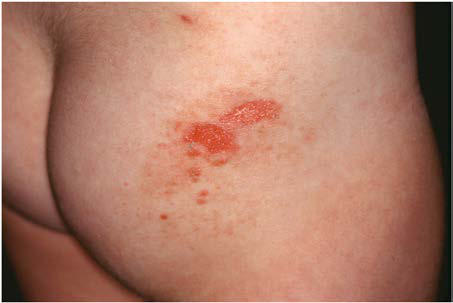

# Chapter 696: Eczematous Disorders — Active-Recall Flashcards
**Part XXIX: The Skin** | [📖 Read Wiki Chapter](../chapters/696.md) | [📝 Chapter MCQs](../mcqs/696_mcqs.md) | [🏠 Course Master Index](../../index.md)

Total cards: **8** *(Click any card below to reveal the answer)*

### Card 1 (Syndrome & Clinical Profile)

<b>Q:</b> What are the hallmark clinical features and diagnostic profile of **Eczematous Disorders**?

**Answer:**
**Category / Inheritance:** The Skin **Clinical Synthesis:** DIFFERENTIAL DIAGNOSIS The eruption can be distinguished by histopathologic and immuno fluorescence studies from PV, BP, DH, scabies, and EM.

### Card 2 (Syndrome & Clinical Profile)

<b>Q:</b> What are the hallmark clinical features and diagnostic profile of **Contact Dermatitis (Eczematous Disorders)**?

**Answer:**
**Category / Inheritance:** The Skin **Clinical Synthesis:** Gram stain and culture preclude the diagnosis of bullous impetigo.

### Card 3 (Syndrome & Clinical Profile)

<b>Q:</b> What are the hallmark clinical features and diagnostic profile of **Nummular Eczema (Eczematous Disorders)**?

**Answer:**
**Category / Inheritance:** The Skin **Clinical Synthesis:** Gram stain and culture preclude the diagnosis of bullous impetigo.

### Card 4 (Pediatric Therapeutics & Management)

<b>Q:</b> What is the clinical management or therapeutic approach for **Eczematous Disorders**?

**Answer:**
**Therapy / Protocol:** Methylprednisolone **Clinical Application:** Children who show no response to dapsone may benefit from oral therapy with methylprednisolone (1 mg/kg/day) or a combination of these drugs.

### Card 5 (Core Pediatric Concept)

<b>Q:</b> In the pediatric evaluation of **Eczematous Disorders** (*Eczematous Disorders*), how is **DIFFERENTIAL DIAGNOSIS** characterized?

**Answer:**
DIFFERENTIAL DIAGNOSIS The eruption can be distinguished by histopathologic and immuno fluorescence studies from PV, BP, DH, scabies, and EM.

### Card 6 (Core Pediatric Concept)

<b>Q:</b> In the pediatric evaluation of **Eczematous Disorders** (*Eczematous Disorders*), how is **TREATMENT** characterized?

**Answer:**
TREATMENT Many cases of linear IgA dermatosis respond favorably to oral dap sone (see treatment of DH) or sulfapyridine.

### Card 7 (Core Pediatric Concept)

<b>Q:</b> In the pediatric evaluation of **Eczematous Disorders** (*Eczematous Disorders*), how is **atopic dermatitis** characterized?

**Answer:**
atopic dermatitis, although seborrheic dermatitis, allergic and irritant contact dermatitis, nummular eczema, and acute palmoplantar eczema (dyshidrosis) are also relatively common in childhood.

### Card 8 (Visual Diagnosis & Clinical Spotter)

<b>Q:</b> Identify the pediatric clinical finding, imaging sign, or mechanism illustrated in **Fig. 695.14** (*Eczematous Disorders*):

**Answer:**
Erosion on an erythematous base after loss of blister roof in linear IgA dermatosis.

