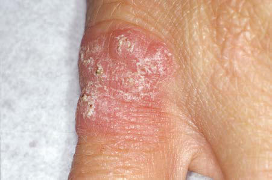

# Chapter 707: Cutaneous Fungal Infections — Active-Recall Flashcards
**Part XXIX: The Skin** | [📖 Read Wiki Chapter](../chapters/707.md) | [📝 Chapter MCQs](../mcqs/707_mcqs.md) | [🏠 Course Master Index](../../index.md)

Total cards: **8** *(Click any card below to reveal the answer)*

### Card 1 (Syndrome & Clinical Profile)

<b>Q:</b> What are the hallmark clinical features and diagnostic profile of **SCID (Cutaneous Fungal Infections)**?

**Answer:**
**Associated Gene(s):** `RAG1, JAK3, RAG2, ADA, IL2RG` · **Category / Inheritance:** X-Linked **Clinical Synthesis:** Bacteria, viruses, fungi,; mycobacteria; No T cells, with or without B and/; or NK cell lymphopenia; >30 genes:; IL2RG, X-linked; JAK3, autosomal; recessive; RAG1, autosomal; recessive; RAG2, autosomal; recessive; ARTEMIS, autosomal; recessive; ADA, autosomal; recessive; CD3, autosomal; recessive, etc.

### Card 2 (Syndrome & Clinical Profile)

<b>Q:</b> What are the hallmark clinical features and diagnostic profile of **CID (Cutaneous Fungal Infections)**?

**Answer:**
**Associated Gene(s):** `DOCK8, RAG1, NEMO` · **Category / Inheritance:** X-Linked **Clinical Synthesis:** CD25 deficiency; Viruses and bacteria; T-cell defect; IL2RA, autosomal recessive; NEMO or iκBγ deficiency; Pyogenic bacteria, mycobacteria,; viruses; NEMO or IKBG X-linked; IκBα GOF pathogenic variant; IKBA, autosomal dominant; DOCK8 deficiency; Viruses, bacteria and fungi; DOCK8, autosomal recessive; TCR-α deficiency;

### Card 3 (Syndrome & Clinical Profile)

<b>Q:</b> What are the hallmark clinical features and diagnostic profile of **SYNDROMIC CMC (Cutaneous Fungal Infections)**?

**Answer:**
**Associated Gene(s):** `STAT3` · **Category / Inheritance:** AR **Clinical Synthesis:** Interleukin-12Rβ1 and interleukin-; 12p40 deficiencies; Mycobacteria, Salmonella; Deficit of interleukin-17–; producing T cells; IL12RB1, autosomal recessive,; IL12B, autosomal recessive; STAT3 deficiency (autosomal; dominant-HIES); Staphylococcus aureus,; Aspergillus; Hyperimmunoglobulin E, deficit of; interleukin-17–

### Card 4 (Pediatric Therapeutics & Management)

<b>Q:</b> What is the clinical management or therapeutic approach for **Cutaneous Fungal Infections**?

**Answer:**
**Therapy / Protocol:** Treatment of choice **Clinical Application:** Treatment of choice is an 8-week course of rifampin and streptomycin with surgi cal debridement for larger lesions.

### Card 5 (Core Pediatric Concept)

<b>Q:</b> In the pediatric evaluation of **Cutaneous Fungal Infections** (*Cutaneous Fungal Infections*), how is **Treatment of choice** characterized?

**Answer:**
Treatment of choice is an 8-week course of rifampin and streptomycin with surgi cal debridement for larger lesions.

### Card 6 (Core Pediatric Concept)

<b>Q:</b> In the pediatric evaluation of **Cutaneous Fungal Infections** (*Cutaneous Fungal Infections*), how is **TINEA VERSICOLOR** characterized?

**Answer:**
TINEA VERSICOLOR A common, innocuous, chronic fungal infection of the stratum cor neum, tinea versicolor is most often caused by the dimorphic yeast Malassezia globosa, with Malassezia furfur and Malassezia sympodia lis as less frequent causative agents*.

### Card 7 (Core Pediatric Concept)

<b>Q:</b> In the pediatric evaluation of **Cutaneous Fungal Infections** (*Cutaneous Fungal Infections*), how is **Clinical Manifestations** characterized?

**Answer:**
Clinical Manifestations The lesions of tinea versicolor vary widely in color.

### Card 8 (Visual Diagnosis & Clinical Spotter)

<b>Q:</b> Identify the pediatric clinical finding, imaging sign, or mechanism illustrated in **Fig. 706.13** (*Cutaneous Fungal Infections*):

**Answer:**
Violaceous, warty plaque of Mycobacterium marinum infection.

