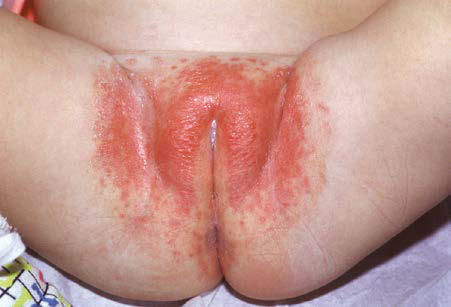
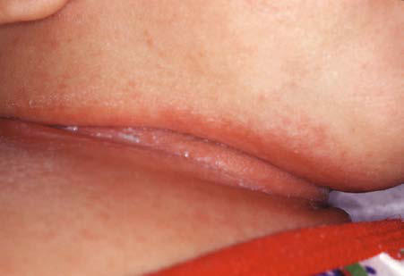

# Chapter 708: Cutaneous Viral Infections — Active-Recall Flashcards
**Part XXIX: The Skin** | [📖 Read Wiki Chapter](../chapters/708.md) | [📝 Chapter MCQs](../mcqs/708_mcqs.md) | [🏠 Course Master Index](../../index.md)

Total cards: **8** *(Click any card below to reveal the answer)*

### Card 1 (Syndrome & Clinical Profile)

<b>Q:</b> What are the hallmark clinical features and diagnostic profile of **Cutaneous Viral Infections**?

**Answer:**
**Associated Gene(s):** `ADA, ATM, DOCK8, GATA2, NEMO` · **Category / Inheritance:** The Skin **Clinical Synthesis:** Plantar warts (verruca plantaris), although similar to the common wart, are caused by HPV type 1 and are usually flush with the surface of the sole because of the constant pressure from weight bearing.

### Card 2 (Pediatric Therapeutics & Management)

<b>Q:</b> What is the clinical management or therapeutic approach for **Cutaneous Viral Infections**?

**Answer:**
**Therapy / Protocol:** Mg/kg **Clinical Application:** Cimetidine 30-40 mg/kg/day by mouth has been used in children with multiple warts unresponsive to other treatment, though its efficacy remains unclear.

### Card 3 (Core Pediatric Concept)

<b>Q:</b> In the pediatric evaluation of **Cutaneous Viral Infections** (*Cutaneous Viral Infections*), how is **Intertriginous Candidiasis** characterized?

**Answer:**
Intertriginous Candidiasis Intertriginous candidiasis occurs most often in the axillae and groin, on the neck (Fig.

### Card 4 (Core Pediatric Concept)

<b>Q:</b> In the pediatric evaluation of **Cutaneous Viral Infections** (*Cutaneous Viral Infections*), how is **Candidal Granuloma** characterized?

**Answer:**
Candidal Granuloma Candidal granuloma is a rare response to an invasive candidal infec tion of skin.

### Card 5 (Core Pediatric Concept)

<b>Q:</b> In the pediatric evaluation of **Cutaneous Viral Infections** (*Cutaneous Viral Infections*), how is **Clinical Manifestations** characterized?

**Answer:**
Clinical Manifestations Cutaneous warts develop in 5–10% of children.

### Card 6 (Visual Diagnosis & Clinical Spotter)

<b>Q:</b> Identify the pediatric clinical finding, imaging sign, or mechanism illustrated in **Fig. 707.14** (*Cutaneous Viral Infections*):

**Answer:**
Erythematous confluent plaque caused by candidal in fection.

### Card 7 (Visual Diagnosis & Clinical Spotter)

<b>Q:</b> Identify the pediatric clinical finding, imaging sign, or mechanism illustrated in **Fig. 707.15** (*Cutaneous Viral Infections*):

**Answer:**
Intertriginous candidiasis of the neck. WART (VERRUCA) Etiology Human papillomaviruses (HPVs) cause a spectrum of diseases from warts (verrucae vulgaris) to squamous cell carcinoma of the skin and mucous membranes, including the larynx. The HPVs are classified by genus, species, and type. More than 200 types are known, and the entire genomes of approximately 100 are completely sequenced. The incidence of all types of warts is highest in children and adolescents. HPV is spread by direct contact and autoinoculation; transmission within families and by fomites also occurs. The clinical manifestations of infection develop 1 month or longer after inoculation and depend on the HPV type, the size of the inoculum, the immune status of the host, and the anatomic site.

### Card 8 (High-Yield Board Pearl)

<b>Q:</b> What is a high-yield clinical or diagnostic principle regarding **Cutaneous Viral Infections** (*Cutaneous Viral Infections*)?

**Answer:**
Plantar warts (verruca plantaris), although similar to the common wart, are caused by HPV type 1 and are usually flush with the surface of the sole because of the constant pressure from weight bearing.

