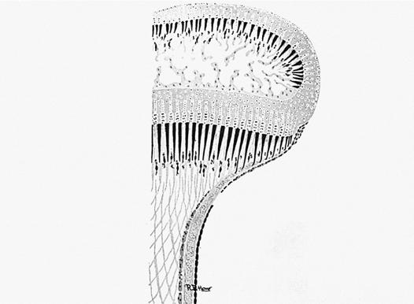
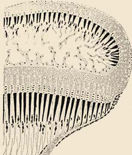

# Chapter 713: Orthopedic Growth and Development — Active-Recall Flashcards
**Part XXX: Bone and Joint Disorders** | [📖 Read Wiki Chapter](../chapters/713.md) | [📝 Chapter MCQs](../mcqs/713_mcqs.md) | [🏠 Course Master Index](../../index.md)

Total cards: **8** *(Click any card below to reveal the answer)*

### Card 1 (Syndrome & Clinical Profile)

<b>Q:</b> What are the hallmark clinical features and diagnostic profile of **DESCRIPTION (Orthopedic Growth and Development)**?

**Answer:**
**Category / Inheritance:** Bone and Joint Disorders **Clinical Synthesis:** Congenital; Anomaly that is apparent at birth; Deformation; A normally formed structure; that is pushed out of shape by; mechanical forces; Deformity; A body part altered in shape; from normal, outside the; normal range; Developmental; A deviation that occurs over; time; one that might not be; present or apparent at bi

### Card 2 (Syndrome & Clinical Profile)

<b>Q:</b> What are the hallmark clinical features and diagnostic profile of **Orthopedic Growth and Development**?

**Answer:**
**Category / Inheritance:** Bone and Joint Disorders **Clinical Synthesis:** Pro duction problems include abnormalities caused by malformation, dysplasia, or disruption that will not spontaneously resolve.

### Card 3 (Pediatric Therapeutics & Management)

<b>Q:</b> What is the clinical management or therapeutic approach for **Orthopedic Growth and Development**?

**Answer:**
**Therapy / Protocol:** Pediatric Clinical Management **Clinical Application:** There is a wide spectrum of normal orthopedic growth and devel opment in children.

### Card 4 (Core Pediatric Concept)

<b>Q:</b> In the pediatric evaluation of **Orthopedic Growth and Development** (*Orthopedic Growth and Development*), how is **IN UTERO POSITIONING** characterized?

**Answer:**
IN UTERO POSITIONING In utero positioning produces temporary joint and muscle contractures and affects the torsional alignment of the long bones, particularly those of the lower extremities.

### Card 5 (Core Pediatric Concept)

<b>Q:</b> In the pediatric evaluation of **Orthopedic Growth and Development** (*Orthopedic Growth and Development*), how is **GROWTH AND DEVELOPMENT** characterized?

**Answer:**
GROWTH AND DEVELOPMENT Consideration of growth and development helps formulate treatment strategies designed to preserve or restore normal growth potential.

### Card 6 (Core Pediatric Concept)

<b>Q:</b> In the pediatric evaluation of **Orthopedic Growth and Development** (*Orthopedic Growth and Development*), how is **CENTERS OF OSSIFICATION** characterized?

**Answer:**
CENTERS OF OSSIFICATION At the beginning of the fetal period, the chondrocytes in the mid shaft of the long bones form the primary centers of growth from which the bone eventually lengthens.

### Card 7 (Visual Diagnosis & Clinical Spotter)

<b>Q:</b> Identify the pediatric clinical finding, imaging sign, or mechanism illustrated in **Fig. 713.3** (*Orthopedic Growth and Development*):

**Answer:**
Functional components of the growing end of a tubular bone and their anatomic substrate. (From Kan JH, Strouse PJ. Embryol ogy, anatomy, and normal findings. In: Coley BD, ed. Caffey’s Pediatric Diagnostic Imaging, 13th ed. Philadelphia: Elsevier, 2019: Fig. 128.5)

### Card 8 (Visual Diagnosis & Clinical Spotter)

<b>Q:</b> Identify the pediatric clinical finding, imaging sign, or mechanism illustrated in **Fig. 713.1** (*Orthopedic Growth and Development*):

**Answer:**
Ages of onset of secondary (epiphyseal and apophyseal) ossification of the major bones of the upper (A) and lower (B) extremity. F, Female; M, male; m, month; wk, week; y, year. (From Caffey J. Pediat ric X-ray Diagnosis, 8th ed. Chicago: Year Book, 1985.)

