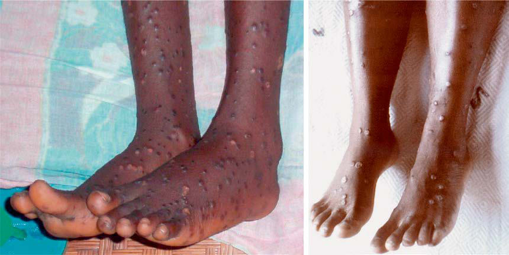

# Chapter 767: Mpox (Monkeypox) — Active-Recall Flashcards
**Part XXXII: Environmental Health** | [📖 Read Wiki Chapter](../chapters/767.md) | [📝 Chapter MCQs](../mcqs/767_mcqs.md) | [🏠 Course Master Index](../../index.md)

Total cards: **8** *(Click any card below to reveal the answer)*

### Card 1 (Syndrome & Clinical Profile)

<b>Q:</b> What are the hallmark clinical features and diagnostic profile of **CHARACTERISTICS (Mpox (Monkeypox))**?

**Answer:**
**Category / Inheritance:** Environmental Health **Clinical Synthesis:** Enanthem; Sometimes, lesions first form on; the tongue and in the mouth.; Macules; 1-2; Macular lesions appear.; Papules; 1-2; Lesions typically progress; from macular (flat) to papular; (raised).; Vesicles; 1-2; Lesions then typically become; vesicular (raised and filled with; clear fluid).; Pustules; 5-7; Lesions the

### Card 2 (Syndrome & Clinical Profile)

<b>Q:</b> What are the hallmark clinical features and diagnostic profile of **CRITERIA (Mpox (Monkeypox))**?

**Answer:**
**Category / Inheritance:** Environmental Health **Clinical Synthesis:** Suspected; New characteristic rash* OR; Meets one of the epidemiologic criteria and has high clinical suspicion† for mpox; Probable; No suspicion of other recent Orthopoxvirus exposure (e.g., vaccinia virus in ACAM2000 vaccination) AND demonstration of; the presence of; • Orthopoxvirus DNA by polymerase chain reaction

### Card 3 (Syndrome & Clinical Profile)

<b>Q:</b> What are the hallmark clinical features and diagnostic profile of **EPIDEMIOLOGIC CLASSIFICATION**?

**Answer:**
**Category / Inheritance:** Environmental Health **Clinical Synthesis:** Within 21 days of; illness onset:; Reports having contact with a person or persons with a similar appearing rash or with a person who has received a; diagnosis of confirmed or probable mpox OR; Had close or intimate in-person contact with persons in a social network experiencing mpox infections. This includes MSM; who

### Card 4 (Pediatric Therapeutics & Management)

<b>Q:</b> What is the clinical management or therapeutic approach for **Mpox (Monkeypox)**?

**Answer:**
**Therapy / Protocol:** Drug of choice **Clinical Application:** TREATMENT Penicillin is the drug of choice for both forms of rat bite fever.

### Card 5 (Core Pediatric Concept)

<b>Q:</b> In the pediatric evaluation of **Mpox (Monkeypox)** (*Mpox (Monkeypox)*), how is **CLINICAL COURSE** characterized?

**Answer:**
CLINICAL COURSE The classic clinical signs, symptoms, and course of mpox are simi lar to those of smallpox, although typically milder.

### Card 6 (Core Pediatric Concept)

<b>Q:</b> In the pediatric evaluation of **Mpox (Monkeypox)** (*Mpox (Monkeypox)*), how is **smallpox** characterized?

**Answer:**
smallpox (variola), mpox (formerly known as monkeypox) virus has, for humans, become the most important member of the genus Orthopoxvirus.

### Card 7 (Core Pediatric Concept)

<b>Q:</b> In the pediatric evaluation of **Mpox (Monkeypox)** (*Mpox (Monkeypox)*), how is **DIAGNOSIS** characterized?

**Answer:**
DIAGNOSIS Diagnosis of the streptobacillary form of rat bite fever is difficult because the disease is uncommon and can be confused with Rocky Mountain spotted fever or (less commonly) meningococcemia.

### Card 8 (Visual Diagnosis & Clinical Spotter)

<b>Q:</b> Identify the pediatric clinical finding, imaging sign, or mechanism illustrated in **Fig. 767.1** (*Mpox (Monkeypox)*):

**Answer:**
A, Legs and feet of an mpox (endemic) patient. B, Legs and feet of a smallpox patient at an analogous stage of rash (pustular). (A, Courtesy Joseph M. Harvey, MD. B, Courtesy J. Nobel, Jr., MD, Centers for Disease Control and Prevention.)

