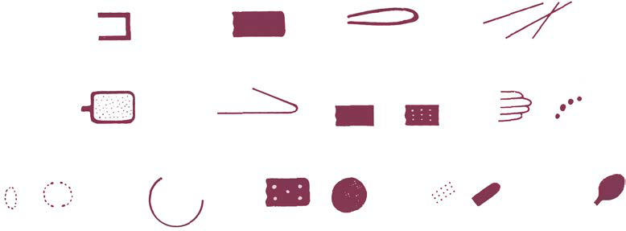

# Chapter 17: Abused and Neglected Children — Board-Style Self-Assessment MCQs
**Part I: The Field of Pediatrics** | [📖 Read Wiki Chapter](../chapters/017.md) | [🃏 Chapter Flashcards](../flashcards/017_flashcards.md) | [🏠 Course Master Index](../../index.md)

Total questions: **5** *(Click "Show Answer & Rationale" beneath each question)*

### Question 1 (Clinical Pediatrics Vignette)
A pediatric patient is evaluated for the following clinical and diagnostic profile: Grip/grab; Relatively round marks that correspond to; fingertips and/or thumb; Closed-fist punch; Series of round bruises that correspond; to the knuckles of the hand; Slap; Parallel, linear bruises (usually petechial); separated by areas of central . Which of the following conditions or syndromes is the most likely diagnosis?

- **A.** PATTERN OBSERVED (Abused and Neglected Children)
- **B.** HIGH SPECIFICITY (Abused and Neglected Children)
- **C.** CUTANEOUS LESIONS (Abused and Neglected Children)
- **D.** SKELETAL LESIONS (Abused and Neglected Children)

<b>Show Answer & Rationale</b>

**Correct Answer: A** — PATTERN OBSERVED (Abused and Neglected Children)

**Rationale:** **PATTERN OBSERVED (Abused and Neglected Children)** is characterized by: Grip/grab; Relatively round marks that correspond to; fingertips and/or thumb; Closed-fist punch; Series of round bruises that correspond; to the knuckles of the hand; Slap; Parallel, linear bruises (usually petechial); separated by areas of central sparing; Belt/electrical cord; Loop marks or parallel lines of petechi.

**Why Other Options Are Incorrect:** **HIGH SPECIFICITY (Abused and Neglected Children)** is incorrect (characterized by Classic metaphyseal lesions; Rib fractures, especially posteromedial; Scapular fractures; Spinous pr). **CUTANEOUS LESIONS (Abused and Neglected Children)** is incorrect (characterized by Accidental trauma; Congenital coagulation defects (hemophilia, von Willebrand disease); Acquired coa). **SKELETAL LESIONS (Abused and Neglected Children)** is incorrect (characterized by Osteogenesis imperfecta; Obstetric trauma; Caffey disease; Rickets (not just low 25-hydroxy-vitamin ).

### Question 2 (Clinical Pediatrics Vignette)
A pediatric patient is evaluated for the following clinical and diagnostic profile: Accidental trauma; Congenital coagulation defects (hemophilia, von Willebrand disease); Acquired coagulation defects (aplastic anemia, ITP, leukemia, vitamin; K deficiency); Ehlers-Danlos syndrome; Vitamin C deficiency; Impetigo; Vasculitis (IgA vasc. Which of the following conditions or syndromes is the most likely diagnosis?

- **A.** HIGH SPECIFICITY (Abused and Neglected Children)
- **B.** CUTANEOUS LESIONS (Abused and Neglected Children)
- **C.** HEAD TRAUMA (Abused and Neglected Children)
- **D.** PATTERN OBSERVED (Abused and Neglected Children)

<b>Show Answer & Rationale</b>

**Correct Answer: B** — CUTANEOUS LESIONS (Abused and Neglected Children)

**Rationale:** **CUTANEOUS LESIONS (Abused and Neglected Children)** is characterized by: Accidental trauma; Congenital coagulation defects (hemophilia, von Willebrand disease); Acquired coagulation defects (aplastic anemia, ITP, leukemia, vitamin; K deficiency); Ehlers-Danlos syndrome; Vitamin C deficiency; Impetigo; Vasculitis (IgA vasculitis: Henoch-Schönlein purpura); Dermal melanocytosis (Mongolian spo.

**Why Other Options Are Incorrect:** **HIGH SPECIFICITY (Abused and Neglected Children)** is incorrect (characterized by Classic metaphyseal lesions; Rib fractures, especially posteromedial; Scapular fractures; Spinous pr). **HEAD TRAUMA (Abused and Neglected Children)** is incorrect (characterized by Birth trauma; Hemophilia; Factor XIII deficiency; Vitamin K deficiency (malabsorption); Cobalamin C ). **PATTERN OBSERVED (Abused and Neglected Children)** is incorrect (characterized by Grip/grab; Relatively round marks that correspond to; fingertips and/or thumb; Closed-fist punch; Se).

### Question 3 (Visual Diagnosis & Clinical Spotter)

A pediatric patient undergoes evaluation for **Abused and Neglected Children**, yielding the clinical or diagnostic finding shown below. Which of the following best characterizes the illustrated finding?

- **A.** Neglect is by far the most common form of maltreatment referred to CPS, involving 7 per 1,000 children.
- **B.** The onus is on the clinician to carefully consider the differential diagnosis and not jump to conclusions.
- **C.** What can we do to keep them out of the hospital?” In sum, child maltreatment results from a complex interplay among risk and protective factors.
- **D.** A variety of instruments may be used to inflict injury on a child. Often the choice of an instrument is a matter of convenience. Marks tend to silhouette or outline the shape of the instrument. T

<b>Show Answer & Rationale</b>

**Correct Answer: D** — A variety of instruments may be used to inflict injury on a child. Often the choice of an instrument is a matter of convenience. Marks tend to silhouette or outline the shape of the instrument. T

**Rationale:** **Fig. 17.1**: A variety of instruments may be used to inflict injury on a child. Often the choice of an instrument is a matter of convenience. Marks tend to silhouette or outline the shape of the instrument. The possibility of in tentional trauma should prompt a high degree of suspicion when injuries to a child are geometric, paired, mir rored, of various ages or types, or on relatively protected parts of the body. Early recognition of intentional trauma is important to provide therapy and prevent escalation to more serious injury.

### Question 4 (Differential Diagnosis (Abused and Neglected Children))
During a pediatric consultation regarding **Abused and Neglected Children**, which clinical entity or concept is described by the following profile? "Abuse is defined as acts of commission, neglect as acts of omission."

- **A.** Factitious disorder imposed on another (FDIA)
- **B.** American Academy of Pediatrics Policy Statements
- **C.** DEFINITIONS
- **D.** Drugs (Disorders of the Sweat Glands)

<b>Show Answer & Rationale</b>

**Correct Answer: C** — DEFINITIONS

**Rationale:** DEFINITIONS Abuse is defined as acts of commission, neglect as acts of omission.

### Question 5 (Pediatric Board Mastery (Abused and Neglected Children))
When formulating an evidence-based diagnostic and management plan for **Abused and Neglected Children** (*Part I: The Field of Pediatrics*), which of the following pediatric clinical statements is **ACCURATE**? (Item 1)

- **A.** Inheritance is exclusively holandric (Y-linked) with 100% penetrance restricted to male neonates.
- **B.** First-line management relies on immediate high-dose aspirin therapy in febrile infants.
- **C.** The condition is an entirely benign physiologic variant that never warrants laboratory or clinical evaluation.
- **D.** Neglect is by far the most common form of maltreatment referred to CPS, involving 7 per 1,000 children.

<b>Show Answer & Rationale</b>

**Correct Answer: D** — Neglect is by far the most common form of maltreatment referred to CPS, involving 7 per 1,000 children.

**Rationale:** **Pediatric Clinical Principle (Abused and Neglected Children):** Neglect is by far the most common form of maltreatment referred to CPS, involving 7 per 1,000 children.

