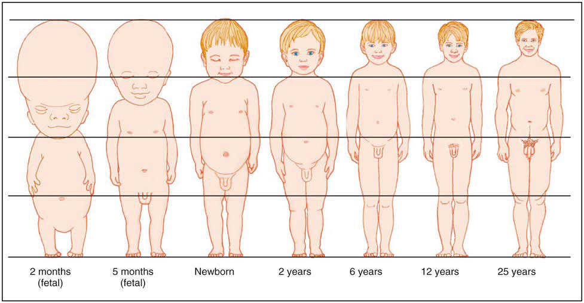

# Chapter 21: Assessment of Fetal Growth and Development — Board-Style Self-Assessment MCQs
**Part II: Growth, Development, and Behavior** | [📖 Read Wiki Chapter](../chapters/021.md) | [🃏 Chapter Flashcards](../flashcards/021_flashcards.md) | [🏠 Course Master Index](../../index.md)

Total questions: **5** *(Click "Show Answer & Rationale" beneath each question)*

### Question 1 (Clinical Pediatrics Vignette)
A pediatric patient is evaluated for the following clinical and diagnostic profile: 1; Fertilization and implantation; beginning of embryonic; period; 2; Endoderm and ectoderm appear (bilaminar embryo); 3; First missed menstrual period; mesoderm appears (trilaminar; embryo); somites begin to form; 4; Neural folds fuse; folding of em. Which of the following conditions or syndromes is the most likely diagnosis?

- **A.** school (Adolescent Physical and Social Development)
- **B.** Assessment of Fetal Growth and Development
- **C.** I. NEONATE/INFANT (Hyperparathyroidism)
- **D.** DEVELOPMENTAL EVENTS

<b>Show Answer & Rationale</b>

**Correct Answer: D** — DEVELOPMENTAL EVENTS

**Rationale:** **DEVELOPMENTAL EVENTS** is characterized by: 1; Fertilization and implantation; beginning of embryonic; period; 2; Endoderm and ectoderm appear (bilaminar embryo); 3; First missed menstrual period; mesoderm appears (trilaminar; embryo); somites begin to form; 4; Neural folds fuse; folding of embryo into human-like shape;; arm and leg buds appear; crown-rump lengt.

**Why Other Options Are Incorrect:** **school (Adolescent Physical and Social Development)** is incorrect (characterized by Positive youth; development; Peer education; Target; knowledge,; attitudes,; and risk; behaviors). **Assessment of Fetal Growth and Development** is incorrect (characterized by Prenatal exposure to opiates can result in neonatal abstinence syndrome (NAS) characterized by irrit). **I. NEONATE/INFANT (Hyperparathyroidism)** is incorrect (characterized by A. Maternal Disorders; 1. Excessive vitamin D ingestion, hypoparathyroidism,; pseudohypoparathyroidi).

### Question 2 (Clinical Pediatrics Vignette)
A pediatric patient is evaluated for the following clinical and diagnostic profile: Prenatal exposure to opiates can result in neonatal abstinence syndrome (NAS) characterized by irritability, poor feeding, tremors and temperature instability in newborn infants.. Which of the following conditions or syndromes is the most likely diagnosis?

- **A.** CLINICAL FINDINGS (Cytomegalovirus)
- **B.** Assessment of Fetal Growth and Development
- **C.** OUTCOME (Disorders of Purine and Pyrimidine Metabolism)
- **D.** VPS13A (Hemoglobinopathies)

<b>Show Answer & Rationale</b>

**Correct Answer: B** — Assessment of Fetal Growth and Development

**Rationale:** **Assessment of Fetal Growth and Development** is characterized by: Prenatal exposure to opiates can result in neonatal abstinence syndrome (NAS) characterized by irritability, poor feeding, tremors and temperature instability in newborn infants..

**Why Other Options Are Incorrect:** **CLINICAL FINDINGS (Cytomegalovirus)** is incorrect (characterized by Prematurity (2 mg/dL); 42; Petechiae; 54; Hepatosplenomegaly; 19; Purpura; 3; Microcephaly; 35). **OUTCOME (Disorders of Purine and Pyrimidine Metabolism)** is incorrect (characterized by APRT deficiency). **VPS13A (Hemoglobinopathies)** is incorrect (characterized by McLeod syndrome; X-linked recessive).

### Question 3 (Visual Diagnosis & Clinical Spotter)

A pediatric patient undergoes evaluation for **Assessment of Fetal Growth and Development**, yielding the clinical or diagnostic finding shown below. Which of the following best characterizes the illustrated finding?

- **A.** Associated risk factors including alcohol and tobacco use, and postnatal environments frequently characterized by toxic stress, may explain some of the observed negative developmental outcom
- **B.** Prenatal exposure to opiates can result in neonatal abstinence syndrome (NAS) characterized by irritability, poor feeding, tremors and temperature instability in newborn infants.
- **C.** Changes in body proportions. Approximate changes in body proportions from fetal life through adulthood. (From Leifer G. Introduction to Maternity & Pediatric Nursing. Philadelphia: WB Saunders;20
- **D.** By 6 days post conception age, as implantation begins, the embryo consists of a spherical mass of cells with a central cavity (the blastocyst).

<b>Show Answer & Rationale</b>

**Correct Answer: C** — Changes in body proportions. Approximate changes in body proportions from fetal life through adulthood. (From Leifer G. Introduction to Maternity & Pediatric Nursing. Philadelphia: WB Saunders;20

**Rationale:** **Fig. 21.1**: Changes in body proportions. Approximate changes in body proportions from fetal life through adulthood. (From Leifer G. Introduction to Maternity & Pediatric Nursing. Philadelphia: WB Saunders;2011: pp 347–385, Fig. 15-2.)

### Question 4 (Differential Diagnosis (Assessment of Fetal Growth and Development))
During a pediatric consultation regarding **Assessment of Fetal Growth and Development**, which clinical entity or concept is described by the following profile? "From the ninth week on (this pediatric condition), somatic changes consist of rapid body growth as well as differentiation of tissues, organs, and organ systems."

- **A.** THREATS TO FETAL DEVELOPMENT
- **B.** BEHAVIORAL DEVELOPMENT
- **C.** Fetal Period
- **D.** (breaths/min) (Pediatric Cardiorespiratory Emergencies and Resuscitation)

<b>Show Answer & Rationale</b>

**Correct Answer: C** — Fetal Period

**Rationale:** Fetal Period From the ninth week on (fetal period), somatic changes consist of rapid body growth as well as differentiation of tissues, organs, and organ systems.

### Question 5 (Pediatric Board Mastery (Assessment of Fetal Growth and Development))
When formulating an evidence-based diagnostic and management plan for **Assessment of Fetal Growth and Development** (*Part II: Growth, Development, and Behavior*), which of the following pediatric clinical statements is **ACCURATE**? (Item 1)

- **A.** Prenatal exposure to opiates can result in neonatal abstinence syndrome (NAS) characterized by irritability, poor feeding, tremors and temperature instability in newborn infants.
- **B.** First-line management relies on immediate high-dose aspirin therapy in febrile infants.
- **C.** Clinical manifestations are permanently restricted to late adulthood and never present during infancy, childhood, or adolescence.
- **D.** Inheritance is exclusively holandric (Y-linked) with 100% penetrance restricted to male neonates.

<b>Show Answer & Rationale</b>

**Correct Answer: A** — Prenatal exposure to opiates can result in neonatal abstinence syndrome (NAS) characterized by irritability, poor feeding, tremors and temperature instability in newborn infants.

**Rationale:** **Pediatric Clinical Principle (Assessment of Fetal Growth and Development):** Prenatal exposure to opiates can result in neonatal abstinence syndrome (NAS) characterized by irritability, poor feeding, tremors and temperature instability in newborn infants.

