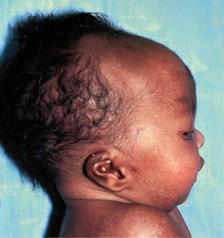

# Chapter 57: Down Syndrome and Other Abnormalities of Chromosome Number — Board-Style Self-Assessment MCQs
**Part IV: Learning and Developmental Disorders** | [📖 Read Wiki Chapter](../chapters/057.md) | [🃏 Chapter Flashcards](../flashcards/057_flashcards.md) | [🏠 Course Master Index](../../index.md)

Total questions: **5** *(Click "Show Answer & Rationale" beneath each question)*

### Question 1 (Clinical Pediatrics Vignette)
A pediatric patient is evaluated for the following clinical and diagnostic profile: Scalp defects (e.g., cutis aplasia); Microphthalmia, corneal; abnormalities; Cleft lip and palate in 60–80%; of cases; Microcephaly; Microphthalmia; Sloping forehead; Holoprosencephaly; (arrhinencephaly); Capillary hemangiomas; Deafness; Small and pr. Which of the following conditions or syndromes is the most likely diagnosis?

- **A.** HEAD AND FACE (Down Syndrome and Other Abnormalities of Chromosome Number)
- **B.** EXTREMITIES (Down Syndrome and Other Abnormalities of Chromosome Number)
- **C.** CHEST (Down Syndrome and Other Abnormalities of Chromosome Number)
- **D.** 47,XX/XY,+8 (Down Syndrome and Other Abnormalities of Chromosome Number)

<b>Show Answer & Rationale</b>

**Correct Answer: A** — HEAD AND FACE (Down Syndrome and Other Abnormalities of Chromosome Number)

**Rationale:** **HEAD AND FACE (Down Syndrome and Other Abnormalities of Chromosome Number)** is characterized by: Scalp defects (e.g., cutis aplasia); Microphthalmia, corneal; abnormalities; Cleft lip and palate in 60–80%; of cases; Microcephaly; Microphthalmia; Sloping forehead; Holoprosencephaly; (arrhinencephaly); Capillary hemangiomas; Deafness; Small and premature appearance; Tight palpebral fissures; Narrow nose and hypoplas.

**Why Other Options Are Incorrect:** **EXTREMITIES (Down Syndrome and Other Abnormalities of Chromosome Number)** is incorrect (characterized by Overlapping of fingers and toes; (clinodactyly); Polydactyly; Hypoplastic nails, hyperconvex; nails;). **CHEST (Down Syndrome and Other Abnormalities of Chromosome Number)** is incorrect (characterized by Congenital heart disease (e.g.,; VSD, PDA, ASD) in 80% of; cases; Thin posterior ribs (missing ribs)). **47,XX/XY,+8 (Down Syndrome and Other Abnormalities of Chromosome Number)** is incorrect (characterized by Growth and mental deficiency are variable.; The majority of patients are mosaics.; Deep palmar and p).

### Question 2 (Clinical Pediatrics Vignette)
A pediatric patient is evaluated for the following clinical and diagnostic profile: Congenital heart disease (e.g.,; VSD, PDA, ASD) in 80% of; cases; Thin posterior ribs (missing ribs); Congenital heart disease (e.g.. Which of the following conditions or syndromes is the most likely diagnosis?

- **A.** CHEST (Down Syndrome and Other Abnormalities of Chromosome Number)
- **B.** HEAD AND FACE (Down Syndrome and Other Abnormalities of Chromosome Number)
- **C.** 47,XX/XY,+9 (Down Syndrome and Other Abnormalities of Chromosome Number)
- **D.** 47,XX/XY,+8 (Down Syndrome and Other Abnormalities of Chromosome Number)

<b>Show Answer & Rationale</b>

**Correct Answer: A** — CHEST (Down Syndrome and Other Abnormalities of Chromosome Number)

**Rationale:** **CHEST (Down Syndrome and Other Abnormalities of Chromosome Number)** is characterized by: Congenital heart disease (e.g.,; VSD, PDA, ASD) in 80% of; cases; Thin posterior ribs (missing ribs); Congenital heart disease (e.g.,.

**Why Other Options Are Incorrect:** **HEAD AND FACE (Down Syndrome and Other Abnormalities of Chromosome Number)** is incorrect (characterized by Scalp defects (e.g., cutis aplasia); Microphthalmia, corneal; abnormalities; Cleft lip and palate in). **47,XX/XY,+9 (Down Syndrome and Other Abnormalities of Chromosome Number)** is incorrect (characterized by The majority of patients are mosaics.; Clinical features include craniofacial (high forehead, microp). **47,XX/XY,+8 (Down Syndrome and Other Abnormalities of Chromosome Number)** is incorrect (characterized by Growth and mental deficiency are variable.; The majority of patients are mosaics.; Deep palmar and p).

### Question 3 (Visual Diagnosis & Clinical Spotter)

A pediatric patient undergoes evaluation for **Down Syndrome and Other Abnormalities of Chromosome Number**, yielding the clinical or diagnostic finding shown below. Which of the following best characterizes the illustrated finding?

- **A.** Maternal nondisjunction in meiosis is the most common cause of trisomy 21.
- **B.** Thy roid testing should be done at birth as part of newborn screening.
- **C.** Several physical manifestations of trisomy 18. A, Typical profile reveals prominent occiput and low-set, posteriorly rotated malformed auricles. B, Clenched hand showing typical pattern of overla
- **D.** PRINCIPLES OF CARING FOR CHILDREN WITH COMPLEX GENETIC DISORDERS Down syndrome (trisomy 21) is the most common genetic cause of intellectual disability, with an incidence of 1 in 700 live bi

<b>Show Answer & Rationale</b>

**Correct Answer: C** — Several physical manifestations of trisomy 18. A, Typical profile reveals prominent occiput and low-set, posteriorly rotated malformed auricles. B, Clenched hand showing typical pattern of overla

**Rationale:** **Fig. 57.1**: Several physical manifestations of trisomy 18. A, Typical profile reveals prominent occiput and low-set, posteriorly rotated malformed auricles. B, Clenched hand showing typical pattern of overlapping fingers. C, Rocker-bottom feet. (Courtesy Kenneth Garver, MD, Pittsburgh, PA.)

### Question 4 (Differential Diagnosis (Down Syndrome and Other Abnormalities of Chromosome Number))
During a pediatric consultation regarding **Down Syndrome and Other Abnormalities of Chromosome Number**, which clinical entity or concept is described by the following profile? "n effort promoted by the World Health Organization (WHO) over the past 4 decades as a means of making use of existing community resources for persons with disabilities in low-income countries, with the goal of increas ing inclusion and participation within the community."

- **A.** Community-based rehabilitation (CBR)
- **B.** Neurology
- **C.** Endocrine
- **D.** Pulmonary

<b>Show Answer & Rationale</b>

**Correct Answer: A** — Community-based rehabilitation (CBR)

**Rationale:** Community-based rehabilitation (CBR) is an effort promoted by the World Health Organization (WHO) over the past 4 decades as a means of making use of existing community resources for persons with disabilities in low-income countries, with the goal of increas ing inclusion and participation within the community.

### Question 5 (Pediatric Board Mastery (Down Syndrome and Other Abnormalities of Chromosome Number))
When formulating an evidence-based diagnostic and management plan for **Down Syndrome and Other Abnormalities of Chromosome Number** (*Part IV: Learning and Developmental Disorders*), which of the following pediatric clinical statements is **ACCURATE**? (Item 1)

- **A.** Inheritance is exclusively holandric (Y-linked) with 100% penetrance restricted to male neonates.
- **B.** First-line management relies on immediate high-dose aspirin therapy in febrile infants.
- **C.** PRINCIPLES OF CARING FOR CHILDREN WITH COMPLEX GENETIC DISORDERS Down syndrome (trisomy 21) is the most common genetic cause of intellectual disability, with an incidence of 1 in 700 live births in the Uni
- **D.** Diagnostic confirmation relies solely on plain skull radiographs without biochemical, microbiologic, or clinical correlation.

<b>Show Answer & Rationale</b>

**Correct Answer: C** — PRINCIPLES OF CARING FOR CHILDREN WITH COMPLEX GENETIC DISORDERS Down syndrome (trisomy 21) is the most common genetic cause of intellectual disability, with an incidence of 1 in 700 live births in the Uni

**Rationale:** **Pediatric Clinical Principle (Down Syndrome and Other Abnormalities of Chromosome Number):** PRINCIPLES OF CARING FOR CHILDREN WITH COMPLEX GENETIC DISORDERS Down syndrome (trisomy 21) is the most common genetic cause of intellectual disability, with an incidence of 1 in 700 live births in the United States.

