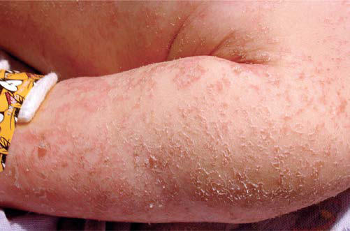

# Chapter 62: Nutrition, Food Security, and Health — Board-Style Self-Assessment MCQs
**Part V: Nutrition** | [📖 Read Wiki Chapter](../chapters/062.md) | [🃏 Chapter Flashcards](../flashcards/062_flashcards.md) | [🏠 Course Master Index](../../index.md)

Total questions: **5** *(Click "Show Answer & Rationale" beneath each question)*

### Question 1 (Clinical Pediatrics Vignette)
A pediatric patient is evaluated for the following clinical and diagnostic profile: 1. Access to an adequate and; stable food supply for all; 2. Elimination of stunting; in children <2 yr, and no; malnutrition in pregnancy and; early childhood; 3. Sustainable food systems; 4. Doubling of smallholder; productivity and income,; partic. Which of the following conditions or syndromes is the most likely diagnosis?

- **A.** HEIGHT/LENGTH-FOR-AGE
- **B.** DEATHS <5 YR (Nutrition, Food Security, and Health)
- **C.** FOR 2025 (Nutrition, Food Security, and Health)
- **D.** WEIGHT-FOR-AGE (Nutrition, Food Security, and Health)

<b>Show Answer & Rationale</b>

**Correct Answer: C** — FOR 2025 (Nutrition, Food Security, and Health)

**Rationale:** **FOR 2025 (Nutrition, Food Security, and Health)** is characterized by: 1. Access to an adequate and; stable food supply for all; 2. Elimination of stunting; in children <2 yr, and no; malnutrition in pregnancy and; early childhood; 3. Sustainable food systems; 4. Doubling of smallholder; productivity and income,; particularly for women; 5. No loss or waste of food and; responsible consump.

**Why Other Options Are Incorrect:** **HEIGHT/LENGTH-FOR-AGE** is incorrect (characterized by < −3; 5.5; 6.4; 6.3; 6.0; 3.0; −3 to < −2; 2.3; 2.2; 2.4; 2.8; 1.9; −2 to < −1; 1.5; 1.6; 1.7; 1.3; ). **DEATHS <5 YR (Nutrition, Food Security, and Health)** is incorrect (characterized by (a) Fetal growth; restriction (<1 mo); 817,000; 11.8; (b) Stunting (1-59 mo); 1,017,000; 14.7; (c) W). **WEIGHT-FOR-AGE (Nutrition, Food Security, and Health)** is incorrect (characterized by < −3; 9.4; 10.1; 11.6; 7.7; 8.3; −3 to < −2; 2.6; 3.1; 2.9; 3.1; 1.6; −2 to < −1; 1.5; 1.9; 1.7; 1.0).

### Question 2 (Clinical Pediatrics Vignette)
A pediatric patient is evaluated for the following clinical and diagnostic profile: Gomez (underweight); 90–75% of median; weight-for-age; Grade 1 (mild); 75–60%; Grade 2 (moderate); −3 SD; weight-for-height; Moderate; −3 SD; height-for-age; Moderate; < −3; Severe; WHO (wasting) (for; age-group 6-59 mo); 115-125 mm; mid-upper arm; c. Which of the following conditions or syndromes is the most likely diagnosis?

- **A.** FOR 2025 (Nutrition, Food Security, and Health)
- **B.** WEIGHT-FOR-LENGTH (Nutrition, Food Security, and Health)
- **C.** GRADING (Nutrition, Food Security, and Health)
- **D.** HEIGHT/LENGTH-FOR-AGE

<b>Show Answer & Rationale</b>

**Correct Answer: C** — GRADING (Nutrition, Food Security, and Health)

**Rationale:** **GRADING (Nutrition, Food Security, and Health)** is characterized by: Gomez (underweight); 90–75% of median; weight-for-age; Grade 1 (mild); 75–60%; Grade 2 (moderate); −3 SD; weight-for-height; Moderate; −3 SD; height-for-age; Moderate; < −3; Severe; WHO (wasting) (for; age-group 6-59 mo); 115-125 mm; mid-upper arm; circumference; Moderate; <115 mm; Severe; SD, Standard deviation; WHO, .

**Why Other Options Are Incorrect:** **FOR 2025 (Nutrition, Food Security, and Health)** is incorrect (characterized by 1. Access to an adequate and; stable food supply for all; 2. Elimination of stunting; in children <2). **WEIGHT-FOR-LENGTH (Nutrition, Food Security, and Health)** is incorrect (characterized by < −3; 11.6; 9.7; 12.3; 9.6; 11.2; −3 to < −2; 3.4; 4.7; 3.4; 2.6; 2.7; −2 to < −1; 1.6; 1.9; 1.6; 1.). **HEIGHT/LENGTH-FOR-AGE** is incorrect (characterized by < −3; 5.5; 6.4; 6.3; 6.0; 3.0; −3 to < −2; 2.3; 2.2; 2.4; 2.8; 1.9; −2 to < −1; 1.5; 1.6; 1.7; 1.3; ).

### Question 3 (Visual Diagnosis & Clinical Spotter)

A pediatric patient undergoes evaluation for **Nutrition, Food Security, and Health**, yielding the clinical or diagnostic finding shown below. Which of the following best characterizes the illustrated finding?

- **A.** Other terms are marasmus (severe wasting), kwashiorkor (characterized by edema), and marasmic-kwashiorkor (severe wast ing and edema).
- **B.** Vitamin A deficiency is caused by a low intake of retinol (in animal foods) or its carotenoid precursors, mainly beta-carotene (in orangecolored fruits and vegetables and dark-green leaves).
- **C.** Preventing LBW is essential, with emphasis on prevention of low maternal BMI and anemia, and in the longer term, prevention of low maternal stature.
- **D.** A 14-month-old girl with “flaky paint” dermatitis. (From Katz KA, Mahlberg MH, Honig PJ, et al. Rice nightmare: Kwashiorkor in 2 Philadelphia-area infants fed Rice Dream beverage. J Am Acad Derma

<b>Show Answer & Rationale</b>

**Correct Answer: D** — A 14-month-old girl with “flaky paint” dermatitis. (From Katz KA, Mahlberg MH, Honig PJ, et al. Rice nightmare: Kwashiorkor in 2 Philadelphia-area infants fed Rice Dream beverage. J Am Acad Derma

**Rationale:** **Fig. 62.2**: A 14-month-old girl with “flaky paint” dermatitis. (From Katz KA, Mahlberg MH, Honig PJ, et al. Rice nightmare: Kwashiorkor in 2 Philadelphia-area infants fed Rice Dream beverage. J Am Acad Derma tol. 2005;52:S69–S72.)

### Question 4 (Differential Diagnosis (Nutrition, Food Security, and Health))
During a pediatric consultation regarding **Nutrition, Food Security, and Health**, which clinical entity or concept is described by the following profile? "this pediatric condition exists when all people, at all times, have access to suf ficient, safe, nutritious food to maintain a healthy and active life."

- **A.** Height-for-age
- **B.** Iron-deficiency anemia
- **C.** FOOD SECURITY
- **D.** Mineral Vitamin mix (CMV)

<b>Show Answer & Rationale</b>

**Correct Answer: C** — FOOD SECURITY

**Rationale:** FOOD SECURITY Food security exists when all people, at all times, have access to suf ficient, safe, nutritious food to maintain a healthy and active life.

### Question 5 (Pediatric Board Mastery (Nutrition, Food Security, and Health))
When formulating an evidence-based diagnostic and management plan for **Nutrition, Food Security, and Health** (*Part V: Nutrition*), which of the following pediatric clinical statements is **ACCURATE**? (Item 1)

- **A.** Vitamin A deficiency is caused by a low intake of retinol (in animal foods) or its carotenoid precursors, mainly beta-carotene (in orangecolored fruits and vegetables and dark-green leaves).
- **B.** First-line management relies on immediate high-dose aspirin therapy in febrile infants.
- **C.** The condition is an entirely benign physiologic variant that never warrants laboratory or clinical evaluation.
- **D.** Systemic tetracyclines and fluoroquinolones are universally required as routine prophylaxis in all healthy newborns.

<b>Show Answer & Rationale</b>

**Correct Answer: A** — Vitamin A deficiency is caused by a low intake of retinol (in animal foods) or its carotenoid precursors, mainly beta-carotene (in orangecolored fruits and vegetables and dark-green leaves).

**Rationale:** **Pediatric Clinical Principle (Nutrition, Food Security, and Health):** Vitamin A deficiency is caused by a low intake of retinol (in animal foods) or its carotenoid precursors, mainly beta-carotene (in orangecolored fruits and vegetables and dark-green leaves).

