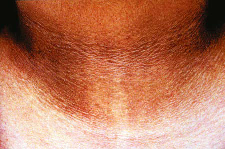

# Chapter 65: Overweight and Obesity — Board-Style Self-Assessment MCQs
**Part V: Nutrition** | [📖 Read Wiki Chapter](../chapters/065.md) | [🃏 Chapter Flashcards](../flashcards/065_flashcards.md) | [🏠 Course Master Index](../../index.md)

Total questions: **5** *(Click "Show Answer & Rationale" beneath each question)*

### Question 1 (Clinical Pediatrics Vignette)
A pediatric patient is evaluated for the following clinical and diagnostic profile: Dyslipidemia; HDL 130, total cholesterol >200 mg/dL; Fasting total cholesterol, HDL, LDL, triglycerides; Hypertension; SBP >95% for sex, age, height; Serial testing, urinalysis, electrolytes, blood urea nitrogen,; creatinine. Which of the following conditions or syndromes is the most likely diagnosis?

- **A.** GASTROINTESTINAL (Overweight and Obesity)
- **B.** ORTHOPEDIC (Overweight and Obesity)
- **C.** CARDIOVASCULAR (Overweight and Obesity)
- **D.** (NAFLD) (Overweight and Obesity)

<b>Show Answer & Rationale</b>

**Correct Answer: C** — CARDIOVASCULAR (Overweight and Obesity)

**Rationale:** **CARDIOVASCULAR (Overweight and Obesity)** is characterized by: Dyslipidemia; HDL 130, total cholesterol >200 mg/dL; Fasting total cholesterol, HDL, LDL, triglycerides; Hypertension; SBP >95% for sex, age, height; Serial testing, urinalysis, electrolytes, blood urea nitrogen,; creatinine.

**Why Other Options Are Incorrect:** **GASTROINTESTINAL (Overweight and Obesity)** is incorrect (characterized by Gallbladder disease; Abdominal pain, vomiting, jaundice; Ultrasound; Nonalcoholic fatty liver diseas). **ORTHOPEDIC (Overweight and Obesity)** is incorrect (characterized by Blount disease (tibia vara); Severe bowing of tibia, knee pain, limp; Knee radiographs; Musculoskele). **(NAFLD) (Overweight and Obesity)** is incorrect (characterized by Hepatomegaly, abdominal pain, dependent; edema, ↑ transaminases; Can progress to fibrosis, cirrhosis).

### Question 2 (Clinical Pediatrics Vignette)
A pediatric patient is evaluated for the following clinical and diagnostic profile: Type 2 diabetes mellitus; Acanthosis nigricans, polyuria, polydipsia; Fasting blood glucose >110, hemoglobin A1c, insulin; level, C-peptide, oral glucose tolerance test; Metabolic syndrome; Central adiposity, insulin resistance, dyslipidemia,; hypert. Which of the following conditions or syndromes is the most likely diagnosis?

- **A.** NEUROLOGIC (Overweight and Obesity)
- **B.** ENDOCRINE (Overweight and Obesity)
- **C.** (NAFLD) (Overweight and Obesity)
- **D.** GASTROINTESTINAL (Overweight and Obesity)

<b>Show Answer & Rationale</b>

**Correct Answer: B** — ENDOCRINE (Overweight and Obesity)

**Rationale:** **ENDOCRINE (Overweight and Obesity)** is characterized by: Type 2 diabetes mellitus; Acanthosis nigricans, polyuria, polydipsia; Fasting blood glucose >110, hemoglobin A1c, insulin; level, C-peptide, oral glucose tolerance test; Metabolic syndrome; Central adiposity, insulin resistance, dyslipidemia,; hypertension, glucose intolerance; Fasting glucose, LDL and HDL cholesterol;.

**Why Other Options Are Incorrect:** **NEUROLOGIC (Overweight and Obesity)** is incorrect (characterized by Pseudotumor cerebri; Headaches, vision changes, papilledema; Cerebrospinal fluid opening pressure, C). **(NAFLD) (Overweight and Obesity)** is incorrect (characterized by Hepatomegaly, abdominal pain, dependent; edema, ↑ transaminases; Can progress to fibrosis, cirrhosis). **GASTROINTESTINAL (Overweight and Obesity)** is incorrect (characterized by Gallbladder disease; Abdominal pain, vomiting, jaundice; Ultrasound; Nonalcoholic fatty liver diseas).

### Question 3 (Visual Diagnosis & Clinical Spotter)

A pediatric patient undergoes evaluation for **Overweight and Obesity**, yielding the clinical or diagnostic finding shown below. Which of the following best characterizes the illustrated finding?

- **A.** Developed by the National Center for Health Statistics in collaboration with the National Center for Chronic Disease Prevention and Health Promotion, 2000.
- **B.** Simplistically, obesity results from an imbalance of caloric intake and energy expenditure.
- **C.** In addition, there are genetic conditions associated with obesity, such as Prader-Willi syndrome, which results from absence of paternally expressed imprinted genes in the 15q11.2-q13 region
- **D.** Acanthosis nigricans. From Gahagan S. Child and adoles cent obesity. Curr Probl Pediatr Adolesc Health Care. 2004;34:6–43.

<b>Show Answer & Rationale</b>

**Correct Answer: D** — Acanthosis nigricans. From Gahagan S. Child and adoles cent obesity. Curr Probl Pediatr Adolesc Health Care. 2004;34:6–43.

**Rationale:** **Fig. 65.4**: Acanthosis nigricans. From Gahagan S. Child and adoles cent obesity. Curr Probl Pediatr Adolesc Health Care. 2004;34:6–43.

### Question 4 (Differential Diagnosis (Overweight and Obesity))
During a pediatric consultation regarding **Overweight and Obesity**, which clinical entity or concept is described by the following profile? "Obesity, or increased adiposity, is defined using the this pediatric condition (BMI), an excellent proxy for more direct measurement of body fat."

- **A.** EVALUATION
- **B.** growth chart
- **C.** BODY MASS INDEX
- **D.** obesity

<b>Show Answer & Rationale</b>

**Correct Answer: C** — BODY MASS INDEX

**Rationale:** BODY MASS INDEX Obesity, or increased adiposity, is defined using the body mass index (BMI), an excellent proxy for more direct measurement of body fat.

### Question 5 (Pediatric Board Mastery (Overweight and Obesity))
When formulating an evidence-based diagnostic and management plan for **Overweight and Obesity** (*Part V: Nutrition*), which of the following pediatric clinical statements is **ACCURATE**? (Item 1)

- **A.** Simplistically, obesity results from an imbalance of caloric intake and energy expenditure.
- **B.** The condition is an entirely benign physiologic variant that never warrants laboratory or clinical evaluation.
- **C.** Clinical manifestations are permanently restricted to late adulthood and never present during infancy, childhood, or adolescence.
- **D.** First-line management relies on immediate high-dose aspirin therapy in febrile infants.

<b>Show Answer & Rationale</b>

**Correct Answer: A** — Simplistically, obesity results from an imbalance of caloric intake and energy expenditure.

**Rationale:** **Pediatric Clinical Principle (Overweight and Obesity):** Simplistically, obesity results from an imbalance of caloric intake and energy expenditure.

