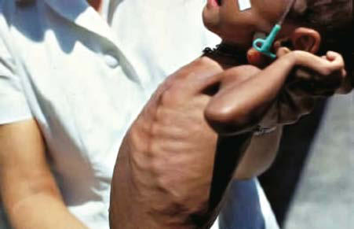

# Chapter 68: Vitamin C (Ascorbic Acid) Deficiency and Excess — Board-Style Self-Assessment MCQs
**Part V: Nutrition** | [📖 Read Wiki Chapter](../chapters/068.md) | [🃏 Chapter Flashcards](../flashcards/068_flashcards.md) | [🏠 Course Master Index](../../index.md)

Total questions: **5** *(Click "Show Answer & Rationale" beneath each question)*

### Question 1 (Clinical Pediatrics Vignette)
A pediatric patient is evaluated for the following clinical and diagnostic profile: VITAMIN C DEFICIENCY A deficiency of vitamin C results in the clinical presentation of scurvy.. Which of the following conditions or syndromes is the most likely diagnosis?

- **A.** CPTIA (Defects in Metabolism of Lipids)
- **B.** Vitamin C (Ascorbic Acid) Deficiency and Excess
- **C.** NEUROMUSCULAR DYSFUNCTION
- **D.** DISCUSSION (Ethics in Pediatric Care)

<b>Show Answer & Rationale</b>

**Correct Answer: B** — Vitamin C (Ascorbic Acid) Deficiency and Excess

**Rationale:** **Vitamin C (Ascorbic Acid) Deficiency and Excess** is characterized by: VITAMIN C DEFICIENCY A deficiency of vitamin C results in the clinical presentation of scurvy..

**Why Other Options Are Incorrect:** **CPTIA (Defects in Metabolism of Lipids)** is incorrect (characterized by Liver failure, renal tubulopathy, and sudden death; reported; maternal preeclampsia; HELLP syndrome;). **NEUROMUSCULAR DYSFUNCTION** is incorrect (characterized by Paralytic: misalignment secondary to a cranial nerve palsy, muscle; weakness, or mechanical restrict). **DISCUSSION (Ethics in Pediatric Care)** is incorrect (characterized by Is there a legal right to refuse medical interventions?).

### Question 2 (Visual Diagnosis & Clinical Spotter)

A pediatric patient undergoes evaluation for **Vitamin C (Ascorbic Acid) Deficiency and Excess**, yielding the clinical or diagnostic finding shown below. Which of the following best characterizes the illustrated finding?

- **A.** Sharp angulation of beading at costochondral junction (scorbutic rosary) in scurvy. (Courtesy Dr. J.D. MacLean, McGill Centre for Tropical Diseases, Montreal.)
- **B.** Biochemical tests are not very useful in the diagnosis of scurvy, because they do not reflect the tissue status.
- **C.** Laboratory Findings and Diagnosis The diagnosis of vitamin C deficiency is usually based on the char acteristic clinical picture, the radiographic appearance of the long bones, and a history
- **D.** VITAMIN C DEFICIENCY A deficiency of vitamin C results in the clinical presentation of scurvy.

<b>Show Answer & Rationale</b>

**Correct Answer: A** — Sharp angulation of beading at costochondral junction (scorbutic rosary) in scurvy. (Courtesy Dr. J.D. MacLean, McGill Centre for Tropical Diseases, Montreal.)

**Rationale:** **Fig. 68.1**: Sharp angulation of beading at costochondral junction (scorbutic rosary) in scurvy. (Courtesy Dr. J.D. MacLean, McGill Centre for Tropical Diseases, Montreal.)

### Question 3 (Differential Diagnosis (Vitamin C (Ascorbic Acid) Deficiency and Excess))
During a pediatric consultation regarding **Vitamin C (Ascorbic Acid) Deficiency and Excess**, which clinical entity or concept is described by the following profile? "Humans depend on dietary sources for vitamin C."

- **A.** Treatment
- **B.** DIETARY NEEDS AND SOURCES OF VITAMIN C
- **C.** Clinical Features
- **D.** Differential Diagnosis

<b>Show Answer & Rationale</b>

**Correct Answer: B** — DIETARY NEEDS AND SOURCES OF VITAMIN C

**Rationale:** DIETARY NEEDS AND SOURCES OF VITAMIN C Humans depend on dietary sources for vitamin C.

### Question 4 (Differential Diagnosis (Vitamin C (Ascorbic Acid) Deficiency and Excess))
During a pediatric consultation regarding **Vitamin C (Ascorbic Acid) Deficiency and Excess**, which clinical entity or concept is described by the following profile? "A deficiency of vitamin C results in the clinical presentation of scurvy."

- **A.** Laboratory Findings and Diagnosis
- **B.** Decreased psychomotor activity
- **C.** DIETARY NEEDS AND SOURCES OF VITAMIN C
- **D.** VITAMIN C DEFICIENCY

<b>Show Answer & Rationale</b>

**Correct Answer: D** — VITAMIN C DEFICIENCY

**Rationale:** VITAMIN C DEFICIENCY A deficiency of vitamin C results in the clinical presentation of scurvy.

### Question 5 (Pediatric Board Mastery (Vitamin C (Ascorbic Acid) Deficiency and Excess))
When formulating an evidence-based diagnostic and management plan for **Vitamin C (Ascorbic Acid) Deficiency and Excess** (*Part V: Nutrition*), which of the following pediatric clinical statements is **ACCURATE**? (Item 1)

- **A.** The condition is an entirely benign physiologic variant that never warrants laboratory or clinical evaluation.
- **B.** Systemic tetracyclines and fluoroquinolones are universally required as routine prophylaxis in all healthy newborns.
- **C.** VITAMIN C DEFICIENCY A deficiency of vitamin C results in the clinical presentation of scurvy.
- **D.** Inheritance is exclusively holandric (Y-linked) with 100% penetrance restricted to male neonates.

<b>Show Answer & Rationale</b>

**Correct Answer: C** — VITAMIN C DEFICIENCY A deficiency of vitamin C results in the clinical presentation of scurvy.

**Rationale:** **Pediatric Clinical Principle (Vitamin C (Ascorbic Acid) Deficiency and Excess):** VITAMIN C DEFICIENCY A deficiency of vitamin C results in the clinical presentation of scurvy.

