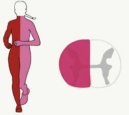

# Chapter 81: Spinal Cord Injuries in Children — Board-Style Self-Assessment MCQs
**Part VII: Emergency Medicine, Critical Care, and Anesthesia** | [📖 Read Wiki Chapter](../chapters/081.md) | [🃏 Chapter Flashcards](../flashcards/081_flashcards.md) | [🏠 Course Master Index](../../index.md)

Total questions: **5** *(Click "Show Answer & Rationale" beneath each question)*

### Question 1 (Clinical Pediatrics Vignette)
A pediatric patient is evaluated for the following clinical and diagnostic profile: Abnormal development of; the cervical spine; Trisomy 21; Larsen syndrome; Mucopolysaccharidosis IV/Morquio; syndrome; Klippel-Feil syndrome; Achondroplasia; Chiari malformation; Syringomyelia; Abnormal bone and soft; tissue; Marfan syndrome; Ehlers-D. Which of the following conditions or syndromes is the most likely diagnosis?

- **A.** ANDROGEN EXCESS SOCIETY
- **B.** SYNDROMES PREDISPOSING TO NEUROBLASTOMA
- **C.** CONDITIONS (Spinal Cord Injuries in Children)
- **D.** CYP2C9 (Integration of Genetics into Pediatric Practice)

<b>Show Answer & Rationale</b>

**Correct Answer: C** — CONDITIONS (Spinal Cord Injuries in Children)

**Rationale:** **CONDITIONS (Spinal Cord Injuries in Children)** is characterized by: Abnormal development of; the cervical spine; Trisomy 21; Larsen syndrome; Mucopolysaccharidosis IV/Morquio; syndrome; Klippel-Feil syndrome; Achondroplasia; Chiari malformation; Syringomyelia; Abnormal bone and soft; tissue; Marfan syndrome; Ehlers-Danlos syndrome; Osteogenesis imperfecta; Arthritis; Ankylosing spondyl.

**Why Other Options Are Incorrect:** **ANDROGEN EXCESS SOCIETY** is incorrect (characterized by Oligoovulation or anovulation; and; Clinical or biochemical hyperandrogenism; Two of three of the fo). **SYNDROMES PREDISPOSING TO NEUROBLASTOMA** is incorrect (characterized by Neurocristopathy syndrome; Neuroblastoma associated with other neural crest disorders, including con). **CYP2C9 (Integration of Genetics into Pediatric Practice)** is incorrect (characterized by Cytochrome P450 2C9; Warfarin; Individuals having ≥1 reduced function alleles require; lower doses o).

### Question 2 (Clinical Pediatrics Vignette)
A pediatric patient is evaluated for the following clinical and diagnostic profile: Child or parent reports; persistent neck pain,; abnormal head posture,; or difficulty with neck; movement; Visible known substantial injury to; chest, abdomen, or pelvis (injury; that is life-threatening, warrants; surgical intervention or inpatient;. Which of the following conditions or syndromes is the most likely diagnosis?

- **A.** DISORDERS IN PENTOSE METABOLISM
- **B.** PHYSICAL EXAMINATION
- **C.** Biliary atresia
- **D.** Enteric Duplication Cyst

<b>Show Answer & Rationale</b>

**Correct Answer: B** — PHYSICAL EXAMINATION

**Rationale:** **PHYSICAL EXAMINATION** is characterized by: Child or parent reports; persistent neck pain,; abnormal head posture,; or difficulty with neck; movement; Visible known substantial injury to; chest, abdomen, or pelvis (injury; that is life-threatening, warrants; surgical intervention or inpatient; admission); History of focal sensory; abnormality or motor deficit; G.

**Why Other Options Are Incorrect:** **DISORDERS IN PENTOSE METABOLISM** is incorrect (characterized by Pentosuria; l-Xylulose reductase; Urine-reducing substance; Benign; Transaldolase deficiency; Transa). **Enteric Duplication Cyst** is incorrect (characterized by Mesenteric border of ileum (#1); shares muscular wall & blood supply with bowel; ultrasound 'double-).

### Question 3 (Visual Diagnosis & Clinical Spotter)

A pediatric patient undergoes evaluation for **Spinal Cord Injuries in Children**, yielding the clinical or diagnostic finding shown below. Which of the following best characterizes the illustrated finding?

- **A.** CLINICAL MANIFESTATIONS One in three patients with significant trauma to the spine and spi nal cord will have a concomitant severe head injury, which makes early diagnosis challenging.
- **B.** T2-weighted MRI performed the day after the accident showed cervical spinal cord swelling combined with high signal inten sity (C1-C3) (arrow) and dislocation of C5-C6 (arrowhead). (From Inoue K,
- **C.** If their imaging is normal, these chil dren can generally return to normal activities after a period of rest from days to weeks, depending on the initial severity, similar to cerebral concus
- **D.** CLEARING THE CERVICAL SPINE IN CHILDREN The management of children after major trauma is challenging.

<b>Show Answer & Rationale</b>

**Correct Answer: B** — T2-weighted MRI performed the day after the accident showed cervical spinal cord swelling combined with high signal inten sity (C1-C3) (arrow) and dislocation of C5-C6 (arrowhead). (From Inoue K,

**Rationale:** **Fig. 81.2**: T2-weighted MRI performed the day after the accident showed cervical spinal cord swelling combined with high signal inten sity (C1-C3) (arrow) and dislocation of C5-C6 (arrowhead). (From Inoue K, Kumada T, Fujii T, Kimura N. Progressive cervical spinal cord atrophy after a traffic accident. J Pediatr. 2017;180:287: Fig. 1, p. 287.)

### Question 4 (Differential Diagnosis (Spinal Cord Injuries in Children))
During a pediatric consultation regarding **Spinal Cord Injuries in Children**, which clinical entity or concept is described by the following profile? "form involves severe injury of the cervical or thoracic spinal cord; these patients have a poor chance of complete recovery."

- **A.** infantile
- **B.** transient quadriparesis
- **C.** CLINICAL MANIFESTATIONS
- **D.** Occipi tocervical dislocation

<b>Show Answer & Rationale</b>

**Correct Answer: A** — infantile

**Rationale:** infantile form involves severe injury of the cervical or thoracic spinal cord; these patients have a poor chance of complete recovery.

### Question 5 (Pediatric Board Mastery (Spinal Cord Injuries in Children))
When formulating an evidence-based diagnostic and management plan for **Spinal Cord Injuries in Children** (*Part VII: Emergency Medicine, Critical Care, and Anesthesia*), which of the following pediatric clinical statements is **ACCURATE**? (Item 1)

- **A.** First-line management relies on immediate high-dose aspirin therapy in febrile infants.
- **B.** CLINICAL MANIFESTATIONS One in three patients with significant trauma to the spine and spi nal cord will have a concomitant severe head injury, which makes early diagnosis challenging.
- **C.** Systemic tetracyclines and fluoroquinolones are universally required as routine prophylaxis in all healthy newborns.
- **D.** Clinical manifestations are permanently restricted to late adulthood and never present during infancy, childhood, or adolescence.

<b>Show Answer & Rationale</b>

**Correct Answer: B** — CLINICAL MANIFESTATIONS One in three patients with significant trauma to the spine and spi nal cord will have a concomitant severe head injury, which makes early diagnosis challenging.

**Rationale:** **Pediatric Clinical Principle (Spinal Cord Injuries in Children):** CLINICAL MANIFESTATIONS One in three patients with significant trauma to the spine and spi nal cord will have a concomitant severe head injury, which makes early diagnosis challenging.

