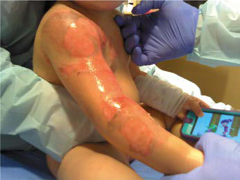

# Chapter 89: Burn Injuries — Board-Style Self-Assessment MCQs
**Part VII: Emergency Medicine, Critical Care, and Anesthesia** | [📖 Read Wiki Chapter](../chapters/089.md) | [🃏 Chapter Flashcards](../flashcards/089_flashcards.md) | [🏠 Course Master Index](../../index.md)

Total questions: **5** *(Click "Show Answer & Rationale" beneath each question)*

### Question 1 (Clinical Pediatrics Vignette)
A pediatric patient is evaluated for the following clinical and diagnostic profile: Install and use smoke detectors.; Control the hot water thermostat; maximum water temperature; should be 48.9°C (120°F).; Keep fire, matches, and lighters out of the reach of children.; Avoid cigarette smoking, especially in bed.; Do not leave lit ca. Which of the following conditions or syndromes is the most likely diagnosis?

- **A.** PREVENT INJURY (Burn Injuries)
- **B.** 1: Resuscitation, 0-72 hours
- **C.** 2: Acute treatment phase, day 3 through
- **D.** PREVENT FIRES (Burn Injuries)

<b>Show Answer & Rationale</b>

**Correct Answer: D** — PREVENT FIRES (Burn Injuries)

**Rationale:** **PREVENT FIRES (Burn Injuries)** is characterized by: Install and use smoke detectors.; Control the hot water thermostat; maximum water temperature; should be 48.9°C (120°F).; Keep fire, matches, and lighters out of the reach of children.; Avoid cigarette smoking, especially in bed.; Do not leave lit candles unattended.; Keep hair appliances such as curling irons and stra.

**Why Other Options Are Incorrect:** **PREVENT INJURY (Burn Injuries)** is incorrect (characterized by Stop, drop, and roll (do not run) if clothing catches fire; wrap in a; blanket.; Practice escape pro). **1: Resuscitation, 0-72 hours** is incorrect (characterized by Massive capillary leak, edema, and burn; shock; Airway, breathing, and circulation optimization via;). **2: Acute treatment phase, day 3 through** is incorrect (characterized by discharge; Hyperdynamic and catabolic state,; immunosuppression, risk of infection; Enteral nutritio).

### Question 2 (Clinical Pediatrics Vignette)
A pediatric patient is evaluated for the following clinical and diagnostic profile: Stop, drop, and roll (do not run) if clothing catches fire; wrap in a; blanket.; Practice escape procedures.; Crawl beneath smoke if a fire occurs indoors.; Use educational materials.; National Fire Protection Association pamphlets and videos.. Which of the following conditions or syndromes is the most likely diagnosis?

- **A.** PREVENT FIRES (Burn Injuries)
- **B.** 3: Rehabilitation, day 1 through discharge
- **C.** 2: Acute treatment phase, day 3 through
- **D.** PREVENT INJURY (Burn Injuries)

<b>Show Answer & Rationale</b>

**Correct Answer: D** — PREVENT INJURY (Burn Injuries)

**Rationale:** **PREVENT INJURY (Burn Injuries)** is characterized by: Stop, drop, and roll (do not run) if clothing catches fire; wrap in a; blanket.; Practice escape procedures.; Crawl beneath smoke if a fire occurs indoors.; Use educational materials.; National Fire Protection Association pamphlets and videos..

**Why Other Options Are Incorrect:** **PREVENT FIRES (Burn Injuries)** is incorrect (characterized by Install and use smoke detectors.; Control the hot water thermostat; maximum water temperature; shoul). **3: Rehabilitation, day 1 through discharge** is incorrect (characterized by Gradual waning of initial catabolic state,; wounds heal, scars form, and strength; recovers; Maintai). **2: Acute treatment phase, day 3 through** is incorrect (characterized by discharge; Hyperdynamic and catabolic state,; immunosuppression, risk of infection; Enteral nutritio).

### Question 3 (Visual Diagnosis & Clinical Spotter)

A pediatric patient undergoes evaluation for **Burn Injuries**, yielding the clinical or diagnostic finding shown below. Which of the following best characterizes the illustrated finding?

- **A.** Flame burns are the most common cause of burn injury in all age-groups ≥5 years old.
- **B.** Second-degree burns. A, Superficial partial-thickness (second-degree) burn, which is pink and glistening. B, Deep partial-thickness (second-degree) burn. The white-appearing area over the dorsum
- **C.** Burn care involves a range of activities: prevention, acute care and resuscitation, wound management, pain relief, reconstruction, reha bilitation, and psychosocial adjustment.
- **D.** PREVENTION The aim of burn prevention is a continuing reduction in the number of serious burn injuries.

<b>Show Answer & Rationale</b>

**Correct Answer: B** — Second-degree burns. A, Superficial partial-thickness (second-degree) burn, which is pink and glistening. B, Deep partial-thickness (second-degree) burn. The white-appearing area over the dorsum

**Rationale:** **Fig. 89.3**: Second-degree burns. A, Superficial partial-thickness (second-degree) burn, which is pink and glistening. B, Deep partial-thickness (second-degree) burn. The white-appearing area over the dorsum of the hand is a deep partial-thickness burn. (From Singer AJ, Lee CC. Thermal burns. In: Walls RM, Hockberger RS, Gausche-Hill M, et al., eds. Rosen’s Emergency Medicine, 9th ed. Philadelphia: Elsevier; 2018: Figs. 56.1 and 56.2, p. 717.)

### Question 4 (Differential Diagnosis (Burn Injuries))
During a pediatric consultation regarding **Burn Injuries**, which clinical entity or concept is described by the following profile? "main a major cause of mortality in children, but children <14 years old have a lower relative risk of dying in a fire than the general population."

- **A.** Pressure therapy
- **B.** First-degree burns
- **C.** Fires
- **D.** TREATMENT Outpatient Management of Minor Burns

<b>Show Answer & Rationale</b>

**Correct Answer: C** — Fires

**Rationale:** Fires remain a major cause of mortality in children, but children <14 years old have a lower relative risk of dying in a fire than the general population.

### Question 5 (Pediatric Board Mastery (Burn Injuries))
When formulating an evidence-based diagnostic and management plan for **Burn Injuries** (*Part VII: Emergency Medicine, Critical Care, and Anesthesia*), which of the following pediatric clinical statements is **ACCURATE**? (Item 1)

- **A.** Flame burns are the most common cause of burn injury in all age-groups ≥5 years old.
- **B.** Systemic tetracyclines and fluoroquinolones are universally required as routine prophylaxis in all healthy newborns.
- **C.** Diagnostic confirmation relies solely on plain skull radiographs without biochemical, microbiologic, or clinical correlation.
- **D.** Clinical manifestations are permanently restricted to late adulthood and never present during infancy, childhood, or adolescence.

<b>Show Answer & Rationale</b>

**Correct Answer: A** — Flame burns are the most common cause of burn injury in all age-groups ≥5 years old.

**Rationale:** **Pediatric Clinical Principle (Burn Injuries):** Flame burns are the most common cause of burn injury in all age-groups ≥5 years old.

