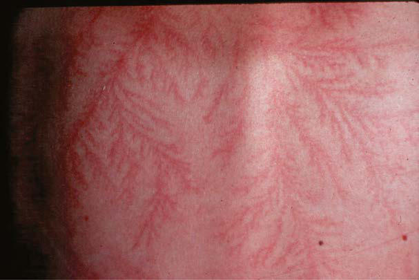

# Chapter 90: Cold Injuries — Board-Style Self-Assessment MCQs
**Part VII: Emergency Medicine, Critical Care, and Anesthesia** | [📖 Read Wiki Chapter](../chapters/090.md) | [🃏 Chapter Flashcards](../flashcards/090_flashcards.md) | [🏠 Course Master Index](../../index.md)

Total questions: **5** *(Click "Show Answer & Rationale" beneath each question)*

### Question 1 (Clinical Pediatrics Vignette)
A pediatric patient is evaluated for the following clinical and diagnostic profile: Mild; 35 (95); Urine temperature, 34.8°C (94.6°F); increased shivering thermogenesis; increase in metabolic; rate; 34 (93.2); Amnesia and dysarthria develop; normal blood pressure; maximum respiratory stimulation; 33 (91.4); Ataxia, apathy develop; M. Which of the following conditions or syndromes is the most likely diagnosis?

- **A.** CHARACTERISTICS (Cold Injuries)
- **B.** XR]† (5, 10, 15, 20, 25, 30
- **C.** ARTHROGRYPOSIS CAUSED BY NERVOUS SYSTEM DISORDERS
- **D.** COVID-19 (Thrombotic Disorders in Children)

<b>Show Answer & Rationale</b>

**Correct Answer: A** — CHARACTERISTICS (Cold Injuries)

**Rationale:** **CHARACTERISTICS (Cold Injuries)** is characterized by: Mild; 35 (95); Urine temperature, 34.8°C (94.6°F); increased shivering thermogenesis; increase in metabolic; rate; 34 (93.2); Amnesia and dysarthria develop; normal blood pressure; maximum respiratory stimulation; 33 (91.4); Ataxia, apathy develop; Moderate; 32 (89.6); Stupor; 25% decrease in oxygen consumption; 31 (87.

**Why Other Options Are Incorrect:** **XR]† (5, 10, 15, 20, 25, 30** is incorrect (characterized by mg caps); 12 hr). **ARTHROGRYPOSIS CAUSED BY NERVOUS SYSTEM DISORDERS** is incorrect (characterized by • Focal anterior horn cell deficiency; • Generalized anterior horn cell deficiency; • Structural bra). **COVID-19 (Thrombotic Disorders in Children)** is incorrect (characterized by Antiphospholipid antibody syndrome).

### Question 2 (Clinical Pediatrics Vignette)
A pediatric patient is evaluated for the following clinical and diagnostic profile: • Superficial; • Edema and redness without tissue; necrosis in the affected area; • Numbness, firm white-yellow; plaque; • No blisters or necrosis; • Occasional skin desquamation; (5-10 days later); • Blister formation; • Erythema, substantial edema;. Which of the following conditions or syndromes is the most likely diagnosis?

- **A.** GRADE IV INJURY (Cold Injuries)
- **B.** CEFTRIAXONE (Neisseria meningitidis (Meningococcus))
- **C.** ETV6-RUNX1 (The Leukemias)
- **D.** FEATURES (Chromatin Regulatory Disorders)

<b>Show Answer & Rationale</b>

**Correct Answer: A** — GRADE IV INJURY (Cold Injuries)

**Rationale:** **GRADE IV INJURY (Cold Injuries)** is characterized by: • Superficial; • Edema and redness without tissue; necrosis in the affected area; • Numbness, firm white-yellow; plaque; • No blisters or necrosis; • Occasional skin desquamation; (5-10 days later); • Blister formation; • Erythema, substantial edema; • Vesicles with clear or milky; fluid; • Blisters; • Desquamation and.

**Why Other Options Are Incorrect:** **CEFTRIAXONE (Neisseria meningitidis (Meningococcus))** is incorrect (characterized by Children <15 yr; 125 mg IM; 1 dose; 90–95%; Children ≥15 yr and adults; 250 mg IM; 1 dose; 90–95%). **ETV6-RUNX1 (The Leukemias)** is incorrect (characterized by Favorable; TCF3-PBX1 translocation, t(1;19); (q23;p13); 5% children, AYAs and adults). **FEATURES (Chromatin Regulatory Disorders)** is incorrect (characterized by Facial features; 0-5 points (0-3 features = 1 point; 4-6 = 2 point;; 7-9 = 3 point; 10-12 = 4 point;).

### Question 3 (Visual Diagnosis & Clinical Spotter)

A pediatric patient undergoes evaluation for **Cold Injuries**, yielding the clinical or diagnostic finding shown below. Which of the following best characterizes the illustrated finding?

- **A.** Lightning burn: Lichtenberg feathering. (Courtesy Dr. Mary Ann Cooper.)
- **B.** Risk Factors and Prevention of Hypothermia The risk factors associated with hypothermia are extensive.
- **C.** Evaporative heat loss results from the conversion of water (sweat) to vapor; like respiratory loss, it is a small but obligate contribu tion to thermal balance.
- **D.** The crucial factors for reducing morbidity and mortality due to hypother mia are prevention, prompt recognition, and rapid treatment.

<b>Show Answer & Rationale</b>

**Correct Answer: A** — Lightning burn: Lichtenberg feathering. (Courtesy Dr. Mary Ann Cooper.)

**Rationale:** **Fig. 89.7**: Lightning burn: Lichtenberg feathering. (Courtesy Dr. Mary Ann Cooper.)

### Question 4 (Differential Diagnosis (Cold Injuries))
During a pediatric consultation regarding **Cold Injuries**, which clinical entity or concept is described by the following profile? "Environmental heat or cold injury occurs when the metabolic capacity for thermoregulation cannot maintain core body temperature in the setting of extreme environmental temperatures."

- **A.** MECHANISMS OF HEAT TRANSFER
- **B.** autoinflammatory
- **C.** First-degree
- **D.** Principles of Dermatologic Therapy

<b>Show Answer & Rationale</b>

**Correct Answer: A** — MECHANISMS OF HEAT TRANSFER

**Rationale:** MECHANISMS OF HEAT TRANSFER Environmental heat or cold injury occurs when the metabolic capacity for thermoregulation cannot maintain core body temperature in the setting of extreme environmental temperatures.

### Question 5 (Pediatric Board Mastery (Cold Injuries))
When formulating an evidence-based diagnostic and management plan for **Cold Injuries** (*Part VII: Emergency Medicine, Critical Care, and Anesthesia*), which of the following pediatric clinical statements is **ACCURATE**? (Item 1)

- **A.** Inheritance is exclusively holandric (Y-linked) with 100% penetrance restricted to male neonates.
- **B.** Evaporative heat loss results from the conversion of water (sweat) to vapor; like respiratory loss, it is a small but obligate contribu tion to thermal balance.
- **C.** Diagnostic confirmation relies solely on plain skull radiographs without biochemical, microbiologic, or clinical correlation.
- **D.** Clinical manifestations are permanently restricted to late adulthood and never present during infancy, childhood, or adolescence.

<b>Show Answer & Rationale</b>

**Correct Answer: B** — Evaporative heat loss results from the conversion of water (sweat) to vapor; like respiratory loss, it is a small but obligate contribu tion to thermal balance.

**Rationale:** **Pediatric Clinical Principle (Cold Injuries):** Evaporative heat loss results from the conversion of water (sweat) to vapor; like respiratory loss, it is a small but obligate contribu tion to thermal balance.

