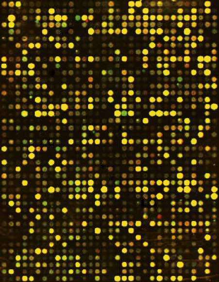

# Chapter 96: Principles of Human Genetics — Board-Style Self-Assessment MCQs
**Part VIII: Human Genetics** | [📖 Read Wiki Chapter](../chapters/096.md) | [🃏 Chapter Flashcards](../flashcards/096_flashcards.md) | [🏠 Course Master Index](../../index.md)

Total questions: **5** *(Click "Show Answer & Rationale" beneath each question)*

### Question 1 (Clinical Pediatrics Vignette)
A pediatric patient is evaluated for the following clinical and diagnostic profile: Substitution; Synonymous; Silent; Same amino acid; Nonsynonymous; Missense; Altered amino acid—may affect protein function or stability; Nonsense or stop-gain; Stop codon—loss of function or expression from degradation of; mRNA; Splice site; Aberrant. Which of the following conditions or syndromes is the most likely diagnosis?

- **A.** EFFECT ON PROTEIN PRODUCT
- **B.** THORACIC CAGE (Acute Care of Respiratory Distress and Failure)
- **C.** 2. Professionals should
- **D.** INTRUSIVE GRIEF THOUGHTS SCALE (IGTS)

<b>Show Answer & Rationale</b>

**Correct Answer: A** — EFFECT ON PROTEIN PRODUCT

**Rationale:** **EFFECT ON PROTEIN PRODUCT** is characterized by: Substitution; Synonymous; Silent; Same amino acid; Nonsynonymous; Missense; Altered amino acid—may affect protein function or stability; Nonsense or stop-gain; Stop codon—loss of function or expression from degradation of; mRNA; Splice site; Aberrant splicing—exon skipping or intron retention; Promoter; Altered gene ex.

**Why Other Options Are Incorrect:** **THORACIC CAGE (Acute Care of Respiratory Distress and Failure)** is incorrect (characterized by Choanal atresia; Tonsilloadenoidal hypertrophy; Retropharyngeal/peritonsillar; abscess; Laryngomalac). **2. Professionals should** is incorrect (characterized by • Offer support and advice to parents who allow their children unsupervised; access to extreme viole). **INTRUSIVE GRIEF THOUGHTS SCALE (IGTS)** is incorrect (characterized by (During the past 4 wk) How often did you think about the death of; your loved one?; How often did yo).

### Question 2 (Clinical Pediatrics Vignette)
A pediatric patient is evaluated for the following clinical and diagnostic profile: In some cases, changes in gene expression are caused by changes in the number of copies of a gene that are present in the genome.. Which of the following conditions or syndromes is the most likely diagnosis?

- **A.** WHEN TO ISOLATE (Rotaviruses, Caliciviruses, and Astroviruses)
- **B.** Principles of Human Genetics
- **C.** DETERMINING SEVERITY
- **D.** EFFECT ON PROTEIN PRODUCT

<b>Show Answer & Rationale</b>

**Correct Answer: B** — Principles of Human Genetics

**Rationale:** **Principles of Human Genetics** (associated with **`AR, CFTR, FGFR3, KCNH2, KCNQ1`**) is characterized by: In some cases, changes in gene expression are caused by changes in the number of copies of a gene that are present in the genome..

**Why Other Options Are Incorrect:** **WHEN TO ISOLATE (Rotaviruses, Caliciviruses, and Astroviruses)** is incorrect (characterized by • If you test negative: You can end your isolation.; • If you test positive: Follow the full isolati). **DETERMINING SEVERITY** is incorrect (characterized by Mild; TDD 3-10 mm; Type I; Flattening restricted; to back of the skull). **EFFECT ON PROTEIN PRODUCT** is incorrect (characterized by Substitution; Synonymous; Silent; Same amino acid; Nonsynonymous; Missense; Altered amino acid—may a).

### Question 3 (Visual Diagnosis & Clinical Spotter)

A pediatric patient undergoes evaluation for **Principles of Human Genetics**, yielding the clinical or diagnostic finding shown below. Which of the following best characterizes the illustrated finding?

- **A.** In some cases, changes in gene expression are caused by changes in the number of copies of a gene that are present in the genome.
- **B.** Microarray containing 36,000 oligonucleotides. The micro array was exposed to RNA from normal fibroblasts (labeled in red; see arrows) and fibroblasts from a patient with Niemann-Pick disease, ty
- **C.** Charcot-Marie-Tooth disease type 1A, the most com mon inherited form of chronic peripheral neuropathy of childhood, is caused by duplications of the gene for peripheral myelin protein 22, re
- **D.** Marfan syndrome is characterized by the combination of skeletal, ocular, and aortic mani festations, with the most devastating outcome being aortic root dissec tion and sudden death.

<b>Show Answer & Rationale</b>

**Correct Answer: B** — Microarray containing 36,000 oligonucleotides. The micro array was exposed to RNA from normal fibroblasts (labeled in red; see arrows) and fibroblasts from a patient with Niemann-Pick disease, ty

**Rationale:** **Fig. 96.5**: Microarray containing 36,000 oligonucleotides. The micro array was exposed to RNA from normal fibroblasts (labeled in red; see arrows) and fibroblasts from a patient with Niemann-Pick disease, type C (labeled green). Arrows point to regions in which there was a strong hybridization signal with either normal or disease RNA. This microarray was used to search for genes that are highly expressed in the fibroblasts of patients. (From Jorde LB, Carey JC, Bamshad MJ, White RL. Medical Genetics, 3rd ed. St Louis: Mosby; 2006: p. 116.)

### Question 4 (Differential Diagnosis (Principles of Human Genetics))
During a pediatric consultation regarding **Principles of Human Genetics**, which clinical entity or concept is described by the following profile? "consists of a double-stranded circular piece of DNA, which contains 16,568 base pairs (bp) of DNA and is present in multiple copies per cell."

- **A.** TENDERNESS (Acute Mastoiditis)
- **B.** mitochondrial chromosome
- **C.** Loss-of-function variants
- **D.** mRNA processing

<b>Show Answer & Rationale</b>

**Correct Answer: B** — mitochondrial chromosome

**Rationale:** mitochondrial chromosome consists of a double-stranded circular piece of DNA, which contains 16,568 base pairs (bp) of DNA and is present in multiple copies per cell.

### Question 5 (Pediatric Board Mastery (Principles of Human Genetics))
When formulating an evidence-based diagnostic and management plan for **Principles of Human Genetics** (*Part VIII: Human Genetics*), which of the following pediatric clinical statements is **ACCURATE**? (Item 1)

- **A.** In some cases, changes in gene expression are caused by changes in the number of copies of a gene that are present in the genome.
- **B.** Diagnostic confirmation relies solely on plain skull radiographs without biochemical, microbiologic, or clinical correlation.
- **C.** Inheritance is exclusively holandric (Y-linked) with 100% penetrance restricted to male neonates.
- **D.** Systemic tetracyclines and fluoroquinolones are universally required as routine prophylaxis in all healthy newborns.

<b>Show Answer & Rationale</b>

**Correct Answer: A** — In some cases, changes in gene expression are caused by changes in the number of copies of a gene that are present in the genome.

**Rationale:** **Pediatric Clinical Principle (Principles of Human Genetics):** In some cases, changes in gene expression are caused by changes in the number of copies of a gene that are present in the genome.

