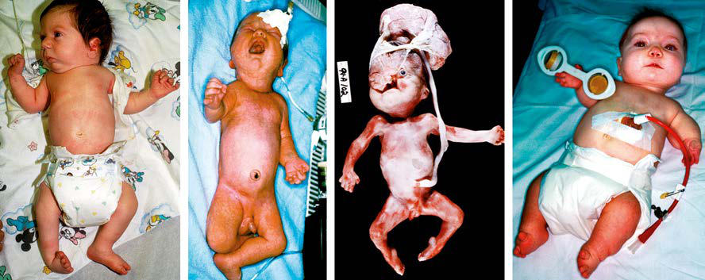

# Chapter 100: Dysmorphology, Phenotyping, and Sequences — Board-Style Self-Assessment MCQs
**Part VIII: Human Genetics** | [📖 Read Wiki Chapter](../chapters/100.md) | [🃏 Chapter Flashcards](../flashcards/100_flashcards.md) | [🏠 Course Master Index](../../index.md)

Total questions: **5** *(Click "Show Answer & Rationale" beneath each question)*

### Question 1 (Clinical Pediatrics Vignette)
A pediatric patient is evaluated for the following clinical and diagnostic profile: Sequence; Single error in morphogenesis that results; in a series of subsequent defects; Pierre-Robin sequence, in which a small jaw results in glossoptosis and; cleft palate; 22q11 deletion sequence of primary fourth brachial arch and third and; fou. Which of the following conditions or syndromes is the most likely diagnosis?

- **A.** EXAMPLE (Dysmorphology, Phenotyping, and Sequences)
- **B.** PAX6 (Dysmorphology, Phenotyping, and Sequences)
- **C.** DCX (Dysmorphology, Phenotyping, and Sequences)
- **D.** PATHOGENESIS (Dysmorphology, Phenotyping, and Sequences)

<b>Show Answer & Rationale</b>

**Correct Answer: A** — EXAMPLE (Dysmorphology, Phenotyping, and Sequences)

**Rationale:** **EXAMPLE (Dysmorphology, Phenotyping, and Sequences)** is characterized by: Sequence; Single error in morphogenesis that results; in a series of subsequent defects; Pierre-Robin sequence, in which a small jaw results in glossoptosis and; cleft palate; 22q11 deletion sequence of primary fourth brachial arch and third and; fourth pharyngeal pouch defects, leading to aplasia or hypoplasia of the;.

**Why Other Options Are Incorrect:** **PAX6 (Dysmorphology, Phenotyping, and Sequences)** is incorrect (characterized by Waardenburg syndrome, type I; Autosomal dominant; Deafness; White forelock; Wide-spaced eyes; Iris h). **DCX (Dysmorphology, Phenotyping, and Sequences)** is incorrect (characterized by Aniridia; Autosomal dominant; Absent iris or iris/foveal; hypoplasia; Deleterious sequence variants ). **PATHOGENESIS (Dysmorphology, Phenotyping, and Sequences)** is incorrect (characterized by Spondylocostal dysostosis; syndrome; Mendelian; autosomal recessive; Abnormal vertebral and rib; seg).

### Question 2 (Clinical Pediatrics Vignette)
A pediatric patient is evaluated for the following clinical and diagnostic profile: Spondylocostal dysostosis; syndrome; Mendelian; autosomal recessive; Abnormal vertebral and rib; segmentation; Deleterious sequence variants in; DLL3 and other genes; Rubinstein-Taybi syndrome; Autosomal dominant; Intellectual disability; Broad thumb. Which of the following conditions or syndromes is the most likely diagnosis?

- **A.** DCX (Dysmorphology, Phenotyping, and Sequences)
- **B.** PAX3 (Dysmorphology, Phenotyping, and Sequences)
- **C.** EXAMPLE (Dysmorphology, Phenotyping, and Sequences)
- **D.** PATHOGENESIS (Dysmorphology, Phenotyping, and Sequences)

<b>Show Answer & Rationale</b>

**Correct Answer: D** — PATHOGENESIS (Dysmorphology, Phenotyping, and Sequences)

**Rationale:** **PATHOGENESIS (Dysmorphology, Phenotyping, and Sequences)** (associated with **`EP300`**) is characterized by: Spondylocostal dysostosis; syndrome; Mendelian; autosomal recessive; Abnormal vertebral and rib; segmentation; Deleterious sequence variants in; DLL3 and other genes; Rubinstein-Taybi syndrome; Autosomal dominant; Intellectual disability; Broad thumbs and halluces;; valgus deviation of these digits; Hypoplastic maxilla.

**Why Other Options Are Incorrect:** **DCX (Dysmorphology, Phenotyping, and Sequences)** is incorrect (characterized by Aniridia; Autosomal dominant; Absent iris or iris/foveal; hypoplasia; Deleterious sequence variants ). **PAX3 (Dysmorphology, Phenotyping, and Sequences)** is incorrect (characterized by Holoprosencephaly; Loss of function or; haploinsufficiency for multiple; genes; Microcephaly; SHH, m). **EXAMPLE (Dysmorphology, Phenotyping, and Sequences)** is incorrect (characterized by Sequence; Single error in morphogenesis that results; in a series of subsequent defects; Pierre-Robi).

### Question 3 (Visual Diagnosis & Clinical Spotter)

A pediatric patient undergoes evaluation for **Dysmorphology, Phenotyping, and Sequences**, yielding the clinical or diagnostic finding shown below. Which of the following best characterizes the illustrated finding?

- **A.** Malformations and Dysplasias Human anomalies and dysplasias can be caused by pathogenic gene variants, chromosome aberrations and copy number variants, envi ronmental factors, or interaction
- **B.** Sequences consist of multiple anomalies that are caused by a single event, although the sequence itself can have different etiologies.
- **C.** Some malformations are caused by deleterious sequence variants in single genes, whereas other anomalies arise because of deleterious sequence variants in multiple genes acting in combination
- **D.** Four major types of problems in morphogenesis: malformation, deformation, disruption, and dysplasia. A, Infant with campomelic dys plasia syndrome, which results in multiple anomalies caused by a

<b>Show Answer & Rationale</b>

**Correct Answer: D** — Four major types of problems in morphogenesis: malformation, deformation, disruption, and dysplasia. A, Infant with campomelic dys plasia syndrome, which results in multiple anomalies caused by a

**Rationale:** **Fig. 100.1**: Four major types of problems in morphogenesis: malformation, deformation, disruption, and dysplasia. A, Infant with campomelic dys plasia syndrome, which results in multiple anomalies caused by a pathogenic variant in SOX9. B, Infant with oligohydramnios deformation sequence caused by premature rupture of membranes from 17 weeks’ gestation until birth at 36 weeks; the infant was delivered from a persistent transverse lie. C, Fetus with early amnion rupture sequence with attachment of the placenta to the head and resultant disruption of craniofacial structures with distal limb contractures. D, Infant with diastrophic dysplasia caused by biallelic pathogenic variants in a sulfate transporter protein. (From Graham Jr JM. Smith’s Recognizable Patterns of Human Deformation, 3rd ed. Philadelphia: Saunders; 2007, Fig. 1-1, p. 4.)

### Question 4 (Differential Diagnosis (Dysmorphology, Phenotyping, and Sequences))
During a pediatric consultation regarding **Dysmorphology, Phenotyping, and Sequences**, which clinical entity or concept is described by the following profile? "Birth defects can be subdivided into isolated (single) defects or multiple defects, typically described as multiple congenital anomalies (MCAs)."

- **A.** Management and Counseling
- **B.** CLASSIFICATION OF BIRTH DEFECTS
- **C.** Down syndrome
- **D.** DCX (Dysmorphology, Phenotyping, and Sequences)

<b>Show Answer & Rationale</b>

**Correct Answer: B** — CLASSIFICATION OF BIRTH DEFECTS

**Rationale:** CLASSIFICATION OF BIRTH DEFECTS Birth defects can be subdivided into isolated (single) defects or multiple defects, typically described as multiple congenital anomalies (MCAs).

### Question 5 (Pediatric Board Mastery (Dysmorphology, Phenotyping, and Sequences))
When formulating an evidence-based diagnostic and management plan for **Dysmorphology, Phenotyping, and Sequences** (*Part VIII: Human Genetics*), which of the following pediatric clinical statements is **ACCURATE**? (Item 1)

- **A.** Clinical manifestations are permanently restricted to late adulthood and never present during infancy, childhood, or adolescence.
- **B.** Diagnostic confirmation relies solely on plain skull radiographs without biochemical, microbiologic, or clinical correlation.
- **C.** Systemic tetracyclines and fluoroquinolones are universally required as routine prophylaxis in all healthy newborns.
- **D.** Sequences consist of multiple anomalies that are caused by a single event, although the sequence itself can have different etiologies.

<b>Show Answer & Rationale</b>

**Correct Answer: D** — Sequences consist of multiple anomalies that are caused by a single event, although the sequence itself can have different etiologies.

**Rationale:** **Pediatric Clinical Principle (Dysmorphology, Phenotyping, and Sequences):** Sequences consist of multiple anomalies that are caused by a single event, although the sequence itself can have different etiologies.

