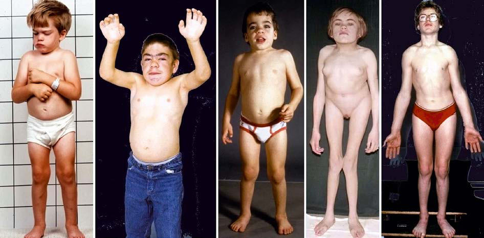

# Chapter 109: Mucopolysaccharidoses — Board-Style Self-Assessment MCQs
**Part IX: Metabolic Disorders** | [📖 Read Wiki Chapter](../chapters/109.md) | [🃏 Chapter Flashcards](../flashcards/109_flashcards.md) | [🏠 Course Master Index](../../index.md)

Total questions: **5** *(Click "Show Answer & Rationale" beneath each question)*

### Question 1 (Visual Diagnosis & Clinical Spotter)

A pediatric patient undergoes evaluation for **Mucopolysaccharidoses**, yielding the clinical or diagnostic finding shown below. Which of the following best characterizes the illustrated finding?

- **A.** In the United States the most common subtype is MPS-III, followed by MPS-I and MPS-II.
- **B.** reduced rate of progression. Adult height may exceed 150 cm. Airway involvement, valvular cardiac disease, hearing impairment, carpal tun nel syndrome, and joint stiffness are common and can resu
- **C.** Mucopolysaccharidoses are autosomal recessive disorders, with the exception of Hunter disease (Hunter syndrome), which is X-linked recessive.
- **D.** CLINICAL ENTITIES Mucopolysaccharidosis I Mucopolysaccharidosis I (MPS-I) is caused by pathogenic variants of the IUA gene on chromosome 4p16.3 encoding α-l-iduronidase.

<b>Show Answer & Rationale</b>

**Correct Answer: B** — reduced rate of progression. Adult height may exceed 150 cm. Airway involvement, valvular cardiac disease, hearing impairment, carpal tun nel syndrome, and joint stiffness are common and can resu

**Rationale:** **Fig. 109.1**: reduced rate of progression. Adult height may exceed 150 cm. Airway involvement, valvular cardiac disease, hearing impairment, carpal tun nel syndrome, and joint stiffness are common and can result in signifi cant loss of function in both t

### Question 2 (Differential Diagnosis (Mucopolysaccharidoses))
During a pediatric consultation regarding **Mucopolysaccharidoses**, which clinical entity or concept is described by the following profile? "(Hunter syndrome), which is X-linked recessive."

- **A.** Hurler Disease
- **B.** Hunter disease
- **C.** Hurler-Scheie Disease
- **D.** Mucopolysaccharidosis IV Morquio disease

<b>Show Answer & Rationale</b>

**Correct Answer: B** — Hunter disease

**Rationale:** Hunter disease (Hunter syndrome), which is X-linked recessive.

### Question 3 (Differential Diagnosis (Mucopolysaccharidoses))
During a pediatric consultation regarding **Mucopolysaccharidoses**, which clinical entity or concept is described by the following profile? "Mucopolysaccharidosis I (MPS-I) is caused by pathogenic variants of the IUA gene on chromosome 4p16."

- **A.** Hurler-Scheie Disease
- **B.** DIAGNOSIS AND DIFFERENTIAL DIAGNOSIS
- **C.** CLINICAL ENTITIES Mucopolysaccharidosis I
- **D.** Mucopolysaccharidosis VI

<b>Show Answer & Rationale</b>

**Correct Answer: C** — CLINICAL ENTITIES Mucopolysaccharidosis I

**Rationale:** CLINICAL ENTITIES Mucopolysaccharidosis I Mucopolysaccharidosis I (MPS-I) is caused by pathogenic variants of the IUA gene on chromosome 4p16.

### Question 4 (Pediatric Board Mastery (Mucopolysaccharidoses))
When formulating an evidence-based diagnostic and management plan for **Mucopolysaccharidoses** (*Part IX: Metabolic Disorders*), which of the following pediatric clinical statements is **ACCURATE**? (Item 1)

- **A.** Diagnostic confirmation relies solely on plain skull radiographs without biochemical, microbiologic, or clinical correlation.
- **B.** Mucopolysaccharidoses are autosomal recessive disorders, with the exception of Hunter disease (Hunter syndrome), which is X-linked recessive.
- **C.** Systemic tetracyclines and fluoroquinolones are universally required as routine prophylaxis in all healthy newborns.
- **D.** First-line management relies on immediate high-dose aspirin therapy in febrile infants.

<b>Show Answer & Rationale</b>

**Correct Answer: B** — Mucopolysaccharidoses are autosomal recessive disorders, with the exception of Hunter disease (Hunter syndrome), which is X-linked recessive.

**Rationale:** **Pediatric Clinical Principle (Mucopolysaccharidoses):** Mucopolysaccharidoses are autosomal recessive disorders, with the exception of Hunter disease (Hunter syndrome), which is X-linked recessive.

### Question 5 (Pediatric Board Mastery (Mucopolysaccharidoses))
When formulating an evidence-based diagnostic and management plan for **Mucopolysaccharidoses** (*Part IX: Metabolic Disorders*), which of the following pediatric clinical statements is **ACCURATE**? (Item 2)

- **A.** In the United States the most common subtype is MPS-III, followed by MPS-I and MPS-II.
- **B.** Systemic tetracyclines and fluoroquinolones are universally required as routine prophylaxis in all healthy newborns.
- **C.** Clinical manifestations are permanently restricted to late adulthood and never present during infancy, childhood, or adolescence.
- **D.** The condition is an entirely benign physiologic variant that never warrants laboratory or clinical evaluation.

<b>Show Answer & Rationale</b>

**Correct Answer: A** — In the United States the most common subtype is MPS-III, followed by MPS-I and MPS-II.

**Rationale:** **Pediatric Clinical Principle (Mucopolysaccharidoses):** In the United States the most common subtype is MPS-III, followed by MPS-I and MPS-II.

