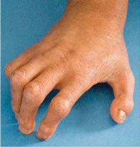

# Chapter 111: Hutchinson-Gilford Progeria Syndrome (Progeria) — Board-Style Self-Assessment MCQs
**Part IX: Metabolic Disorders** | [📖 Read Wiki Chapter](../chapters/111.md) | [🃏 Chapter Flashcards](../flashcards/111_flashcards.md) | [🏠 Course Master Index](../../index.md)

Total questions: **5** *(Click "Show Answer & Rationale" beneath each question)*

### Question 1 (Clinical Pediatrics Vignette)
A pediatric patient is evaluated for the following clinical and diagnostic profile: Hutchinson-Gilford; progeria syndrome. Which of the following conditions or syndromes is the most likely diagnosis?

- **A.** CSB (ERCC6) (Hutchinson-Gilford Progeria Syndrome (Progeria))
- **B.** MAIN CLINICAL FEATURES
- **C.** POLR3A (Hutchinson-Gilford Progeria Syndrome (Progeria))
- **D.** (NGPS) (Hutchinson-Gilford Progeria Syndrome (Progeria))

<b>Show Answer & Rationale</b>

**Correct Answer: B** — MAIN CLINICAL FEATURES

**Rationale:** **MAIN CLINICAL FEATURES** is characterized by: Hutchinson-Gilford; progeria syndrome.

**Why Other Options Are Incorrect:** **CSB (ERCC6) (Hutchinson-Gilford Progeria Syndrome (Progeria))** is incorrect (characterized by Neonatal/; infancy; Skin and dental abnormalities, subcutaneous fat loss, short; stature, vasculopat). **POLR3A (Hutchinson-Gilford Progeria Syndrome (Progeria))** is incorrect (characterized by Neonatal; Severe prenatal and postnatal growth restriction, facial; dysmorphism, generalized lipodys). **(NGPS) (Hutchinson-Gilford Progeria Syndrome (Progeria))** is incorrect (characterized by BANF1: recessive pathogenic; variant (c.34G>A; p.Ala12Thr); Early childhood; Failure to thrive, aged).

### Question 2 (Clinical Pediatrics Vignette)
A pediatric patient is evaluated for the following clinical and diagnostic profile: the causative gene: de novo dominant point; pathogenic variant (c.1824C>T;; p.G608G or pathogenic variants; in first five intronic bases of intron; 11); Early childhood; Severe failure to thrive in infancy, progressive alopecia leading; to total alop. Which of the following conditions or syndromes is the most likely diagnosis?

- **A.** (HGPS) (Hutchinson-Gilford Progeria Syndrome (Progeria))
- **B.** (RD) (Hutchinson-Gilford Progeria Syndrome (Progeria))
- **C.** (NGPS) (Hutchinson-Gilford Progeria Syndrome (Progeria))
- **D.** MAIN CLINICAL FEATURES

<b>Show Answer & Rationale</b>

**Correct Answer: A** — (HGPS) (Hutchinson-Gilford Progeria Syndrome (Progeria))

**Rationale:** **(HGPS) (Hutchinson-Gilford Progeria Syndrome (Progeria))** (associated with **`LMNA`**) is characterized by: LMNA: de novo dominant point; pathogenic variant (c.1824C>T;; p.G608G or pathogenic variants; in first five intronic bases of intron; 11); Early childhood; Severe failure to thrive in infancy, progressive alopecia leading; to total alopecia, skin lesions, characteristic facies, loss of; subcutaneous fat, bone changes, .

**Why Other Options Are Incorrect:** **(RD) (Hutchinson-Gilford Progeria Syndrome (Progeria))** is incorrect (characterized by ZMPSTE24: recessive null; pathogenic variants; Neonatal; Intrauterine growth restriction, reduced fe). **(NGPS) (Hutchinson-Gilford Progeria Syndrome (Progeria))** is incorrect (characterized by BANF1: recessive pathogenic; variant (c.34G>A; p.Ala12Thr); Early childhood; Failure to thrive, aged). **MAIN CLINICAL FEATURES** is incorrect (characterized by Hutchinson-Gilford; progeria syndrome).

### Question 3 (Visual Diagnosis & Clinical Spotter)

A pediatric patient undergoes evaluation for **Hutchinson-Gilford Progeria Syndrome (Progeria)**, yielding the clinical or diagnostic finding shown below. Which of the following best characterizes the illustrated finding?

- **A.** The most common clinical features are shown in the top row.
- **B.** Distinguishing clinical features in Hutchinson-Gilford progeria syndrome. A, Alopecia, prominent scalp veins, narrowed nasal bridge, retrognathia. B, Generalized lipoatrophy leaves muscular promi
- **C.** Progeria is caused by a single-base pathogenic variant in the LMNA gene, which results in the production of an abnormal lamin A protein called progerin.
- **D.** Hutchinson-Gilford progeria syndrome (HGPS, or progeria) is a rare, fatal, autosomal dominant segmental premature aging disease.

<b>Show Answer & Rationale</b>

**Correct Answer: B** — Distinguishing clinical features in Hutchinson-Gilford progeria syndrome. A, Alopecia, prominent scalp veins, narrowed nasal bridge, retrognathia. B, Generalized lipoatrophy leaves muscular promi

**Rationale:** **Fig. 111.1**: Distinguishing clinical features in Hutchinson-Gilford progeria syndrome. A, Alopecia, prominent scalp veins, narrowed nasal bridge, retrognathia. B, Generalized lipoatrophy leaves muscular prominence. C, Skin tightening and mottling. D, Skin bulging. E, Digital joint contractures. F, Nail dystrophy with spooning. G, Knee joint contractures, lipodystrophy. H, Corneal scarring secondary to exposure keratopathy. I, Flat umbilicus with scarred-over appearance; J, Calcinosis cutis in a digit. (Photos courtesy The Progeria Research Foundation and Boston Children’s Hospital.)

### Question 4 (Differential Diagnosis (Hutchinson-Gilford Progeria Syndrome (Progeria)))
During a pediatric consultation regarding **Hutchinson-Gilford Progeria Syndrome (Progeria)**, which clinical entity or concept is described by the following profile? "nd die of heart failure, usually between ages 5 and 20 years."

- **A.** primary vasculopathy
- **B.** AND/OR NECK (Headaches)
- **C.** premature progressive atherosclerosis
- **D.** LABORATORY FINDINGS

<b>Show Answer & Rationale</b>

**Correct Answer: C** — premature progressive atherosclerosis

**Rationale:** premature progressive atherosclerosis and die of heart failure, usually between ages 5 and 20 years.

### Question 5 (Pediatric Board Mastery (Hutchinson-Gilford Progeria Syndrome (Progeria)))
When formulating an evidence-based diagnostic and management plan for **Hutchinson-Gilford Progeria Syndrome (Progeria)** (*Part IX: Metabolic Disorders*), which of the following pediatric clinical statements is **ACCURATE**? (Item 1)

- **A.** The most common clinical features are shown in the top row.
- **B.** Systemic tetracyclines and fluoroquinolones are universally required as routine prophylaxis in all healthy newborns.
- **C.** Inheritance is exclusively holandric (Y-linked) with 100% penetrance restricted to male neonates.
- **D.** First-line management relies on immediate high-dose aspirin therapy in febrile infants.

<b>Show Answer & Rationale</b>

**Correct Answer: A** — The most common clinical features are shown in the top row.

**Rationale:** **Pediatric Clinical Principle (Hutchinson-Gilford Progeria Syndrome (Progeria)):** The most common clinical features are shown in the top row.

