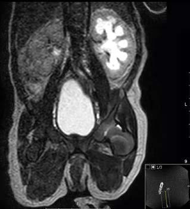

# Chapter 115: The Newborn Infant — Board-Style Self-Assessment MCQs
**Part X: The Fetus and the Neonatal Infant** | [📖 Read Wiki Chapter](../chapters/115.md) | [🃏 Chapter Flashcards](../flashcards/115_flashcards.md) | [🏠 Course Master Index](../../index.md)

Total questions: **5** *(Click "Show Answer & Rationale" beneath each question)*

### Question 1 (Clinical Pediatrics Vignette)
A pediatric patient is evaluated for the following clinical and diagnostic profile: Evidence of parental knowledge, ability, and confidence to care for; the baby at home:; Feeding; Normal stool and urine output; Cord, skin, and genital care; Recognition of illness (jaundice, poor feeding, lethargy, fever, etc.); Infant safety (car s. Which of the following conditions or syndromes is the most likely diagnosis?

- **A.** SOCIAL (The Newborn Infant)
- **B.** CONTRAINDICATED (The Newborn Infant)
- **C.** USE WITH CAUTION (The Newborn Infant)
- **D.** HTLV-2 (The Newborn Infant)

<b>Show Answer & Rationale</b>

**Correct Answer: A** — SOCIAL (The Newborn Infant)

**Rationale:** **SOCIAL (The Newborn Infant)** is characterized by: Evidence of parental knowledge, ability, and confidence to care for; the baby at home:; Feeding; Normal stool and urine output; Cord, skin, and genital care; Recognition of illness (jaundice, poor feeding, lethargy, fever, etc.); Infant safety (car seat, supine sleep position, etc.); Availability of family and physicia.

**Why Other Options Are Incorrect:** **CONTRAINDICATED (The Newborn Infant)** is incorrect (characterized by Amphetamines; Antineoplastic agents; Bromocriptine; Chloramphenicol; Clozapine; Cocaine; Cyclophosph). **USE WITH CAUTION (The Newborn Infant)** is incorrect (characterized by Alcohol; Amiodarone; Anthraquinones (laxatives); Aspirin (salicylates); Atropine; β-Adrenergic block). **HTLV-2 (The Newborn Infant)** is incorrect (characterized by Yes; Uncertain; Yes, developed countries; Herpes simplex virus; Yes; Yes; No, unless breast vesicles).

### Question 2 (Clinical Pediatrics Vignette)
A pediatric patient is evaluated for the following clinical and diagnostic profile: Amphetamines; Antineoplastic agents; Bromocriptine; Chloramphenicol; Clozapine; Cocaine; Cyclophosphamide; Doxorubicin; Ecstasy (MDMA); Ergots; Gold salts; Heroin; Immunosuppressants; Methamphetamine; Phencyclidine (PCP); Radiopharmaceuticals; Thiour. Which of the following conditions or syndromes is the most likely diagnosis?

- **A.** BACTERIA (The Newborn Infant)
- **B.** HTLV-2 (The Newborn Infant)
- **C.** USE WITH CAUTION (The Newborn Infant)
- **D.** CONTRAINDICATED (The Newborn Infant)

<b>Show Answer & Rationale</b>

**Correct Answer: D** — CONTRAINDICATED (The Newborn Infant)

**Rationale:** **CONTRAINDICATED (The Newborn Infant)** is characterized by: Amphetamines; Antineoplastic agents; Bromocriptine; Chloramphenicol; Clozapine; Cocaine; Cyclophosphamide; Doxorubicin; Ecstasy (MDMA); Ergots; Gold salts; Heroin; Immunosuppressants; Methamphetamine; Phencyclidine (PCP); Radiopharmaceuticals; Thiouracil.

**Why Other Options Are Incorrect:** **BACTERIA (The Newborn Infant)** is incorrect (characterized by Mastitis/Staphylococcus aureus; Yes; No; No, unless breast abscess present; Mycobacterium tuberculos). **HTLV-2 (The Newborn Infant)** is incorrect (characterized by Yes; Uncertain; Yes, developed countries; Herpes simplex virus; Yes; Yes; No, unless breast vesicles). **USE WITH CAUTION (The Newborn Infant)** is incorrect (characterized by Alcohol; Amiodarone; Anthraquinones (laxatives); Aspirin (salicylates); Atropine; β-Adrenergic block).

### Question 3 (Visual Diagnosis & Clinical Spotter)

A pediatric patient undergoes evaluation for **The Newborn Infant**, yielding the clinical or diagnostic finding shown below. Which of the following best characterizes the illustrated finding?

- **A.** Mottling is seen in cutis marmorata, which is characterized by reticular mottling of the trunk and extremities and associated with hypothermia.
- **B.** History should include the following information to guide evaluation and management in the newborn period.
- **C.** Prompt identification and diagnosis can lead to rapid reassurance for families, or further workup for pathophysiology.
- **D.** Nomogram for mean blood pressure (BP) in neonates with gestational ages of 23-43 wk. Derived from continuous arterial BP measurements obtained from 103 infants admitted to the neonatal in tensive

<b>Show Answer & Rationale</b>

**Correct Answer: D** — Nomogram for mean blood pressure (BP) in neonates with gestational ages of 23-43 wk. Derived from continuous arterial BP measurements obtained from 103 infants admitted to the neonatal in tensive

**Rationale:** **Fig. 115.2**: Nomogram for mean blood pressure (BP) in neonates with gestational ages of 23-43 wk. Derived from continuous arterial BP measurements obtained from 103 infants admitted to the neonatal in tensive care unit. The graph shows the predicted mean BP of neonates of different gestational ages during the first 72 hours of life. Each line represents the lower limit of the 80% confidence interval (two-tail) of the mean BP for each gestational age-group; 90% of infants for each gestational age-group will be expected to have a mean BP value equal to or greater than the value indicated by the corresponding line, the lower limit of the confidence interval. (From Nuntnarumit P, Yang W, Bada-Ellzey SB. Blood pressure measurements in the newborn. Clin Perinatol. 1999;26:976–996.)

### Question 4 (Differential Diagnosis (115.2 Physical Examination of the Newborn Infant Joanna J. Parga-Belinkie))
During a pediatric consultation regarding **The Newborn Infant**, which clinical entity or concept is described by the following profile? "of a newborn infant should be performed as soon as possible after delivery."

- **A.** initial examination
- **B.** PRETRANSPLANTATION EXPOSURES (NOT LISTED ABOVE)
- **C.** delayed cord clamping
- **D.** Apgar score

<b>Show Answer & Rationale</b>

**Correct Answer: A** — initial examination

**Rationale:** initial examination of a newborn infant should be performed as soon as possible after delivery.

### Question 5 (Pediatric Board Mastery (The Newborn Infant))
When formulating an evidence-based diagnostic and management plan for **The Newborn Infant** (*Part X: The Fetus and the Neonatal Infant*), which of the following pediatric clinical statements is **ACCURATE**? (Item 1)

- **A.** First-line management relies on immediate high-dose aspirin therapy in febrile infants.
- **B.** Clinical manifestations are permanently restricted to late adulthood and never present during infancy, childhood, or adolescence.
- **C.** History should include the following information to guide evaluation and management in the newborn period.
- **D.** Diagnostic confirmation relies solely on plain skull radiographs without biochemical, microbiologic, or clinical correlation.

<b>Show Answer & Rationale</b>

**Correct Answer: C** — History should include the following information to guide evaluation and management in the newborn period.

**Rationale:** **Pediatric Clinical Principle (The Newborn Infant):** History should include the following information to guide evaluation and management in the newborn period.

