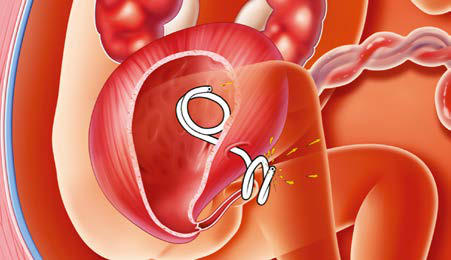

# Chapter 118: Fetal Intervention and Surgery — Board-Style Self-Assessment MCQs
**Part X: The Fetus and the Neonatal Infant** | [📖 Read Wiki Chapter](../chapters/118.md) | [🃏 Chapter Flashcards](../flashcards/118_flashcards.md) | [🏠 Course Master Index](../../index.md)

Total questions: **5** *(Click "Show Answer & Rationale" beneath each question)*

### Question 1 (Clinical Pediatrics Vignette)
A pediatric patient is evaluated for the following clinical and diagnostic profile: 1. Congenital diaphragmatic; hernia; Pulmonary hypoplasia and anatomic substrate for; pulmonary hypertension; Reversal of pulmonary hypoplasia and reduced degree; of pulmonary hypertension; Repair of actual defect delayed until after birth; 2. Lower . Which of the following conditions or syndromes is the most likely diagnosis?

- **A.** PROGNOSTIC UNCERTAINTY/BEST INTEREST
- **B.** DIAGNOSTIC CERTAINTY/PROGNOSTIC CERTAINTY
- **C.** SURGERY ON THE PLACENTA, CORD, OR MEMBRANES
- **D.** SURGERY ON THE FETUS

<b>Show Answer & Rationale</b>

**Correct Answer: D** — SURGERY ON THE FETUS

**Rationale:** **SURGERY ON THE FETUS** is characterized by: 1. Congenital diaphragmatic; hernia; Pulmonary hypoplasia and anatomic substrate for; pulmonary hypertension; Reversal of pulmonary hypoplasia and reduced degree; of pulmonary hypertension; Repair of actual defect delayed until after birth; 2. Lower urinary tract; obstruction; Progressive renal damage due to obstructiv.

**Why Other Options Are Incorrect:** **PROGNOSTIC UNCERTAINTY/BEST INTEREST** is incorrect (characterized by Genetic problems; Errors of metabolism that are expected to be lethal even with available therapy; M). **DIAGNOSTIC CERTAINTY/PROGNOSTIC CERTAINTY** is incorrect (characterized by Genetic problems; Trisomy 13, 15, or 18; Triploidy; Central nervous system abnormalities; Anencephal). **SURGERY ON THE PLACENTA, CORD, OR MEMBRANES** is incorrect (characterized by 7. Chorioangioma; High-output cardiac failure due to AV shunting; Effects of polyhydramnios; Reversa).

### Question 2 (Clinical Pediatrics Vignette)
A pediatric patient is evaluated for the following clinical and diagnostic profile: 7. Chorioangioma; High-output cardiac failure due to AV shunting; Effects of polyhydramnios; Reversal of process of cardiac failure and hydrops; fetoplacentalis by ablation or reduction of flow; 8. Amniotic bands; Progressive constrictions causing ir. Which of the following conditions or syndromes is the most likely diagnosis?

- **A.** SURGERY ON THE FETUS
- **B.** DIAGNOSTIC CERTAINTY/PROGNOSTIC CERTAINTY
- **C.** SURGERY ON THE PLACENTA, CORD, OR MEMBRANES
- **D.** PROGNOSTIC UNCERTAINTY/BEST INTEREST

<b>Show Answer & Rationale</b>

**Correct Answer: C** — SURGERY ON THE PLACENTA, CORD, OR MEMBRANES

**Rationale:** **SURGERY ON THE PLACENTA, CORD, OR MEMBRANES** is characterized by: 7. Chorioangioma; High-output cardiac failure due to AV shunting; Effects of polyhydramnios; Reversal of process of cardiac failure and hydrops; fetoplacentalis by ablation or reduction of flow; 8. Amniotic bands; Progressive constrictions causing irreversible; neurologic or vascular damage; Prevention of amniotic band.

**Why Other Options Are Incorrect:** **SURGERY ON THE FETUS** is incorrect (characterized by 1. Congenital diaphragmatic; hernia; Pulmonary hypoplasia and anatomic substrate for; pulmonary hype). **DIAGNOSTIC CERTAINTY/PROGNOSTIC CERTAINTY** is incorrect (characterized by Genetic problems; Trisomy 13, 15, or 18; Triploidy; Central nervous system abnormalities; Anencephal). **PROGNOSTIC UNCERTAINTY/BEST INTEREST** is incorrect (characterized by Genetic problems; Errors of metabolism that are expected to be lethal even with available therapy; M).

### Question 3 (Visual Diagnosis & Clinical Spotter)

A pediatric patient undergoes evaluation for **Fetal Intervention and Surgery**, yielding the clinical or diagnostic finding shown below. Which of the following best characterizes the illustrated finding?

- **A.** Because the neural tube closes within the first 28 days of con ception, periconceptional supplementation is needed for prevention.
- **B.** Management of a fetal disease depends on coordinated advances in diagnostic accuracy and knowledge of the disease’s natural history; an understanding of fetal nutrition, pharmacology, immuno
- **C.** Ultrasound image showing fetoscopic placement of a transurethral vesicoamniotic shunt in a patient with posterior urethral valves. (Courtesy Dr. Foong Lim, Cincinnati Fetal Center at Cincinnati C
- **D.** Management of definitively diagnosed fetal genetic disease or congenital anomalies consists of multidisciplinary parental counseling.

<b>Show Answer & Rationale</b>

**Correct Answer: C** — Ultrasound image showing fetoscopic placement of a transurethral vesicoamniotic shunt in a patient with posterior urethral valves. (Courtesy Dr. Foong Lim, Cincinnati Fetal Center at Cincinnati C

**Rationale:** **Fig. 118.1**: Ultrasound image showing fetoscopic placement of a transurethral vesicoamniotic shunt in a patient with posterior urethral valves. (Courtesy Dr. Foong Lim, Cincinnati Fetal Center at Cincinnati Children’s Hospital Medical Center.)

### Question 4 (Differential Diagnosis (Fetal Intervention and Surgery))
During a pediatric consultation regarding **Fetal Intervention and Surgery**, which clinical entity or concept is described by the following profile? "may be accurately detected by fetal Doppler assessment of the peak systolic velocity of the middle cerebral artery and treated with intrauterine transfusions of packed Rh-negative blood cells via the intraperitoneal or, more often, intraumbilical vein approach."

- **A.** BLOOD LOSS (Anemia in the Newborn Infant)
- **B.** Folic acid supplementation
- **C.** Fetal erythroblastosis
- **D.** DIAGNOSTIC CERTAINTY/PROGNOSTIC CERTAINTY

<b>Show Answer & Rationale</b>

**Correct Answer: C** — Fetal erythroblastosis

**Rationale:** Fetal erythroblastosis may be accurately detected by fetal Doppler assessment of the peak systolic velocity of the middle cerebral artery and treated with intrauterine transfusions of packed Rh-negative blood cells via the intraperitoneal or, more often, intraumbilical vein approach.

### Question 5 (Pediatric Board Mastery (Fetal Intervention and Surgery))
When formulating an evidence-based diagnostic and management plan for **Fetal Intervention and Surgery** (*Part X: The Fetus and the Neonatal Infant*), which of the following pediatric clinical statements is **ACCURATE**? (Item 1)

- **A.** Management of a fetal disease depends on coordinated advances in diagnostic accuracy and knowledge of the disease’s natural history; an understanding of fetal nutrition, pharmacology, immunology, and patho
- **B.** Systemic tetracyclines and fluoroquinolones are universally required as routine prophylaxis in all healthy newborns.
- **C.** Clinical manifestations are permanently restricted to late adulthood and never present during infancy, childhood, or adolescence.
- **D.** Inheritance is exclusively holandric (Y-linked) with 100% penetrance restricted to male neonates.

<b>Show Answer & Rationale</b>

**Correct Answer: A** — Management of a fetal disease depends on coordinated advances in diagnostic accuracy and knowledge of the disease’s natural history; an understanding of fetal nutrition, pharmacology, immunology, and patho

**Rationale:** **Pediatric Clinical Principle (Fetal Intervention and Surgery):** Management of a fetal disease depends on coordinated advances in diagnostic accuracy and knowledge of the disease’s natural history; an understanding of fetal nutrition, pharmacology, immunology, and pathophysiology; the availability of specific active drugs that cross the placenta; and therapeutic procedures.

