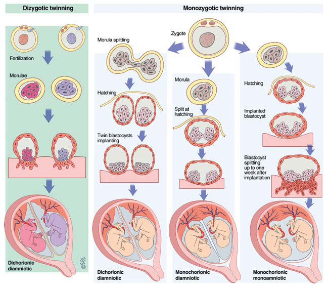

# Chapter 119: The High-Risk Infant — Board-Style Self-Assessment MCQs
**Part X: The Fetus and the Neonatal Infant** | [📖 Read Wiki Chapter](../chapters/119.md) | [🃏 Chapter Flashcards](../flashcards/119_flashcards.md) | [🏠 Course Master Index](../../index.md)

Total questions: **5** *(Click "Show Answer & Rationale" beneath each question)*

### Question 1 (Clinical Pediatrics Vignette)
A pediatric patient is evaluated for the following clinical and diagnostic profile: Maternal age 40 yr; Environmental, economic, social disadvantage, racial discrimination. Which of the following conditions or syndromes is the most likely diagnosis?

- **A.** NEONATE (The High-Risk Infant)
- **B.** BIRTH PARENT DEMOGRAPHIC FACTORS
- **C.** PRESENT PREGNANCY (The High-Risk Infant)
- **D.** BIRTH PARENT MEDICAL HISTORY

<b>Show Answer & Rationale</b>

**Correct Answer: B** — BIRTH PARENT DEMOGRAPHIC FACTORS

**Rationale:** **BIRTH PARENT DEMOGRAPHIC FACTORS** is characterized by: Maternal age 40 yr; Environmental, economic, social disadvantage, racial discrimination.

**Why Other Options Are Incorrect:** **NEONATE (The High-Risk Infant)** is incorrect (characterized by Birthweight 4,000 g; Birth <37 wk or ≥42 wk of gestation; Small or large for gestational age; Respir). **PRESENT PREGNANCY (The High-Risk Infant)** is incorrect (characterized by Vaginal bleeding (abruptio placentae, placenta previa); Sexually transmitted infections (colonizatio). **BIRTH PARENT MEDICAL HISTORY** is incorrect (characterized by Genetic disorders; Diabetes mellitus; Hypertension; Asymptomatic bacteriuria; Rheumatologic illness ).

### Question 2 (Clinical Pediatrics Vignette)
A pediatric patient is evaluated for the following clinical and diagnostic profile: Genetic disorders; Diabetes mellitus; Hypertension; Asymptomatic bacteriuria; Rheumatologic illness (systemic lupus erythematosus); Immune-mediated diseases; Long-term medication. Which of the following conditions or syndromes is the most likely diagnosis?

- **A.** BIRTH PARENT MEDICAL HISTORY
- **B.** PREVIOUS PREGNANCY
- **C.** PRESENT PREGNANCY (The High-Risk Infant)
- **D.** LABOR AND DELIVERY

<b>Show Answer & Rationale</b>

**Correct Answer: A** — BIRTH PARENT MEDICAL HISTORY

**Rationale:** **BIRTH PARENT MEDICAL HISTORY** is characterized by: Genetic disorders; Diabetes mellitus; Hypertension; Asymptomatic bacteriuria; Rheumatologic illness (systemic lupus erythematosus); Immune-mediated diseases; Long-term medication.

**Why Other Options Are Incorrect:** **PREVIOUS PREGNANCY** is incorrect (characterized by Intrauterine fetal demise; Neonatal death; Prematurity; Intrauterine growth restriction; Congenital ). **PRESENT PREGNANCY (The High-Risk Infant)** is incorrect (characterized by Vaginal bleeding (abruptio placentae, placenta previa); Sexually transmitted infections (colonizatio). **LABOR AND DELIVERY** is incorrect (characterized by Premature labor (<37 wk); Postdates pregnancy (≥42 wk); Fetal distress; Breech presentation; Meconiu).

### Question 3 (Visual Diagnosis & Clinical Spotter)

A pediatric patient undergoes evaluation for **The High-Risk Infant**, yielding the clinical or diagnostic finding shown below. Which of the following best characterizes the illustrated finding?

- **A.** In the classic fission theory, twinning results from the splitting of a single conceptus, with the timing of splitting resulting in differing amnionicity and chorionicity (i.e., the earlier
- **B.** The prognosis for symmetrically conjoined twins depends on the possibility of surgical separation, which in turn depends on the extent to which vital organs are shared.
- **C.** Classical fission theory of twinning. Dizy gotic twins result from two distinct fertilization events, with dichorionic diamniotic twins each developing to become a genetically distinct individual
- **D.** Diagnosis A prenatal diagnosis of pregnancy with twins is suggested by a uterine size that is greater than that expected for gestational age, auscultation of two fetal heartbeats, and/or ele

<b>Show Answer & Rationale</b>

**Correct Answer: C** — Classical fission theory of twinning. Dizy gotic twins result from two distinct fertilization events, with dichorionic diamniotic twins each developing to become a genetically distinct individual

**Rationale:** **Fig. 119.2**: Classical fission theory of twinning. Dizy gotic twins result from two distinct fertilization events, with dichorionic diamniotic twins each developing to become a genetically distinct individual. Monozygotic twins result from postzygotic splitting of the product of a single fertilization event. Splitting on days 1-3 (up to the morula stage) results in dichorionic diamniotic twins, on days 3-8 (during which blastocyst hatching occurs) in monochorionic diamniotic twins, on days 8-13 in mono chorionic monoamniotic twins. (Illustration copyright LeventEfe, CMI. www.leventefe.com.au.)

### Question 4 (Differential Diagnosis (The High-Risk Infant))
During a pediatric consultation regarding **The High-Risk Infant**, which clinical entity or concept is described by the following profile? "of neonatal and infant mortality occurs in infants with birthweight <1,000 g and/or with gestational age <28 weeks."

- **A.** diamniotic
- **B.** MODERATE PRETERM INFANT
- **C.** BIRTH PARENT DEMOGRAPHIC FACTORS
- **D.** highest risk

<b>Show Answer & Rationale</b>

**Correct Answer: D** — highest risk

**Rationale:** highest risk of neonatal and infant mortality occurs in infants with birthweight <1,000 g and/or with gestational age <28 weeks.

### Question 5 (Pediatric Board Mastery (The High-Risk Infant))
When formulating an evidence-based diagnostic and management plan for **The High-Risk Infant** (*Part X: The Fetus and the Neonatal Infant*), which of the following pediatric clinical statements is **ACCURATE**? (Item 1)

- **A.** Diagnostic confirmation relies solely on plain skull radiographs without biochemical, microbiologic, or clinical correlation.
- **B.** Clinical manifestations are permanently restricted to late adulthood and never present during infancy, childhood, or adolescence.
- **C.** In the classic fission theory, twinning results from the splitting of a single conceptus, with the timing of splitting resulting in differing amnionicity and chorionicity (i.e., the earlier the fission occ
- **D.** First-line management relies on immediate high-dose aspirin therapy in febrile infants.

<b>Show Answer & Rationale</b>

**Correct Answer: C** — In the classic fission theory, twinning results from the splitting of a single conceptus, with the timing of splitting resulting in differing amnionicity and chorionicity (i.e., the earlier the fission occ

**Rationale:** **Pediatric Clinical Principle (The High-Risk Infant):** In the classic fission theory, twinning results from the splitting of a single conceptus, with the timing of splitting resulting in differing amnionicity and chorionicity (i.e., the earlier the fission occurs, the more likely the twins are to be diamniotic dicho rionic).

