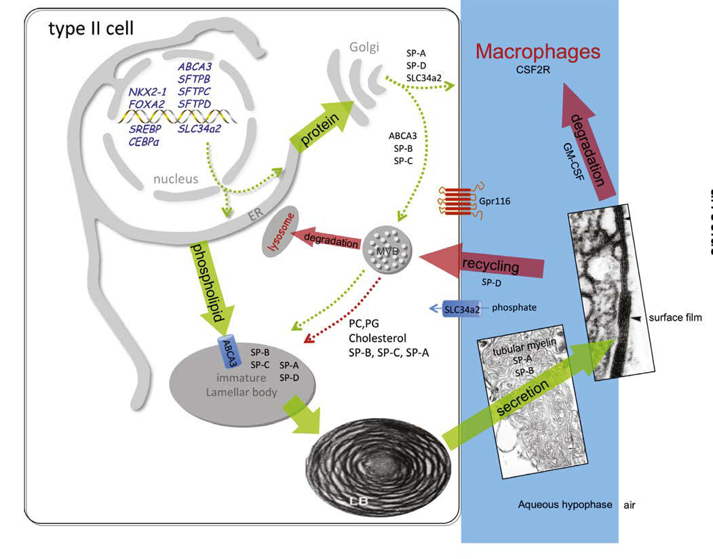

# Chapter 126: Respiratory Distress Syndrome (Hyaline Membrane Disease) — Board-Style Self-Assessment MCQs
**Part X: The Fetus and the Neonatal Infant** | [📖 Read Wiki Chapter](../chapters/126.md) | [🃏 Chapter Flashcards](../flashcards/126_flashcards.md) | [🏠 Course Master Index](../../index.md)

Total questions: **5** *(Click "Show Answer & Rationale" beneath each question)*

### Question 1 (Clinical Pediatrics Vignette)
A pediatric patient is evaluated for the following clinical and diagnostic profile: Ductal characteristics; PDA size (small 2 mm) and flow; direction (left to right, right; to left, or bidirectional) and; Doppler assessment with; maximum velocity (Vmax) in; systole and end-diastole; Assessment of pulmonary over; circulation; Dilated. Which of the following conditions or syndromes is the most likely diagnosis?

- **A.** Respiratory Distress Syndrome (Hyaline Membrane Disease)
- **B.** PREVENTION (Arthropod Bites and Infestations)
- **C.** HIV (Multisystem Disease Associated with Hematuria)
- **D.** HEMODYNAMIC EVALUATION

<b>Show Answer & Rationale</b>

**Correct Answer: D** — HEMODYNAMIC EVALUATION

**Rationale:** **HEMODYNAMIC EVALUATION** is characterized by: Ductal characteristics; PDA size (small 2 mm) and flow; direction (left to right, right; to left, or bidirectional) and; Doppler assessment with; maximum velocity (Vmax) in; systole and end-diastole; Assessment of pulmonary over; circulation; Dilated left side of the heart on; visual inspection “eyeballing”; and LA/Ao .

**Why Other Options Are Incorrect:** **Respiratory Distress Syndrome (Hyaline Membrane Disease)** is incorrect (characterized by Progressive injury to epithelial and endothe lial cells results from atelectasis (atelectrauma), vol). **PREVENTION (Arthropod Bites and Infestations)** is incorrect (characterized by • Carefully examine secondhand furniture to assure the absence of; bed bugs before purchase so as no). **HIV (Multisystem Disease Associated with Hematuria)** is incorrect (characterized by Influenza; Human herpes virus 6; Parvovirus B19; Malaria).

### Question 2 (Clinical Pediatrics Vignette)
A pediatric patient is evaluated for the following clinical and diagnostic profile: Progressive injury to epithelial and endothe lial cells results from atelectasis (atelectrauma), volutrauma, ischemic injury, and oxygen toxicity.. Which of the following conditions or syndromes is the most likely diagnosis?

- **A.** COMMENTS (Principles of Antifungal Therapy)
- **B.** HEMODYNAMIC EVALUATION
- **C.** GENITOURINARY (Surgical Conditions of the Anus and Rectum)
- **D.** Respiratory Distress Syndrome (Hyaline Membrane Disease)

<b>Show Answer & Rationale</b>

**Correct Answer: D** — Respiratory Distress Syndrome (Hyaline Membrane Disease)

**Rationale:** **Respiratory Distress Syndrome (Hyaline Membrane Disease)** (associated with **`ABCA3, NKX2-1, SFTPB, SFTPC`**) is characterized by: Progressive injury to epithelial and endothe lial cells results from atelectasis (atelectrauma), volutrauma, ischemic injury, and oxygen toxicity..

**Why Other Options Are Incorrect:** **COMMENTS (Principles of Antifungal Therapy)** is incorrect (characterized by Amphotericin B deoxycholate). **HEMODYNAMIC EVALUATION** is incorrect (characterized by Ductal characteristics; PDA size (small 2 mm) and flow; direction (left to right, right; to left, or). **GENITOURINARY (Surgical Conditions of the Anus and Rectum)** is incorrect (characterized by Vesicoureteric reflux; Renal agenesis; Renal dysplasia; Ureteral duplication; Cryptorchidism; Hyposp).

### Question 3 (Visual Diagnosis & Clinical Spotter)

A pediatric patient undergoes evaluation for **Respiratory Distress Syndrome (Hyaline Membrane Disease)**, yielding the clinical or diagnostic finding shown below. Which of the following best characterizes the illustrated finding?

- **A.** Composition of surfactant. SP-A, Surfactant-associated protein A; SP-B, surfactant-associated protein B; SP-C, surfactant- associated protein C; SP-D, surfactant-associated protein D. (From Jobe
- **B.** The natural course of untreated RDS is characterized by progres sive worsening of cyanosis and dyspnea.
- **C.** Progressive injury to epithelial and endothe lial cells results from atelectasis (atelectrauma), volutrauma, ischemic injury, and oxygen toxicity.
- **D.** DIAGNOSIS The clinical course, chest x-ray findings, and blood gas values help establish the clinical diagnosis.

<b>Show Answer & Rationale</b>

**Correct Answer: A** — Composition of surfactant. SP-A, Surfactant-associated protein A; SP-B, surfactant-associated protein B; SP-C, surfactant- associated protein C; SP-D, surfactant-associated protein D. (From Jobe

**Rationale:** **Fig. 126.2**: Composition of surfactant. SP-A, Surfactant-associated protein A; SP-B, surfactant-associated protein B; SP-C, surfactant- associated protein C; SP-D, surfactant-associated protein D. (From Jobe AH, Ikegami M. Biology of surfactant. Clin Perinatol. 2001;28:655–669.)

### Question 4 (Differential Diagnosis (Respiratory Distress Syndrome (Hyaline Membrane Disease)))
During a pediatric consultation regarding **Respiratory Distress Syndrome (Hyaline Membrane Disease)**, which clinical entity or concept is described by the following profile? "deficiency (decreased production and secretion) is the primary cause of RDS."

- **A.** ETIOLOGY AND PATHOPHYSIOLOGY Surfactant
- **B.** PREVENTION
- **C.** HEMODYNAMIC EVALUATION
- **D.** DIAGNOSIS

<b>Show Answer & Rationale</b>

**Correct Answer: A** — ETIOLOGY AND PATHOPHYSIOLOGY Surfactant

**Rationale:** ETIOLOGY AND PATHOPHYSIOLOGY Surfactant deficiency (decreased production and secretion) is the primary cause of RDS.

### Question 5 (Pediatric Board Mastery (Respiratory Distress Syndrome (Hyaline Membrane Disease)))
When formulating an evidence-based diagnostic and management plan for **Respiratory Distress Syndrome (Hyaline Membrane Disease)** (*Part X: The Fetus and the Neonatal Infant*), which of the following pediatric clinical statements is **ACCURATE**? (Item 1)

- **A.** Inheritance is exclusively holandric (Y-linked) with 100% penetrance restricted to male neonates.
- **B.** Progressive injury to epithelial and endothe lial cells results from atelectasis (atelectrauma), volutrauma, ischemic injury, and oxygen toxicity.
- **C.** The condition is an entirely benign physiologic variant that never warrants laboratory or clinical evaluation.
- **D.** First-line management relies on immediate high-dose aspirin therapy in febrile infants.

<b>Show Answer & Rationale</b>

**Correct Answer: B** — Progressive injury to epithelial and endothe lial cells results from atelectasis (atelectrauma), volutrauma, ischemic injury, and oxygen toxicity.

**Rationale:** **Pediatric Clinical Principle (Respiratory Distress Syndrome (Hyaline Membrane Disease)):** Progressive injury to epithelial and endothe lial cells results from atelectasis (atelectrauma), volutrauma, ischemic injury, and oxygen toxicity.

