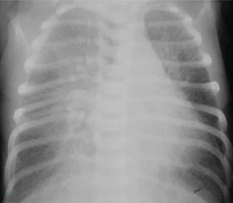

# Chapter 129: Aspiration of Foreign Material (Meconium Aspiration Syndrome, Aspiration Pneumonia) — Board-Style Self-Assessment MCQs
**Part X: The Fetus and the Neonatal Infant** | [📖 Read Wiki Chapter](../chapters/129.md) | [🃏 Chapter Flashcards](../flashcards/129_flashcards.md) | [🏠 Course Master Index](../../index.md)

Total questions: **5** *(Click "Show Answer & Rationale" beneath each question)*

### Question 1 (Visual Diagnosis & Clinical Spotter)

A pediatric patient undergoes evaluation for **Aspiration of Foreign Material (Meconium Aspiration Syndrome, Aspiration Pneumonia)**, yielding the clinical or diagnostic finding shown below. Which of the following best characterizes the illustrated finding?

- **A.** Commonly, ampicillin and an aminoglycoside (gentamicin) are used as first-line therapy with the substitution of a cephalosporin or meropenem in place of the amino glycoside when meningitis i
- **B.** Diagnosis of neonatal pneumonia includes radiographic evidence of infiltrate, and consolidation, and less often cavitation or pneu matocele.
- **C.** Chest radiograph of an infant with transient tachypnea of the newborn. No table features include increased pulmonary markings particularly in the perihilar region and fluid in the fissure. This c
- **D.** Recent ad vances in pathophysiology and management of transient tachypnea of newborn.

<b>Show Answer & Rationale</b>

**Correct Answer: C** — Chest radiograph of an infant with transient tachypnea of the newborn. No table features include increased pulmonary markings particularly in the perihilar region and fluid in the fissure. This c

**Rationale:** **Fig. 128.1**: Chest radiograph of an infant with transient tachypnea of the newborn. No table features include increased pulmonary markings particularly in the perihilar region and fluid in the fissure. This contrasts with the radiograph of an infant with respiratory distress syndrome, which generally includes a homogenous ground glass appearance and hypoinflation. (From Alhassen Z, Vali P, Gugla ni L, Lakshminrusimha S, Ryan RM. Recent ad vances in pathophysiology and management of transient tachypnea of newborn. J Perinatol. 2021;41:6–16. Fig. 5.)

### Question 2 (Differential Diagnosis (Aspiration of Foreign Material (Meconium Aspiration Syndrome, Aspiration Pneumonia)))
During a pediatric consultation regarding **Aspiration of Foreign Material (Meconium Aspiration Syndrome, Aspiration Pneumonia)**, which clinical entity or concept is described by the following profile? "With fetal distress, the fetus often initiates vigorous respiratory move ments in utero because of interference with the supply of oxygen through the placenta."

- **A.** Viral: coxsackievirus B, Epstein-Barr virus, influenza, adenovirus
- **B.** Anatomic Causes of Postpartum Aspiration
- **C.** GAIN OF FUNCTION (Hereditary Predisposition to Thrombosis)
- **D.** INTRAPARTUM ASPIRATION

<b>Show Answer & Rationale</b>

**Correct Answer: D** — INTRAPARTUM ASPIRATION

**Rationale:** INTRAPARTUM ASPIRATION With fetal distress, the fetus often initiates vigorous respiratory move ments in utero because of interference with the supply of oxygen through the placenta.

### Question 3 (Differential Diagnosis (Aspiration of Foreign Material (Meconium Aspiration Syndrome, Aspiration Pneumonia)))
During a pediatric consultation regarding **Aspiration of Foreign Material (Meconium Aspiration Syndrome, Aspiration Pneumonia)**, which clinical entity or concept is described by the following profile? "Pneumonia as a presentation of early-onset sepsis typically arises fol lowing aspiration of infected amniotic fluid."

- **A.** GENE (Disorders Involving Transmembrane Receptors)
- **B.** POSTPARTUM ASPIRATION
- **C.** SGSH (Mucopolysaccharidoses)
- **D.** Early-Onset Sepsis and Neonatal Pneumonia

<b>Show Answer & Rationale</b>

**Correct Answer: D** — Early-Onset Sepsis and Neonatal Pneumonia

**Rationale:** Early-Onset Sepsis and Neonatal Pneumonia Pneumonia as a presentation of early-onset sepsis typically arises fol lowing aspiration of infected amniotic fluid.

### Question 4 (Pediatric Board Mastery (Aspiration of Foreign Material (Meconium Aspiration Syndrome, Aspiration Pneumonia)))
When formulating an evidence-based diagnostic and management plan for **Aspiration of Foreign Material (Meconium Aspiration Syndrome, Aspiration Pneumonia)** (*Part X: The Fetus and the Neonatal Infant*), which of the following pediatric clinical statements is **ACCURATE**? (Item 1)

- **A.** Inheritance is exclusively holandric (Y-linked) with 100% penetrance restricted to male neonates.
- **B.** The condition is an entirely benign physiologic variant that never warrants laboratory or clinical evaluation.
- **C.** Systemic tetracyclines and fluoroquinolones are universally required as routine prophylaxis in all healthy newborns.
- **D.** Recent ad vances in pathophysiology and management of transient tachypnea of newborn.

<b>Show Answer & Rationale</b>

**Correct Answer: D** — Recent ad vances in pathophysiology and management of transient tachypnea of newborn.

**Rationale:** **Pediatric Clinical Principle (Aspiration of Foreign Material (Meconium Aspiration Syndrome, Aspiration Pneumonia)):** Recent ad vances in pathophysiology and management of transient tachypnea of newborn.

### Question 5 (Pediatric Board Mastery (Aspiration of Foreign Material (Meconium Aspiration Syndrome, Aspiration Pneumonia)))
When formulating an evidence-based diagnostic and management plan for **Aspiration of Foreign Material (Meconium Aspiration Syndrome, Aspiration Pneumonia)** (*Part X: The Fetus and the Neonatal Infant*), which of the following pediatric clinical statements is **ACCURATE**? (Item 2)

- **A.** Clinical manifestations are permanently restricted to late adulthood and never present during infancy, childhood, or adolescence.
- **B.** Diagnosis of neonatal pneumonia includes radiographic evidence of infiltrate, and consolidation, and less often cavitation or pneu matocele.
- **C.** Inheritance is exclusively holandric (Y-linked) with 100% penetrance restricted to male neonates.
- **D.** The condition is an entirely benign physiologic variant that never warrants laboratory or clinical evaluation.

<b>Show Answer & Rationale</b>

**Correct Answer: B** — Diagnosis of neonatal pneumonia includes radiographic evidence of infiltrate, and consolidation, and less often cavitation or pneu matocele.

**Rationale:** **Pediatric Clinical Principle (Aspiration of Foreign Material (Meconium Aspiration Syndrome, Aspiration Pneumonia)):** Diagnosis of neonatal pneumonia includes radiographic evidence of infiltrate, and consolidation, and less often cavitation or pneu matocele.

