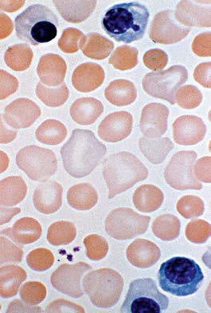

# Chapter 139: Anemia in the Newborn Infant — Board-Style Self-Assessment MCQs
**Part X: The Fetus and the Neonatal Infant** | [📖 Read Wiki Chapter](../chapters/139.md) | [🃏 Chapter Flashcards](../flashcards/139_flashcards.md) | [🏠 Course Master Index](../../index.md)

Total questions: **5** *(Click "Show Answer & Rationale" beneath each question)*

### Question 1 (Clinical Pediatrics Vignette)
A pediatric patient is evaluated for the following clinical and diagnostic profile: • Iatrogenic this pediatric condition (phlebotomy); • Placental hemorrhage; • Placental previa; • Injury of umbilical or placental vessels; • Fetomaternal transfusion; • Fetoplacental transfusion; • Twin-twin transfusion; • Acute perinatal hemorrhage. Which of the following conditions or syndromes is the most likely diagnosis?

- **A.** DAT (−) (Anemia in the Newborn Infant)
- **B.** (HEMATOCRIT %) (Anemia in the Newborn Infant)
- **C.** BLOOD LOSS (Anemia in the Newborn Infant)
- **D.** LDH (Anemia in the Newborn Infant)

<b>Show Answer & Rationale</b>

**Correct Answer: C** — BLOOD LOSS (Anemia in the Newborn Infant)

**Rationale:** **BLOOD LOSS (Anemia in the Newborn Infant)** is characterized by: • Iatrogenic blood loss (phlebotomy); • Placental hemorrhage; • Placental previa; • Injury of umbilical or placental vessels; • Fetomaternal transfusion; • Fetoplacental transfusion; • Twin-twin transfusion; • Acute perinatal hemorrhage (e.g., cesarean; birth, other obstetric trauma); • Chronic in utero blood loss; pre.

**Why Other Options Are Incorrect:** **DAT (−) (Anemia in the Newborn Infant)** is incorrect (characterized by EMA flow (+); Persistent spherocytosis; Reticulocytosis; MCHC/MCV elevated (>36,; likely >40); ABO h). **(HEMATOCRIT %) (Anemia in the Newborn Infant)** is incorrect (characterized by Week 1; 11.0 (33%); 10.0 (30%); Week 2; 10.0 (30%); 8.5 (25%); Week 3; 8.5 (25%); 7.0 (21%); Values ). **LDH (Anemia in the Newborn Infant)** is incorrect (characterized by Neonatal hemolytic-uremic syndrome; Acute renal failure; Homozygous protein C deficiency; Severely d).

### Question 2 (Clinical Pediatrics Vignette)
A pediatric patient is evaluated for the following clinical and diagnostic profile: EMA flow (+); Persistent spherocytosis; Reticulocytosis; MCHC/MCV elevated (>36,; likely >40); ABO hemolytic disease. Which of the following conditions or syndromes is the most likely diagnosis?

- **A.** DAT (+) (Anemia in the Newborn Infant)
- **B.** (HEMATOCRIT %) (Anemia in the Newborn Infant)
- **C.** GENOTYPIC FEATURES
- **D.** DAT (−) (Anemia in the Newborn Infant)

<b>Show Answer & Rationale</b>

**Correct Answer: D** — DAT (−) (Anemia in the Newborn Infant)

**Rationale:** **DAT (−) (Anemia in the Newborn Infant)** is characterized by: EMA flow (+); Persistent spherocytosis; Reticulocytosis; MCHC/MCV elevated (>36,; likely >40); ABO hemolytic disease.

**Why Other Options Are Incorrect:** **DAT (+) (Anemia in the Newborn Infant)** is incorrect (characterized by Transient spherocytosis; Reticulocytosis; MCHC/MCV normal (<36, likely; <34); Elliptocytes; Heredita). **(HEMATOCRIT %) (Anemia in the Newborn Infant)** is incorrect (characterized by Week 1; 11.0 (33%); 10.0 (30%); Week 2; 10.0 (30%); 8.5 (25%); Week 3; 8.5 (25%); 7.0 (21%); Values ). **GENOTYPIC FEATURES** is incorrect (characterized by Adenosine deaminase; deficiency; Autoimmune hemolytic anemia, reduced erythrocyte adenosine; deamina).

### Question 3 (Visual Diagnosis & Clinical Spotter)

A pediatric patient undergoes evaluation for **Anemia in the Newborn Infant**, yielding the clinical or diagnostic finding shown below. Which of the following best characterizes the illustrated finding?

- **A.** Importantly, neonatal blood smears often include atypical erythrocyte morphology with macrocytosis, poikilocytosis, and anisocytosis, which can result from normal erythropoiesis at that age
- **B.** Interventions should occur only in response to clinical signs and symptoms that occur as disease sequelae with referral to subspecialty care for further evaluation and management as appropri
- **C.** Diagnostic algorithm showing the approach to anemia in newborn infants. DIC, Disseminated intravascular coagulation; G6PD, glucose-6-phosphate dehydrogenase; MCV, mean corpuscular volume. (Modifi
- **D.** However, a simple and efficient laboratory workup can facilitate rapid definitive diagnosis and suggest an effective treatment strategy.

<b>Show Answer & Rationale</b>

**Correct Answer: C** — Diagnostic algorithm showing the approach to anemia in newborn infants. DIC, Disseminated intravascular coagulation; G6PD, glucose-6-phosphate dehydrogenase; MCV, mean corpuscular volume. (Modifi

**Rationale:** **Fig. 139.2**: Diagnostic algorithm showing the approach to anemia in newborn infants. DIC, Disseminated intravascular coagulation; G6PD, glucose-6-phosphate dehydrogenase; MCV, mean corpuscular volume. (Modified from Blanchette VS, Zipursky A. Assessment of anemia in newborn infants. Clin Perinatol. 1984;11:489–510.)

### Question 4 (Differential Diagnosis (Anemia in the Newborn Infant))
During a pediatric consultation regarding **Anemia in the Newborn Infant**, which clinical entity or concept is described by the following profile? "Anemia can result from blood loss, erythrocyte destruction (hemoly sis), or underproduction of erythrocytes."

- **A.** ANEMIA CLASSIFICATIONS AND KEY DIAGNOSTIC MODALITIES
- **B.** GENOTYPIC FEATURES
- **C.** Congenital erythrocyte membrane disorders
- **D.** HEMOGLOBINOPATHIES

<b>Show Answer & Rationale</b>

**Correct Answer: A** — ANEMIA CLASSIFICATIONS AND KEY DIAGNOSTIC MODALITIES

**Rationale:** ANEMIA CLASSIFICATIONS AND KEY DIAGNOSTIC MODALITIES Anemia can result from blood loss, erythrocyte destruction (hemoly sis), or underproduction of erythrocytes.

### Question 5 (Pediatric Board Mastery (Anemia in the Newborn Infant))
When formulating an evidence-based diagnostic and management plan for **Anemia in the Newborn Infant** (*Part X: The Fetus and the Neonatal Infant*), which of the following pediatric clinical statements is **ACCURATE**? (Item 1)

- **A.** Interventions should occur only in response to clinical signs and symptoms that occur as disease sequelae with referral to subspecialty care for further evaluation and management as appropriate.
- **B.** Clinical manifestations are permanently restricted to late adulthood and never present during infancy, childhood, or adolescence.
- **C.** Diagnostic confirmation relies solely on plain skull radiographs without biochemical, microbiologic, or clinical correlation.
- **D.** The condition is an entirely benign physiologic variant that never warrants laboratory or clinical evaluation.

<b>Show Answer & Rationale</b>

**Correct Answer: A** — Interventions should occur only in response to clinical signs and symptoms that occur as disease sequelae with referral to subspecialty care for further evaluation and management as appropriate.

**Rationale:** **Pediatric Clinical Principle (Anemia in the Newborn Infant):** Interventions should occur only in response to clinical signs and symptoms that occur as disease sequelae with referral to subspecialty care for further evaluation and management as appropriate.

