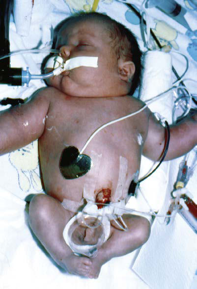

# Chapter 147: Infants of Diabetic Mothers — Board-Style Self-Assessment MCQs
**Part X: The Fetus and the Neonatal Infant** | [📖 Read Wiki Chapter](../chapters/147.md) | [🃏 Chapter Flashcards](../flashcards/147_flashcards.md) | [🏠 Course Master Index](../../index.md)

Total questions: **5** *(Click "Show Answer & Rationale" beneath each question)*

### Question 1 (Clinical Pediatrics Vignette)
A pediatric patient is evaluated for the following clinical and diagnostic profile: Tachypnea develops in many IDMs during the first 2 days after birth and may be a manifestation of hypoglycemia, hypothermia, polycythe mia, cardiac failure, transient tachypnea, or cerebral edema from birth trauma or asphyxia.. Which of the following conditions or syndromes is the most likely diagnosis?

- **A.** T– B+ NK– SCID (Orientation to the Consideration of Inborn Errors of Immunity)
- **B.** EFFECT(S) (Chemical Pollutants)
- **C.** Recommended evaluation
- **D.** Infants of Diabetic Mothers

<b>Show Answer & Rationale</b>

**Correct Answer: D** — Infants of Diabetic Mothers

**Rationale:** **Infants of Diabetic Mothers** is characterized by: Tachypnea develops in many IDMs during the first 2 days after birth and may be a manifestation of hypoglycemia, hypothermia, polycythe mia, cardiac failure, transient tachypnea, or cerebral edema from birth trauma or asphyxia..

**Why Other Options Are Incorrect:** **T– B+ NK– SCID (Orientation to the Consideration of Inborn Errors of Immunity)** is incorrect (characterized by Common gamma chain (IL2RG, X-linked), JAK3). **EFFECT(S) (Chemical Pollutants)** is incorrect (characterized by Air pollution; Asthma, other respiratory; diseases, sudden infant death; syndrome; Asbestos; Mesothe). **Recommended evaluation** is incorrect (characterized by • CSF analysis for VDRL, cell count, and protein; • Complete blood count (CBC) and differential and ).

### Question 2 (Visual Diagnosis & Clinical Spotter)

A pediatric patient undergoes evaluation for **Infants of Diabetic Mothers**, yielding the clinical or diagnostic finding shown below. Which of the following best characterizes the illustrated finding?

- **A.** Macrosomic, plethoric infant of a mother with gestational diabetes. The baby was born at 38 weeks of gestation but weighed 9 lb, 11 oz (4,408 g). Mild respiratory distress was the only symptom ot
- **B.** The symptoms will resolve with treatment of the underlying cause but may persist for weeks if caused by birth asphyxia.
- **C.** Inotropic agents worsen the obstruction and are contraindicated. β-Adrenergic blockers have been shown to relieve the obstruction, but ultimately the condition resolves spontaneously over ti
- **D.** Tachypnea develops in many IDMs during the first 2 days after birth and may be a manifestation of hypoglycemia, hypothermia, polycythe mia, cardiac failure, transient tachypnea, or cerebral

<b>Show Answer & Rationale</b>

**Correct Answer: A** — Macrosomic, plethoric infant of a mother with gestational diabetes. The baby was born at 38 weeks of gestation but weighed 9 lb, 11 oz (4,408 g). Mild respiratory distress was the only symptom ot

**Rationale:** **Fig. 147.2**: Macrosomic, plethoric infant of a mother with gestational diabetes. The baby was born at 38 weeks of gestation but weighed 9 lb, 11 oz (4,408 g). Mild respiratory distress was the only symptom other than appearance.

### Question 3 (Differential Diagnosis (Infants of Diabetic Mothers))
During a pediatric consultation regarding **Infants of Diabetic Mothers**, which clinical entity or concept is described by the following profile? "born large for gestational age (LGA)."

- **A.** PATHOPHYSIOLOGY
- **B.** infants of diabetic mothers (IDMs)
- **C.** TREATMENT
- **D.** GABA (Spasticity)

<b>Show Answer & Rationale</b>

**Correct Answer: B** — infants of diabetic mothers (IDMs)

**Rationale:** infants of diabetic mothers (IDMs) are born large for gestational age (LGA).

### Question 4 (Differential Diagnosis (Infants of Diabetic Mothers))
During a pediatric consultation regarding **Infants of Diabetic Mothers**, which clinical entity or concept is described by the following profile? "The probable pathogenic sequence is that maternal hyperglycemia causes fetal hyperglycemia, and the fetal pancreatic response leads to fetal hyperinsulinemia, or hyperinsulinism."

- **A.** Neurologic (Overview of Environmental Health and Children)
- **B.** PATHOPHYSIOLOGY
- **C.** Hypoglycemia
- **D.** congenital anomalies

<b>Show Answer & Rationale</b>

**Correct Answer: B** — PATHOPHYSIOLOGY

**Rationale:** PATHOPHYSIOLOGY The probable pathogenic sequence is that maternal hyperglycemia causes fetal hyperglycemia, and the fetal pancreatic response leads to fetal hyperinsulinemia, or hyperinsulinism.

### Question 5 (Pediatric Board Mastery (Infants of Diabetic Mothers))
When formulating an evidence-based diagnostic and management plan for **Infants of Diabetic Mothers** (*Part X: The Fetus and the Neonatal Infant*), which of the following pediatric clinical statements is **ACCURATE**? (Item 1)

- **A.** First-line management relies on immediate high-dose aspirin therapy in febrile infants.
- **B.** Inheritance is exclusively holandric (Y-linked) with 100% penetrance restricted to male neonates.
- **C.** Tachypnea develops in many IDMs during the first 2 days after birth and may be a manifestation of hypoglycemia, hypothermia, polycythe mia, cardiac failure, transient tachypnea, or cerebral edema from birt
- **D.** The condition is an entirely benign physiologic variant that never warrants laboratory or clinical evaluation.

<b>Show Answer & Rationale</b>

**Correct Answer: C** — Tachypnea develops in many IDMs during the first 2 days after birth and may be a manifestation of hypoglycemia, hypothermia, polycythe mia, cardiac failure, transient tachypnea, or cerebral edema from birt

**Rationale:** **Pediatric Clinical Principle (Infants of Diabetic Mothers):** Tachypnea develops in many IDMs during the first 2 days after birth and may be a manifestation of hypoglycemia, hypothermia, polycythe mia, cardiac failure, transient tachypnea, or cerebral edema from birth trauma or asphyxia.

