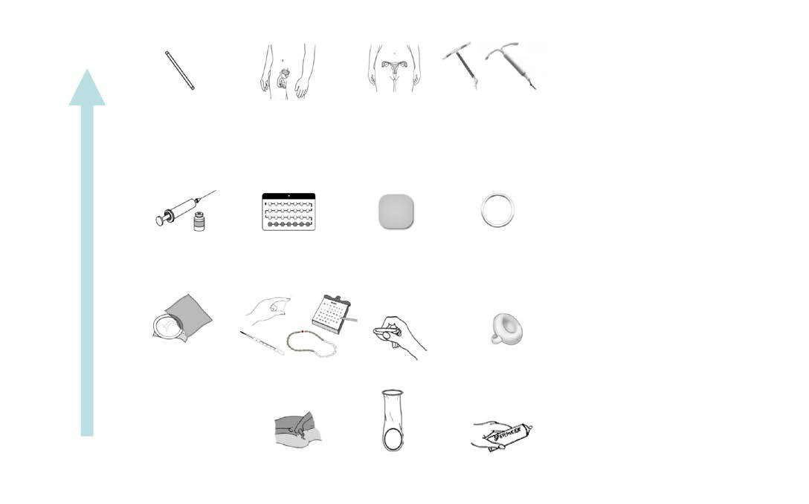

# Chapter 160: Contraception — Board-Style Self-Assessment MCQs
**Part XI: Adolescent Medicine** | [📖 Read Wiki Chapter](../chapters/160.md) | [🃏 Chapter Flashcards](../flashcards/160_flashcards.md) | [🏠 Course Master Index](../../index.md)

Total questions: **5** *(Click "Show Answer & Rationale" beneath each question)*

### Question 1 (Clinical Pediatrics Vignette)
A pediatric patient is evaluated for the following clinical and diagnostic profile: Convenience; long-term; contraception; efficacy not; dependent on patient adherence;; rapid return of fertility after; removal; Irregular bleeding; amenorrhea, insertion and/or; removal complications; Nexplanon; 0.1; 0.1. Which of the following conditions or syndromes is the most likely diagnosis?

- **A.** Contraceptives (Contraception)
- **B.** Vaginal Ring (Contraception)
- **C.** Implant (Contraception)
- **D.** Injectable (Contraception)

<b>Show Answer & Rationale</b>

**Correct Answer: C** — Implant (Contraception)

**Rationale:** **Implant (Contraception)** is characterized by: Convenience; long-term; contraception; efficacy not; dependent on patient adherence;; rapid return of fertility after; removal; Irregular bleeding; amenorrhea, insertion and/or; removal complications; Nexplanon; 0.1; 0.1.

**Why Other Options Are Incorrect:** **Contraceptives (Contraception)** is incorrect (characterized by 7; 0.3; Protection against ovarian and; endometrial cancer; suppresses; ovulation, which can improve). **Vaginal Ring (Contraception)** is incorrect (characterized by 7; 0.3; Convenience of once-monthly; application, benefits similar to; combination oral contraceptiv). **Injectable (Contraception)** is incorrect (characterized by Convenience of q3mo injections;; same as progestin-only oral; contraceptives; Delayed return to fert).

### Question 2 (Clinical Pediatrics Vignette)
A pediatric patient is evaluated for the following clinical and diagnostic profile: Convenience; long-term; contraception; efficacy not; dependent on patient adherence;; rapid return of fertility after; removal; Rare uterine perforation; risk of infection with; insertion; ParaGard T380A; 0.8; 0.6; Effective for 10 yr; nonhormonal; I. Which of the following conditions or syndromes is the most likely diagnosis?

- **A.** Injectable (Contraception)
- **B.** Contraceptives (Contraception)
- **C.** Vaginal Ring (Contraception)
- **D.** Intrauterine Devices (IUDs)

<b>Show Answer & Rationale</b>

**Correct Answer: D** — Intrauterine Devices (IUDs)

**Rationale:** **Intrauterine Devices (IUDs)** is characterized by: Convenience; long-term; contraception; efficacy not; dependent on patient adherence;; rapid return of fertility after; removal; Rare uterine perforation; risk of infection with; insertion; ParaGard T380A; 0.8; 0.6; Effective for 10 yr; nonhormonal; Irregular/heavy bleeding and dysmenorrhea; Mirena; 0.1; 0.1; Effective .

**Why Other Options Are Incorrect:** **Injectable (Contraception)** is incorrect (characterized by Convenience of q3mo injections;; same as progestin-only oral; contraceptives; Delayed return to fert). **Contraceptives (Contraception)** is incorrect (characterized by 7; 0.3; Protection against ovarian and; endometrial cancer; suppresses; ovulation, which can improve). **Vaginal Ring (Contraception)** is incorrect (characterized by 7; 0.3; Convenience of once-monthly; application, benefits similar to; combination oral contraceptiv).

### Question 3 (Visual Diagnosis & Clinical Spotter)

A pediatric patient undergoes evaluation for **Contraception**, yielding the clinical or diagnostic finding shown below. Which of the following best characterizes the illustrated finding?

- **A.** Effectiveness of contraceptive methods. (Modified from Trussell J, Aiken ARA, Micks E, Guthrie K. Contraceptive efficacy, safety, and personal considerations. In: Hatcher RA, Nelson AL, Trussell
- **B.** COMBINED ORAL CONTRACEPTIVES Oral contraceptive pills (OCs) can be either COCs or POPs and are commonly referred to as “the pill.” The pill is one of the most common contraceptive methods us
- **C.** One potential unique complication of this method relates to local ized infection and other side effects after implantation, such as bleed ing, hematoma, or scarring, and if inserted too deep
- **D.** Although the continuation rates are favorable and comparable to the IUD, the most common reason for discontinuation is dissatisfaction with bleeding patterns.

<b>Show Answer & Rationale</b>

**Correct Answer: A** — Effectiveness of contraceptive methods. (Modified from Trussell J, Aiken ARA, Micks E, Guthrie K. Contraceptive efficacy, safety, and personal considerations. In: Hatcher RA, Nelson AL, Trussell

**Rationale:** **Fig. 160.1**: Effectiveness of contraceptive methods. (Modified from Trussell J, Aiken ARA, Micks E, Guthrie K. Contraceptive efficacy, safety, and personal considerations. In: Hatcher RA, Nelson AL, Trussell J, et al., eds. Contraceptive Technology, 21st ed. New York: Ayer Company Publishers; 2018:102.)

### Question 4 (Differential Diagnosis (Contraception))
During a pediatric consultation regarding **Contraception**, which clinical entity or concept is described by the following profile? "methods, the most effective, include those with failure rates of <1 pregnancy per 100 women in a year of typical use, and reversible this pediatric condition methods include intrauterine devices (IUDs) and implants."

- **A.** Long- acting reversible contraception
- **B.** Immune Complex Small Vessel Vasculitis
- **C.** Tier 1
- **D.** Tier 2

<b>Show Answer & Rationale</b>

**Correct Answer: C** — Tier 1

**Rationale:** Tier 1 methods, the most effective, include those with failure rates of <1 pregnancy per 100 women in a year of typical use, and reversible Tier 1 methods include intrauterine devices (IUDs) and implants.

### Question 5 (Pediatric Board Mastery (Contraception))
When formulating an evidence-based diagnostic and management plan for **Contraception** (*Part XI: Adolescent Medicine*), which of the following pediatric clinical statements is **ACCURATE**? (Item 1)

- **A.** Clinical manifestations are permanently restricted to late adulthood and never present during infancy, childhood, or adolescence.
- **B.** Although the continuation rates are favorable and comparable to the IUD, the most common reason for discontinuation is dissatisfaction with bleeding patterns.
- **C.** The condition is an entirely benign physiologic variant that never warrants laboratory or clinical evaluation.
- **D.** Diagnostic confirmation relies solely on plain skull radiographs without biochemical, microbiologic, or clinical correlation.

<b>Show Answer & Rationale</b>

**Correct Answer: B** — Although the continuation rates are favorable and comparable to the IUD, the most common reason for discontinuation is dissatisfaction with bleeding patterns.

**Rationale:** **Pediatric Clinical Principle (Contraception):** Although the continuation rates are favorable and comparable to the IUD, the most common reason for discontinuation is dissatisfaction with bleeding patterns.

