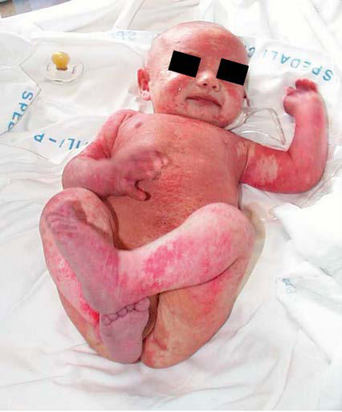

# Chapter 165: T-Cell and Combined Deficiencies — Board-Style Self-Assessment MCQs
**Part XII: Immunology** | [📖 Read Wiki Chapter](../chapters/165.md) | [🃏 Chapter Flashcards](../flashcards/165_flashcards.md) | [🏠 Course Master Index](../../index.md)

Total questions: **5** *(Click "Show Answer & Rationale" beneath each question)*

### Question 1 (Visual Diagnosis & Clinical Spotter)

A pediatric patient undergoes evaluation for **T-Cell and Combined Deficiencies**, yielding the clinical or diagnostic finding shown below. Which of the following best characterizes the illustrated finding?

- **A.** GENETICS AND PATHOGENESIS SCID is caused by pathogenic variants in genes crucial for lymphoid cell development or function.
- **B.** CLINICAL MANIFESTATIONS SCID is included in the newborn screening program in all states in the United States and in several countries around the world.
- **C.** Severe combined immunodeficiency (SCID) is caused by diverse patho genic gene variants that lead to absence of T- and B-cell function.
- **D.** Relative frequencies of the different genetic types of se vere combined immunodeficiency (SCID) among 216 patients seen consecutively. (From Buckley RH, Orange JS. Primary immunodeficien cy disea

<b>Show Answer & Rationale</b>

**Correct Answer: D** — Relative frequencies of the different genetic types of se vere combined immunodeficiency (SCID) among 216 patients seen consecutively. (From Buckley RH, Orange JS. Primary immunodeficien cy disea

**Rationale:** **Fig. 165.2**: Relative frequencies of the different genetic types of se vere combined immunodeficiency (SCID) among 216 patients seen consecutively. (From Buckley RH, Orange JS. Primary immunodeficien cy diseases. In: Burks AW, Holgate ST, O’Hehir RE, et al., eds. Mid dleton’s Allergy: Principles and Practice. 9th ed. Philadelphia: Elsevier; 2020. Fig. 69.2, p. 1126.)

### Question 2 (Differential Diagnosis (165.1 Severe Combined Immunodeficiencies Ramsay L. Fuleihan))
During a pediatric consultation regarding **T-Cell and Combined Deficiencies**, which clinical entity or concept is described by the following profile? "SCID is caused by pathogenic variants in genes crucial for lymphoid cell development or function (Table 165."

- **A.** Clinical Manifestations
- **B.** bare lymphocyte syndrome
- **C.** HSCT, PEG-ADA (T-Cell and Combined Deficiencies)
- **D.** GENETICS AND PATHOGENESIS

<b>Show Answer & Rationale</b>

**Correct Answer: D** — GENETICS AND PATHOGENESIS

**Rationale:** GENETICS AND PATHOGENESIS SCID is caused by pathogenic variants in genes crucial for lymphoid cell development or function (Table 165.

### Question 3 (Differential Diagnosis (165.1 Severe Combined Immunodeficiencies Ramsay L. Fuleihan))
During a pediatric consultation regarding **T-Cell and Combined Deficiencies**, which clinical entity or concept is described by the following profile? "SCID is included in the newborn screening program in all states in the United States and in several countries around the world."

- **A.** bare lymphocyte syndrome
- **B.** CLINICAL MANIFESTATIONS
- **C.** ANHIDROTIC ECTODERMAL DYSPLASIA WITH IMMUNODEFICIENCY
- **D.** Defects in the Zeta-Associated Protein 70

<b>Show Answer & Rationale</b>

**Correct Answer: B** — CLINICAL MANIFESTATIONS

**Rationale:** CLINICAL MANIFESTATIONS SCID is included in the newborn screening program in all states in the United States and in several countries around the world.

### Question 4 (Pediatric Board Mastery (T-Cell and Combined Deficiencies))
When formulating an evidence-based diagnostic and management plan for **T-Cell and Combined Deficiencies** (*Part XII: Immunology*), which of the following pediatric clinical statements is **ACCURATE**? (Item 1)

- **A.** Severe combined immunodeficiency (SCID) is caused by diverse patho genic gene variants that lead to absence of T- and B-cell function.
- **B.** Diagnostic confirmation relies solely on plain skull radiographs without biochemical, microbiologic, or clinical correlation.
- **C.** Clinical manifestations are permanently restricted to late adulthood and never present during infancy, childhood, or adolescence.
- **D.** First-line management relies on immediate high-dose aspirin therapy in febrile infants.

<b>Show Answer & Rationale</b>

**Correct Answer: A** — Severe combined immunodeficiency (SCID) is caused by diverse patho genic gene variants that lead to absence of T- and B-cell function.

**Rationale:** **Pediatric Clinical Principle (T-Cell and Combined Deficiencies):** Severe combined immunodeficiency (SCID) is caused by diverse patho genic gene variants that lead to absence of T- and B-cell function.

### Question 5 (Pediatric Board Mastery (T-Cell and Combined Deficiencies))
When formulating an evidence-based diagnostic and management plan for **T-Cell and Combined Deficiencies** (*Part XII: Immunology*), which of the following pediatric clinical statements is **ACCURATE**? (Item 2)

- **A.** GENETICS AND PATHOGENESIS SCID is caused by pathogenic variants in genes crucial for lymphoid cell development or function.
- **B.** The condition is an entirely benign physiologic variant that never warrants laboratory or clinical evaluation.
- **C.** Systemic tetracyclines and fluoroquinolones are universally required as routine prophylaxis in all healthy newborns.
- **D.** Clinical manifestations are permanently restricted to late adulthood and never present during infancy, childhood, or adolescence.

<b>Show Answer & Rationale</b>

**Correct Answer: A** — GENETICS AND PATHOGENESIS SCID is caused by pathogenic variants in genes crucial for lymphoid cell development or function.

**Rationale:** **Pediatric Clinical Principle (T-Cell and Combined Deficiencies):** GENETICS AND PATHOGENESIS SCID is caused by pathogenic variants in genes crucial for lymphoid cell development or function.

