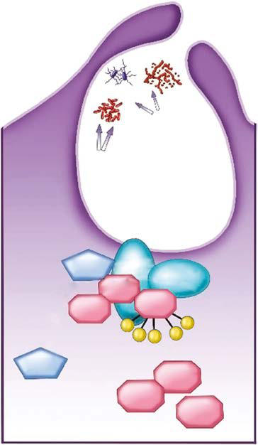

# Chapter 169: Eosinophils — Board-Style Self-Assessment MCQs
**Part XII: Immunology** | [📖 Read Wiki Chapter](../chapters/169.md) | [🃏 Chapter Flashcards](../flashcards/169_flashcards.md) | [🏠 Course Master Index](../../index.md)

Total questions: **5** *(Click "Show Answer & Rationale" beneath each question)*

### Question 1 (Clinical Pediatrics Vignette)
A pediatric patient is evaluated for the following clinical and diagnostic profile: Allergic rhinitis; Asthma; Acute and chronic urticaria; Atopic dermatitis; Angioedema; Hypersensitivity drug reactions (drug rash with eosinophilia and; systemic symptoms [DRESS]); Eosinophilic gastrointestinal disorders; Interstitial nephritis; Mast. Which of the following conditions or syndromes is the most likely diagnosis?

- **A.** GASTROINTESTINAL DISORDERS
- **B.** Eosinophilic Gastrointestinal Disorders
- **C.** Tissue-Invasive Helminth Infections and Other Infections
- **D.** ALLERGIC DISORDERS

<b>Show Answer & Rationale</b>

**Correct Answer: D** — ALLERGIC DISORDERS

**Rationale:** **ALLERGIC DISORDERS** is characterized by: Allergic rhinitis; Asthma; Acute and chronic urticaria; Atopic dermatitis; Angioedema; Hypersensitivity drug reactions (drug rash with eosinophilia and; systemic symptoms [DRESS]); Eosinophilic gastrointestinal disorders; Interstitial nephritis; Mastocytosis.

**Why Other Options Are Incorrect:** **GASTROINTESTINAL DISORDERS** is incorrect (characterized by Inflammatory bowel disease; Peritoneal dialysis; Chronic active hepatitis). **Eosinophilic Gastrointestinal Disorders** is incorrect (characterized by Eosinophilic esophagitis; Eosinophilic gastritis; Eosinophilic enteritis; Eosinophilic colitis). **Tissue-Invasive Helminth Infections and Other Infections** is incorrect (characterized by Trichinosis; Toxocariasis; Strongyloidiasis; Ascariasis; Filariasis; Schistosomiasis; Echinococcosis).

### Question 2 (Clinical Pediatrics Vignette)
A pediatric patient is evaluated for the following clinical and diagnostic profile: Trichinosis; Toxocariasis; Strongyloidiasis; Ascariasis; Filariasis; Schistosomiasis; Echinococcosis; Amebiasis; Malaria; Scabies; Toxoplasmosis; Pneumocystis jirovecii; Scarlet fever; Allergic bronchopulmonary aspergillosis (ABPA); Coccidioidomycosi. Which of the following conditions or syndromes is the most likely diagnosis?

- **A.** MALIGNANT DISORDERS
- **B.** Eosinophilic Gastrointestinal Disorders
- **C.** Tissue-Invasive Helminth Infections and Other Infections
- **D.** GASTROINTESTINAL DISORDERS

<b>Show Answer & Rationale</b>

**Correct Answer: C** — Tissue-Invasive Helminth Infections and Other Infections

**Rationale:** **Tissue-Invasive Helminth Infections and Other Infections** is characterized by: Trichinosis; Toxocariasis; Strongyloidiasis; Ascariasis; Filariasis; Schistosomiasis; Echinococcosis; Amebiasis; Malaria; Scabies; Toxoplasmosis; Pneumocystis jirovecii; Scarlet fever; Allergic bronchopulmonary aspergillosis (ABPA); Coccidioidomycosis; Human immunodeficiency virus (HIV).

**Why Other Options Are Incorrect:** **MALIGNANT DISORDERS** is incorrect (characterized by Hodgkin disease and T-cell lymphoma; Acute myelogenous leukemia; Myeloproliferative disorders; Eosin). **Eosinophilic Gastrointestinal Disorders** is incorrect (characterized by Eosinophilic esophagitis; Eosinophilic gastritis; Eosinophilic enteritis; Eosinophilic colitis). **GASTROINTESTINAL DISORDERS** is incorrect (characterized by Inflammatory bowel disease; Peritoneal dialysis; Chronic active hepatitis).

### Question 3 (Visual Diagnosis & Clinical Spotter)

A pediatric patient undergoes evaluation for **Eosinophils**, yielding the clinical or diagnostic finding shown below. Which of the following best characterizes the illustrated finding?

- **A.** Eosinophilic esophagitis is the most common EGID.
- **B.** Infectious Diseases Eosinophilia is often associated with invasive infection with multicel lular helminthic parasites, which are the most common cause in devel oping countries.
- **C.** Nicotinamide adenine dinucleotide phosphate (NADPH) oxidase components and activation. On activation of phagocytic cells, the 3 cytosolic components (red) of the NADPH oxidase (p67phox, p47phox,
- **D.** Allergic Diseases Allergy is the most common cause of eosinophilia in children in the United States.

<b>Show Answer & Rationale</b>

**Correct Answer: C** — Nicotinamide adenine dinucleotide phosphate (NADPH) oxidase components and activation. On activation of phagocytic cells, the 3 cytosolic components (red) of the NADPH oxidase (p67phox, p47phox,

**Rationale:** **Fig. 168.3**: Nicotinamide adenine dinucleotide phosphate (NADPH) oxidase components and activation. On activation of phagocytic cells, the 3 cytosolic components (red) of the NADPH oxidase (p67phox, p47phox, and p40phox), plus the small guanosine triphosphatase (GTPase) pro tein Rac2, are translocated to the membrane of the phagocytic vacuole. The p47phox subunit binds to the flavocytochromeb558 membrane com ponent (blue-green) of the NADPH oxidase (gp91phox plus p22phox). The NADPH oxidase catalyzes the formation of superoxide by transferring an electron from NADPH to molecular oxygen (O2), thereby forming the superoxide free radical. The unstable superoxide anion is converted to hydrogen peroxide, either spontaneously or by superoxide dismutase (SOD). H2O2 can follow different metabolic pathways into more potent reactive oxidants, such as OH• or HOCl) or degradation to H2O + O2. (Adapted from Stiehm ER, Ochs HD, Winkelstein JA. Immunologic Dis orders in Infants and Children, 5th ed. Philadelphia: Saunders; 2004, p. 622.)

### Question 4 (Differential Diagnosis (Eosinophils))
During a pediatric consultation regarding **Eosinophils**, which clinical entity or concept is described by the following profile? "lectively enhances eosinophil production, adhesion to endothelial cells, and function."

- **A.** Interleukin (IL)-5
- **B.** allergic bronchopulmonary aspergillosis
- **C.** Allergic Diseases
- **D.** DISEASES ASSOCIATED WITH EOSINOPHILIA

<b>Show Answer & Rationale</b>

**Correct Answer: A** — Interleukin (IL)-5

**Rationale:** Interleukin (IL)-5 selectively enhances eosinophil production, adhesion to endothelial cells, and function.

### Question 5 (Pediatric Board Mastery (Eosinophils))
When formulating an evidence-based diagnostic and management plan for **Eosinophils** (*Part XII: Immunology*), which of the following pediatric clinical statements is **ACCURATE**? (Item 1)

- **A.** Allergic Diseases Allergy is the most common cause of eosinophilia in children in the United States.
- **B.** Inheritance is exclusively holandric (Y-linked) with 100% penetrance restricted to male neonates.
- **C.** The condition is an entirely benign physiologic variant that never warrants laboratory or clinical evaluation.
- **D.** Systemic tetracyclines and fluoroquinolones are universally required as routine prophylaxis in all healthy newborns.

<b>Show Answer & Rationale</b>

**Correct Answer: A** — Allergic Diseases Allergy is the most common cause of eosinophilia in children in the United States.

**Rationale:** **Pediatric Clinical Principle (Eosinophils):** Allergic Diseases Allergy is the most common cause of eosinophilia in children in the United States.

