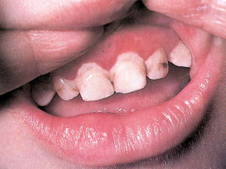

# Chapter 170: Disorders of Phagocyte Function — Board-Style Self-Assessment MCQs
**Part XII: Immunology** | [📖 Read Wiki Chapter](../chapters/170.md) | [🃏 Chapter Flashcards](../flashcards/170_flashcards.md) | [🏠 Course Master Index](../../index.md)

Total questions: **5** *(Click "Show Answer & Rationale" beneath each question)*

### Question 1 (Clinical Pediatrics Vignette)
A pediatric patient is evaluated for the following clinical and diagnostic profile: Autosomal recessive; disordered; coalescence of lysosomal granules;; responsible gene is CHSI/the causative gene, which; encodes a protein hypothesized to; regulate granule fusion; Decreased neutrophil chemotaxis,; degranulation, and bactericidal; ac. Which of the following conditions or syndromes is the most likely diagnosis?

- **A.** HIES (Disorders of Phagocyte Function)
- **B.** DEGRANULATION ABNORMALITIES
- **C.** (CHS) (Disorders of Phagocyte Function)
- **D.** ADHESION ABNORMALITIES

<b>Show Answer & Rationale</b>

**Correct Answer: C** — (CHS) (Disorders of Phagocyte Function)

**Rationale:** **(CHS) (Disorders of Phagocyte Function)** (associated with **`LYST`**) is characterized by: Autosomal recessive; disordered; coalescence of lysosomal granules;; responsible gene is CHSI/LYST, which; encodes a protein hypothesized to; regulate granule fusion; Decreased neutrophil chemotaxis,; degranulation, and bactericidal; activity; platelet storage pool defect;; impaired NK function, failure to; disperse me.

**Why Other Options Are Incorrect:** **HIES (Disorders of Phagocyte Function)** is incorrect (characterized by Cutaneous; Neutropenia,). **DEGRANULATION ABNORMALITIES** is incorrect (characterized by Chédiak-Higashi syndrome). **ADHESION ABNORMALITIES** is incorrect (characterized by Leukocyte adhesion; deficiency 1 (LAD-1); Autosomal recessive; absence of; CD11/CD18 surface adhesiv).

### Question 2 (Visual Diagnosis & Clinical Spotter)

A pediatric patient undergoes evaluation for **Disorders of Phagocyte Function**, yielding the clinical or diagnostic finding shown below. Which of the following best characterizes the illustrated finding?

- **A.** It is best to assay other features of the suspected disorder, such as surface marker expression, to establish a specific diagnosis.
- **B.** Because the genes for most of these disorders have been identified, the first step in diagnosis for all of these disorders is to obtain DNA analysis through commercially available genetic pa
- **C.** In fact, the presence of a true abscess makes the diagnosis of a significant chemotactic defect less likely.
- **D.** Oral pathology in a patient with leukocyte adhesion defi ciency type 1 (LAD-1). Gingivitis and severe periodontitis are hallmarks of LAD-1. (From Rich RR. Clinical Immunology: Principles and Prac

<b>Show Answer & Rationale</b>

**Correct Answer: D** — Oral pathology in a patient with leukocyte adhesion defi ciency type 1 (LAD-1). Gingivitis and severe periodontitis are hallmarks of LAD-1. (From Rich RR. Clinical Immunology: Principles and Prac

**Rationale:** **Fig. 170.3**: Oral pathology in a patient with leukocyte adhesion defi ciency type 1 (LAD-1). Gingivitis and severe periodontitis are hallmarks of LAD-1. (From Rich RR. Clinical Immunology: Principles and Practice. 4th ed. Philadelphia: Saunders; 2013, p. 273.)

### Question 3 (Differential Diagnosis (Disorders of Phagocyte Function))
During a pediatric consultation regarding **Disorders of Phagocyte Function**, which clinical entity or concept is described by the following profile? "ults from pathogenic variants of the gene on chromo some 21q22."

- **A.** Genetics and Pathogenesis LAD-1
- **B.** Laboratory Findings
- **C.** Treatment
- **D.** LAD (Disorders of Phagocyte Function)

<b>Show Answer & Rationale</b>

**Correct Answer: A** — Genetics and Pathogenesis LAD-1

**Rationale:** Genetics and Pathogenesis LAD-1 results from pathogenic variants of the gene on chromo some 21q22.

### Question 4 (Differential Diagnosis (Disorders of Phagocyte Function))
During a pediatric consultation regarding **Disorders of Phagocyte Function**, which clinical entity or concept is described by the following profile? "hare the clinical features of LAD-1 but have normal CD11/CD18 integrins."

- **A.** SCREENING TESTS (Hemostasis)
- **B.** Clinical Manifestations
- **C.** Laboratory Findings
- **D.** LAD-2

<b>Show Answer & Rationale</b>

**Correct Answer: D** — LAD-2

**Rationale:** LAD-2 share the clinical features of LAD-1 but have normal CD11/CD18 integrins.

### Question 5 (Pediatric Board Mastery (Disorders of Phagocyte Function))
When formulating an evidence-based diagnostic and management plan for **Disorders of Phagocyte Function** (*Part XII: Immunology*), which of the following pediatric clinical statements is **ACCURATE**? (Item 1)

- **A.** Because the genes for most of these disorders have been identified, the first step in diagnosis for all of these disorders is to obtain DNA analysis through commercially available genetic panels for immuno
- **B.** Inheritance is exclusively holandric (Y-linked) with 100% penetrance restricted to male neonates.
- **C.** First-line management relies on immediate high-dose aspirin therapy in febrile infants.
- **D.** Clinical manifestations are permanently restricted to late adulthood and never present during infancy, childhood, or adolescence.

<b>Show Answer & Rationale</b>

**Correct Answer: A** — Because the genes for most of these disorders have been identified, the first step in diagnosis for all of these disorders is to obtain DNA analysis through commercially available genetic panels for immuno

**Rationale:** **Pediatric Clinical Principle (Disorders of Phagocyte Function):** Because the genes for most of these disorders have been identified, the first step in diagnosis for all of these disorders is to obtain DNA analysis through commercially available genetic panels for immunodeficiency.

