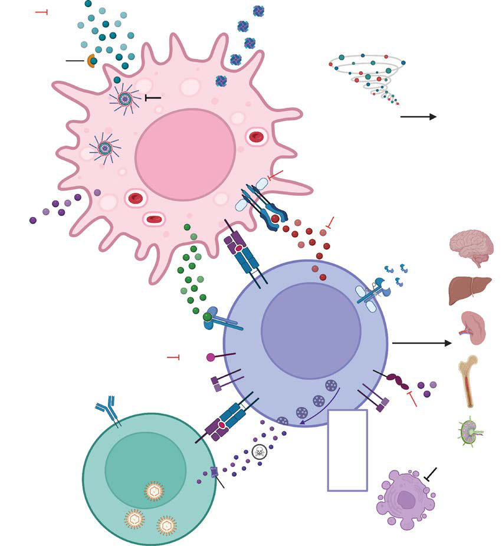

# Chapter 174: Immune Dysregulation — Board-Style Self-Assessment MCQs
**Part XII: Immunology** | [📖 Read Wiki Chapter](../chapters/174.md) | [🃏 Chapter Flashcards](../flashcards/174_flashcards.md) | [🏠 Course Master Index](../../index.md)

Total questions: **5** *(Click "Show Answer & Rationale" beneath each question)*

### Question 1 (Clinical Pediatrics Vignette)
A pediatric patient is evaluated for the following clinical and diagnostic profile: the causative gene haploinsufficiency. Which of the following conditions or syndromes is the most likely diagnosis?

- **A.** ALPSV (Immune Dysregulation)
- **B.** AD, GOF (Immune Dysregulation)
- **C.** LRBA (Immune Dysregulation)
- **D.** BACH2 (Immune Dysregulation)

<b>Show Answer & Rationale</b>

**Correct Answer: A** — ALPSV (Immune Dysregulation)

**Rationale:** **ALPSV (Immune Dysregulation)** (associated with **`CTLA4`**) is characterized by: CTLA4 haploinsufficiency.

**Why Other Options Are Incorrect:** **AD, GOF (Immune Dysregulation)** is incorrect (characterized by Enteropathy, autoimmune cytopenias,; lymphoproliferation, type 1; diabetes, recurrent infections; Ja). **LRBA (Immune Dysregulation)** is incorrect (characterized by LRBA deficiency). **BACH2 (Immune Dysregulation)** is incorrect (characterized by BACH2 deficiency).

### Question 2 (Pediatric Genetics & Molecular Etiology)
A child is diagnosed with **IL2RA (Immune Dysregulation)** after presenting with CD25 deficiency. Pathogenic variants in which of the following genes are most classically implicated?

- **A.** PYGM
- **B.** OTC
- **C.** IL2RA
- **D.** ARX

<b>Show Answer & Rationale</b>

**Correct Answer: C** — IL2RA

**Rationale:** Pathogenic variants in **`IL2RA`** (Immunology) are associated with **IL2RA (Immune Dysregulation)** (CD25 deficiency).

### Question 3 (Pediatric Genetics & Molecular Etiology)
A child is diagnosed with **ALPSV (Immune Dysregulation)** after presenting with the causative gene haploinsufficiency. Pathogenic variants in which of the following genes are most classically implicated?

- **A.** LYST
- **B.** CTLA4
- **C.** PNP
- **D.** SLC7A9

<b>Show Answer & Rationale</b>

**Correct Answer: B** — CTLA4

**Rationale:** Pathogenic variants in **`CTLA4`** (Immunology) are associated with **ALPSV (Immune Dysregulation)** (CTLA4 haploinsufficiency).

**Why Other Options Are Incorrect:** **LYST** is incorrect (associated with (CHS) (Disorders of Phagocyte Function)). **PNP** is incorrect (associated with T– B+ NK+ SCID (Orientation to the Consideration of Inborn Errors of Immunity)).

### Question 4 (Visual Diagnosis & Clinical Spotter)

A pediatric patient undergoes evaluation for **Immune Dysregulation**, yielding the clinical or diagnostic finding shown below. Which of the following best characterizes the illustrated finding?

- **A.** Diagnosis In a patient with early-onset, severe, or difficult to control autoim munity, endocrinopathy, colitis, or nonmalignant lymphoproliferative disease, a diagnosis of a Tregopathy shou
- **B.** Next genera tion sequencing via a targeted panel and/or whole exome sequencing is necessary to establish a genetic diagnosis.
- **C.** Immune dysregulation, polyendocrinopathy, enteropathy, X-linked (IPEX) syndrome is caused by a pathogenic variant in the FOXP3 gene, which encodes a forkhead-winged helix transcription facto
- **D.** Hemophagocytic lymphohistiocytosis (HLH). HLH is a severe systemic inflammatory syndrome due to abnormal reciprocal macrophage and cytotoxic lymphocyte hyperactivation, resulting in cytokine stor

<b>Show Answer & Rationale</b>

**Correct Answer: D** — Hemophagocytic lymphohistiocytosis (HLH). HLH is a severe systemic inflammatory syndrome due to abnormal reciprocal macrophage and cytotoxic lymphocyte hyperactivation, resulting in cytokine stor

**Rationale:** **Fig. 174.3**: Hemophagocytic lymphohistiocytosis (HLH). HLH is a severe systemic inflammatory syndrome due to abnormal reciprocal macrophage and cytotoxic lymphocyte hyperactivation, resulting in cytokine storm, hemophagocytosis, and tissue infiltration by activated immune cells. Primary HLH genes associated with defective granule-mediated cytotoxicity or inflammasome dysregulation are shown in red. Common nonsteroidal immu nosuppressive agents frequently used to treat HLH are also shown. EBV, Epstein-Barr virus; IFN, interferon; IL, interleukin; MHC, major histocompat

### Question 5 (Pediatric Board Mastery (Immune Dysregulation))
When formulating an evidence-based diagnostic and management plan for **Immune Dysregulation** (*Part XII: Immunology*), which of the following pediatric clinical statements is **ACCURATE**? (Item 1)

- **A.** Diagnostic confirmation relies solely on plain skull radiographs without biochemical, microbiologic, or clinical correlation.
- **B.** Diagnosis In a patient with early-onset, severe, or difficult to control autoim munity, endocrinopathy, colitis, or nonmalignant lymphoproliferative disease, a diagnosis of a Tregopathy should be considere
- **C.** Inheritance is exclusively holandric (Y-linked) with 100% penetrance restricted to male neonates.
- **D.** The condition is an entirely benign physiologic variant that never warrants laboratory or clinical evaluation.

<b>Show Answer & Rationale</b>

**Correct Answer: B** — Diagnosis In a patient with early-onset, severe, or difficult to control autoim munity, endocrinopathy, colitis, or nonmalignant lymphoproliferative disease, a diagnosis of a Tregopathy should be considere

**Rationale:** **Pediatric Clinical Principle (Immune Dysregulation):** Diagnosis In a patient with early-onset, severe, or difficult to control autoim munity, endocrinopathy, colitis, or nonmalignant lymphoproliferative disease, a diagnosis of a Tregopathy should be considered.

