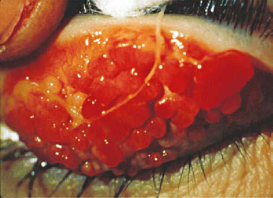

# Chapter 188: Ocular Allergies — Board-Style Self-Assessment MCQs
**Part XIII: Allergic Disorders** | [📖 Read Wiki Chapter](../chapters/188.md) | [🃏 Chapter Flashcards](../flashcards/188_flashcards.md) | [🏠 Course Master Index](../../index.md)

Total questions: **5** *(Click "Show Answer & Rationale" beneath each question)*

### Question 1 (Clinical Pediatrics Vignette)
A pediatric patient is evaluated for the following clinical and diagnostic profile: Seasonal allergic conjunctivitis. Which of the following conditions or syndromes is the most likely diagnosis?

- **A.** DIFFERENTIAL DIAGNOSIS
- **B.** (PAC) (Ocular Allergies)
- **C.** (SAC) (Ocular Allergies)
- **D.** PAC/AKC/VKC (Ocular Allergies)

<b>Show Answer & Rationale</b>

**Correct Answer: A** — DIFFERENTIAL DIAGNOSIS

**Rationale:** **DIFFERENTIAL DIAGNOSIS** is characterized by: Seasonal allergic conjunctivitis.

**Why Other Options Are Incorrect:** **(PAC) (Ocular Allergies)** is incorrect (characterized by • Sensitized individuals; • Both females and males; • Bilateral involvement; • Year-round allergens;). **(SAC) (Ocular Allergies)** is incorrect (characterized by • Sensitized individuals; • Both females and males; • Bilateral involvement; • Seasonal allergens; •). **PAC/AKC/VKC (Ocular Allergies)** is incorrect (characterized by Perennial allergic conjunctivitis).

### Question 2 (Clinical Pediatrics Vignette)
A pediatric patient is evaluated for the following clinical and diagnostic profile: • Sensitized individuals; • Both females and males; • Bilateral involvement; • Seasonal allergens; • Self-limiting; • Ocular itching; • Tearing (watery discharge); • Chemosis, redness; • Often associated with rhinitis; • Not sight threatening; • Infe. Which of the following conditions or syndromes is the most likely diagnosis?

- **A.** SAC/AKC/VKC (Ocular Allergies)
- **B.** PAC/AKC/VKC (Ocular Allergies)
- **C.** (SAC) (Ocular Allergies)
- **D.** (AKC) (Ocular Allergies)

<b>Show Answer & Rationale</b>

**Correct Answer: C** — (SAC) (Ocular Allergies)

**Rationale:** **(SAC) (Ocular Allergies)** is characterized by: • Sensitized individuals; • Both females and males; • Bilateral involvement; • Seasonal allergens; • Self-limiting; • Ocular itching; • Tearing (watery discharge); • Chemosis, redness; • Often associated with rhinitis; • Not sight threatening; • Infective conjunctivitis; • Preservative toxicity; • Medicamentosa; • Dry .

**Why Other Options Are Incorrect:** **SAC/AKC/VKC (Ocular Allergies)** is incorrect (characterized by Atopic keratoconjunctivitis). **PAC/AKC/VKC (Ocular Allergies)** is incorrect (characterized by Perennial allergic conjunctivitis). **(AKC) (Ocular Allergies)** is incorrect (characterized by • Sensitized individuals; • Peak incidence 20-50 years of age; • Both females and males; • Bilateral).

### Question 3 (Visual Diagnosis & Clinical Spotter)

A pediatric patient undergoes evaluation for **Ocular Allergies**, yielding the clinical or diagnostic finding shown below. Which of the following best characterizes the illustrated finding?

- **A.** Vernal keratoconjunctivitis. Cobblestone papillae and ropey discharge are seen on the underside (tarsal conjunctiva) of the upper eyelid. (From Adkinson NF Jr, Bochner BS, Burks AW, et al., eds.
- **B.** It is caused by direct exposure of the muco sal surfaces of the eye to environmental allergens.
- **C.** Allergic Conjunctivitis Allergic conjunctivitis is the most common hypersensitivity response of the eye, affecting approximately 25% of the general population and 30% of children with atopy.
- **D.** DIAGNOSIS Nonallergic conjunctivitis can be viral, bacterial, or chlamydial in ori gin.

<b>Show Answer & Rationale</b>

**Correct Answer: A** — Vernal keratoconjunctivitis. Cobblestone papillae and ropey discharge are seen on the underside (tarsal conjunctiva) of the upper eyelid. (From Adkinson NF Jr, Bochner BS, Burks AW, et al., eds.

**Rationale:** **Fig. 188.2**: Vernal keratoconjunctivitis. Cobblestone papillae and ropey discharge are seen on the underside (tarsal conjunctiva) of the upper eyelid. (From Adkinson NF Jr, Bochner BS, Burks AW, et al., eds. Middleton’s Allergy: Principles & Practice. 8th ed. St Louis: Elsevier, 2014: p. 627.)

### Question 4 (Differential Diagnosis (Ocular Allergies))
During a pediatric consultation regarding **Ocular Allergies**, which clinical entity or concept is described by the following profile? "Allergic eye diseases represent a spectrum of conditions that require allergic sensitization and range from acute (seasonal) progressing to the perennial and then to the more chronic forms and potentially sight-threatening forms, vernal and atopic keratoconjunctivitis (Table 188."

- **A.** PAC/AKC/VKC (Ocular Allergies)
- **B.** SAC/AKC/VKC (Ocular Allergies)
- **C.** (SAC) (Ocular Allergies)
- **D.** CLINICAL MANIFESTATIONS

<b>Show Answer & Rationale</b>

**Correct Answer: D** — CLINICAL MANIFESTATIONS

**Rationale:** CLINICAL MANIFESTATIONS Allergic eye diseases represent a spectrum of conditions that require allergic sensitization and range from acute (seasonal) progressing to the perennial and then to the more chronic forms and potentially sight-threatening forms, vernal and atopic keratoconjunctivitis (Table 188.

### Question 5 (Pediatric Board Mastery (Ocular Allergies))
When formulating an evidence-based diagnostic and management plan for **Ocular Allergies** (*Part XIII: Allergic Disorders*), which of the following pediatric clinical statements is **ACCURATE**? (Item 1)

- **A.** Inheritance is exclusively holandric (Y-linked) with 100% penetrance restricted to male neonates.
- **B.** Allergic Conjunctivitis Allergic conjunctivitis is the most common hypersensitivity response of the eye, affecting approximately 25% of the general population and 30% of children with atopy.
- **C.** Clinical manifestations are permanently restricted to late adulthood and never present during infancy, childhood, or adolescence.
- **D.** First-line management relies on immediate high-dose aspirin therapy in febrile infants.

<b>Show Answer & Rationale</b>

**Correct Answer: B** — Allergic Conjunctivitis Allergic conjunctivitis is the most common hypersensitivity response of the eye, affecting approximately 25% of the general population and 30% of children with atopy.

**Rationale:** **Pediatric Clinical Principle (Ocular Allergies):** Allergic Conjunctivitis Allergic conjunctivitis is the most common hypersensitivity response of the eye, affecting approximately 25% of the general population and 30% of children with atopy.

