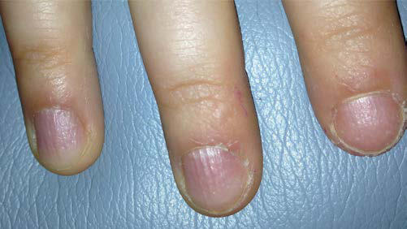

# Chapter 197: Ankylosing Spondylitis and Other Spondyloarthritides — Board-Style Self-Assessment MCQs
**Part XIV: Rheumatic Diseases of Childhood (Connective Tissue Diseases, Collagen Vascular Diseases)** | [📖 Read Wiki Chapter](../chapters/197.md) | [🃏 Chapter Flashcards](../flashcards/197_flashcards.md) | [🏠 Course Master Index](../../index.md)

Total questions: **5** *(Click "Show Answer & Rationale" beneath each question)*

### Question 1 (Clinical Pediatrics Vignette)
A pediatric patient is evaluated for the following clinical and diagnostic profile: Enthesitis; +++; +; +; ++; Axial arthritis; +++; ++; ++; +; Peripheral arthritis; +++; +++; +++; +++; HLA-B27 positive; +++; +; ++; +++; Antinuclear antibody; positive; −; ++; −; −; Rheumatoid factor positive; −; −; −; −. Which of the following conditions or syndromes is the most likely diagnosis?

- **A.** REACTIVE ARTHRITIS
- **B.** PERIPHERAL SpA (Ankylosing Spondylitis and Other Spondyloarthritides)
- **C.** SYSTEMIC DISEASE (Ankylosing Spondylitis and Other Spondyloarthritides)
- **D.** Arthritis or enthesitis or dactylitis plus

<b>Show Answer & Rationale</b>

**Correct Answer: A** — REACTIVE ARTHRITIS

**Rationale:** **REACTIVE ARTHRITIS** is characterized by: Enthesitis; +++; +; +; ++; Axial arthritis; +++; ++; ++; +; Peripheral arthritis; +++; +++; +++; +++; HLA-B27 positive; +++; +; ++; +++; Antinuclear antibody; positive; −; ++; −; −; Rheumatoid factor positive; −; −; −; −.

**Why Other Options Are Incorrect:** **PERIPHERAL SpA (Ankylosing Spondylitis and Other Spondyloarthritides)** is incorrect (characterized by In patients with ≥3 months back pain and age at onset <45 years; In patients with peripheral symptom). **SYSTEMIC DISEASE (Ankylosing Spondylitis and Other Spondyloarthritides)** is incorrect (characterized by Eyes; +; +; +; +; Skin; −; +++; +; +; Mucous membranes; −; −; +; +; Gastrointestinal tract; −; −; ++). **Arthritis or enthesitis or dactylitis plus** is incorrect (characterized by SpA features; • Inflammatory back pain (IBP); • Arthritis; • Enthesitis (heel); • Uveitis; • Dactyli).

### Question 2 (Clinical Pediatrics Vignette)
A pediatric patient is evaluated for the following clinical and diagnostic profile: Eyes; +; +; +; +; Skin; −; +++; +; +; Mucous membranes; −; −; +; +; Gastrointestinal tract; −; −; ++++; +++; *Frequency of characteristics: −, absent; +, <25%; ++, 25–50%; +++, 50–75%; ++++, ≥75%.; From Petty RE, Laxer RM, Lindsley CB, et al., eds. T. Which of the following conditions or syndromes is the most likely diagnosis?

- **A.** SYSTEMIC DISEASE (Ankylosing Spondylitis and Other Spondyloarthritides)
- **B.** REACTIVE ARTHRITIS
- **C.** Sacroiliitis on imaging plus one
- **D.** Arthritis or enthesitis or dactylitis plus

<b>Show Answer & Rationale</b>

**Correct Answer: A** — SYSTEMIC DISEASE (Ankylosing Spondylitis and Other Spondyloarthritides)

**Rationale:** **SYSTEMIC DISEASE (Ankylosing Spondylitis and Other Spondyloarthritides)** is characterized by: Eyes; +; +; +; +; Skin; −; +++; +; +; Mucous membranes; −; −; +; +; Gastrointestinal tract; −; −; ++++; +++; *Frequency of characteristics: −, absent; +, <25%; ++, 25–50%; +++, 50–75%; ++++, ≥75%.; From Petty RE, Laxer RM, Lindsley CB, et al., eds. Textbook of Pediatric Rheumatology, 8th ed. Philadelphia: Elsevier; 202.

**Why Other Options Are Incorrect:** **REACTIVE ARTHRITIS** is incorrect (characterized by Enthesitis; +++; +; +; ++; Axial arthritis; +++; ++; ++; +; Peripheral arthritis; +++; +++; +++; +++). **Sacroiliitis on imaging plus one** is incorrect (characterized by or more SpA feature(s)). **Arthritis or enthesitis or dactylitis plus** is incorrect (characterized by SpA features; • Inflammatory back pain (IBP); • Arthritis; • Enthesitis (heel); • Uveitis; • Dactyli).

### Question 3 (Visual Diagnosis & Clinical Spotter)

A pediatric patient undergoes evaluation for **Ankylosing Spondylitis and Other Spondyloarthritides**, yielding the clinical or diagnostic finding shown below. Which of the following best characterizes the illustrated finding?

- **A.** In India, ERA is the most common category of JIA, accounting for 35% of cases.
- **B.** The presence of psoriasis aids in diagnosis but is not required.
- **C.** Polyarthritis affecting large and small joints is most common and often reflects the activity of the intestinal inflammation.
- **D.** Nail pitting in a 9-year-old with JPsA. (From Srinivasalu H, Sikora KA, Colbert RA. Recent updates in juvenile spondyloarthritis. Rheum Dis Clin N Am. 2021;47:565–583, Fig. 2, p. 569.)

<b>Show Answer & Rationale</b>

**Correct Answer: D** — Nail pitting in a 9-year-old with JPsA. (From Srinivasalu H, Sikora KA, Colbert RA. Recent updates in juvenile spondyloarthritis. Rheum Dis Clin N Am. 2021;47:565–583, Fig. 2, p. 569.)

**Rationale:** **Fig. 197.1**: Nail pitting in a 9-year-old with JPsA. (From Srinivasalu H, Sikora KA, Colbert RA. Recent updates in juvenile spondyloarthritis. Rheum Dis Clin N Am. 2021;47:565–583, Fig. 2, p. 569.)

### Question 4 (Differential Diagnosis (Ankylosing Spondylitis and Other Spondyloarthritides))
During a pediatric consultation regarding **Ankylosing Spondylitis and Other Spondyloarthritides**, which clinical entity or concept is described by the following profile? "Spondyloarthritides are complex diseases in which susceptibility is largely genetically determined."

- **A.** Juvenile Ankylosing Spondylitis
- **B.** ETIOLOGY AND PATHOGENESIS
- **C.** Psoriatic Arthritis
- **D.** Imaging

<b>Show Answer & Rationale</b>

**Correct Answer: B** — ETIOLOGY AND PATHOGENESIS

**Rationale:** ETIOLOGY AND PATHOGENESIS Spondyloarthritides are complex diseases in which susceptibility is largely genetically determined.

### Question 5 (Pediatric Board Mastery (Ankylosing Spondylitis and Other Spondyloarthritides))
When formulating an evidence-based diagnostic and management plan for **Ankylosing Spondylitis and Other Spondyloarthritides** (*Part XIV: Rheumatic Diseases of Childhood (Connective Tissue Diseases, Collagen Vascular Diseases)*), which of the following pediatric clinical statements is **ACCURATE**? (Item 1)

- **A.** First-line management relies on immediate high-dose aspirin therapy in febrile infants.
- **B.** In India, ERA is the most common category of JIA, accounting for 35% of cases.
- **C.** Systemic tetracyclines and fluoroquinolones are universally required as routine prophylaxis in all healthy newborns.
- **D.** The condition is an entirely benign physiologic variant that never warrants laboratory or clinical evaluation.

<b>Show Answer & Rationale</b>

**Correct Answer: B** — In India, ERA is the most common category of JIA, accounting for 35% of cases.

**Rationale:** **Pediatric Clinical Principle (Ankylosing Spondylitis and Other Spondyloarthritides):** In India, ERA is the most common category of JIA, accounting for 35% of cases.

