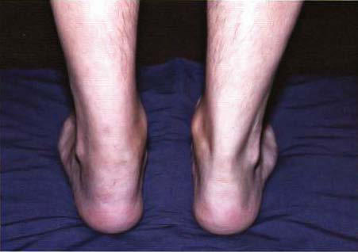

# Chapter 198: Reactive and Postinfectious Arthritis — Board-Style Self-Assessment MCQs
**Part XIV: Rheumatic Diseases of Childhood (Connective Tissue Diseases, Collagen Vascular Diseases)** | [📖 Read Wiki Chapter](../chapters/198.md) | [🃏 Chapter Flashcards](../flashcards/198_flashcards.md) | [🏠 Course Master Index](../../index.md)

Total questions: **5** *(Click "Show Answer & Rationale" beneath each question)*

### Question 1 (Clinical Pediatrics Vignette)
A pediatric patient is evaluated for the following clinical and diagnostic profile: Ross River; Chikungunya; O’nyong-nyong; Mayaro; Sindbis; Ockelbo; Pogosta. Which of the following conditions or syndromes is the most likely diagnosis?

- **A.** ALPHAVIRUSES (Reactive and Postinfectious Arthritis)
- **B.** ORTHOPOXVIRUSES (Reactive and Postinfectious Arthritis)
- **C.** CORONAVIRUSES (Reactive and Postinfectious Arthritis)
- **D.** HERPESVIRUSES (Reactive and Postinfectious Arthritis)

<b>Show Answer & Rationale</b>

**Correct Answer: A** — ALPHAVIRUSES (Reactive and Postinfectious Arthritis)

**Rationale:** **ALPHAVIRUSES (Reactive and Postinfectious Arthritis)** is characterized by: Ross River; Chikungunya; O’nyong-nyong; Mayaro; Sindbis; Ockelbo; Pogosta.

**Why Other Options Are Incorrect:** **ORTHOPOXVIRUSES (Reactive and Postinfectious Arthritis)** is incorrect (characterized by Variola virus (smallpox); Vaccinia virus; Parvoviruses). **CORONAVIRUSES (Reactive and Postinfectious Arthritis)** is incorrect (characterized by SARS-CoV-2; Adapted from Infectious arthritis and osteomyelitis. In: Petty RE, Laxer RM, Lindsley CB). **HERPESVIRUSES (Reactive and Postinfectious Arthritis)** is incorrect (characterized by Epstein-Barr; Cytomegalovirus; Varicella-zoster; Herpes simplex).

### Question 2 (Clinical Pediatrics Vignette)
A pediatric patient is evaluated for the following clinical and diagnostic profile: Variola virus (smallpox); Vaccinia virus; Parvoviruses. Which of the following conditions or syndromes is the most likely diagnosis?

- **A.** ENTEROVIRUSES (Reactive and Postinfectious Arthritis)
- **B.** ORTHOPOXVIRUSES (Reactive and Postinfectious Arthritis)
- **C.** HERPESVIRUSES (Reactive and Postinfectious Arthritis)
- **D.** CORONAVIRUSES (Reactive and Postinfectious Arthritis)

<b>Show Answer & Rationale</b>

**Correct Answer: B** — ORTHOPOXVIRUSES (Reactive and Postinfectious Arthritis)

**Rationale:** **ORTHOPOXVIRUSES (Reactive and Postinfectious Arthritis)** is characterized by: Variola virus (smallpox); Vaccinia virus; Parvoviruses.

**Why Other Options Are Incorrect:** **ENTEROVIRUSES (Reactive and Postinfectious Arthritis)** is incorrect (characterized by Echovirus; Coxsackievirus B). **HERPESVIRUSES (Reactive and Postinfectious Arthritis)** is incorrect (characterized by Epstein-Barr; Cytomegalovirus; Varicella-zoster; Herpes simplex). **CORONAVIRUSES (Reactive and Postinfectious Arthritis)** is incorrect (characterized by SARS-CoV-2; Adapted from Infectious arthritis and osteomyelitis. In: Petty RE, Laxer RM, Lindsley CB).

### Question 3 (Visual Diagnosis & Clinical Spotter)

A pediatric patient undergoes evaluation for **Reactive and Postinfectious Arthritis**, yielding the clinical or diagnostic finding shown below. Which of the following best characterizes the illustrated finding?

- **A.** Acute rheumatic fever caused by group A streptococcus, arthritis associated with infective endocarditis, and the tenosynovitis associated with Neisseria gonorrhoeae are similar in some respe
- **B.** Enthesitis—swelling of the posterior aspect of the left heel and lateral aspect of the ankle. (Courtesy Dr. Nora Singer, Case Western Reserve University and Rainbow Babies’ Hospital.)
- **C.** CLINICAL MANIFESTATIONS AND DIFFERENTIAL DIAGNOSIS Symptoms of reactive arthritis begin approximately 3 days to 6 weeks after infection.
- **D.** Familiarity with other causes of postinfectious arthritis is vital when a diagnosis of reactive arthritis is being considered.

<b>Show Answer & Rationale</b>

**Correct Answer: B** — Enthesitis—swelling of the posterior aspect of the left heel and lateral aspect of the ankle. (Courtesy Dr. Nora Singer, Case Western Reserve University and Rainbow Babies’ Hospital.)

**Rationale:** **Fig. 198.1**: Enthesitis—swelling of the posterior aspect of the left heel and lateral aspect of the ankle. (Courtesy Dr. Nora Singer, Case Western Reserve University and Rainbow Babies’ Hospital.)

### Question 4 (Differential Diagnosis (Reactive and Postinfectious Arthritis))
During a pediatric consultation regarding **Reactive and Postinfectious Arthritis**, which clinical entity or concept is described by the following profile? "Reactive arthritis typically follows enteric infection with Salmonella species, Shigella flexneri, Yersinia enterocolitica, Campylobacter jejuni, or genitourinary (GU) tract infection with Chlamydia trachoma tis."

- **A.** Hepatitis B arthritis– dermatitis syndrome
- **B.** Poststreptococcal arthritis
- **C.** PATHOGENESIS
- **D.** COMPLICATIONS AND PROGNOSIS

<b>Show Answer & Rationale</b>

**Correct Answer: C** — PATHOGENESIS

**Rationale:** PATHOGENESIS Reactive arthritis typically follows enteric infection with Salmonella species, Shigella flexneri, Yersinia enterocolitica, Campylobacter jejuni, or genitourinary (GU) tract infection with Chlamydia trachoma tis.

### Question 5 (Pediatric Board Mastery (Reactive and Postinfectious Arthritis))
When formulating an evidence-based diagnostic and management plan for **Reactive and Postinfectious Arthritis** (*Part XIV: Rheumatic Diseases of Childhood (Connective Tissue Diseases, Collagen Vascular Diseases)*), which of the following pediatric clinical statements is **ACCURATE**? (Item 1)

- **A.** Diagnostic confirmation relies solely on plain skull radiographs without biochemical, microbiologic, or clinical correlation.
- **B.** Systemic tetracyclines and fluoroquinolones are universally required as routine prophylaxis in all healthy newborns.
- **C.** Acute rheumatic fever caused by group A streptococcus, arthritis associated with infective endocarditis, and the tenosynovitis associated with Neisseria gonorrhoeae are similar in some respects to reactive
- **D.** The condition is an entirely benign physiologic variant that never warrants laboratory or clinical evaluation.

<b>Show Answer & Rationale</b>

**Correct Answer: C** — Acute rheumatic fever caused by group A streptococcus, arthritis associated with infective endocarditis, and the tenosynovitis associated with Neisseria gonorrhoeae are similar in some respects to reactive

**Rationale:** **Pediatric Clinical Principle (Reactive and Postinfectious Arthritis):** Acute rheumatic fever caused by group A streptococcus, arthritis associated with infective endocarditis, and the tenosynovitis associated with Neisseria gonorrhoeae are similar in some respects to reactive arthritis.

