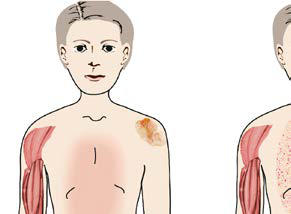

# Chapter 200: Juvenile Dermatomyositis — Board-Style Self-Assessment MCQs
**Part XIV: Rheumatic Diseases of Childhood (Connective Tissue Diseases, Collagen Vascular Diseases)** | [📖 Read Wiki Chapter](../chapters/200.md) | [🃏 Chapter Flashcards](../flashcards/200_flashcards.md) | [🏠 Course Master Index](../../index.md)

Total questions: **5** *(Click "Show Answer & Rationale" beneath each question)*

### Question 1 (Clinical Pediatrics Vignette)
A pediatric patient is evaluated for the following clinical and diagnostic profile: Common myositis-specific autoantibodies are found in 45–55% of patients with juvenile-onset myositis; Anti-Mi2; Nucleosome remodeling; deacetylase complex (NuRD); 3–4; • “Classic” dermatomyositis; • Responds well to standard therapies; • Favorable pr. Which of the following conditions or syndromes is the most likely diagnosis?

- **A.** TRIM33) (Juvenile Dermatomyositis)
- **B.** PL7 (Juvenile Dermatomyositis)
- **C.** CLINICAL ASSOCIATIONS
- **D.** HMGCR (Juvenile Dermatomyositis)

<b>Show Answer & Rationale</b>

**Correct Answer: C** — CLINICAL ASSOCIATIONS

**Rationale:** **CLINICAL ASSOCIATIONS** is characterized by: Common myositis-specific autoantibodies are found in 45–55% of patients with juvenile-onset myositis; Anti-Mi2; Nucleosome remodeling; deacetylase complex (NuRD); 3–4; • “Classic” dermatomyositis; • Responds well to standard therapies; • Favorable prognosis; Anti-TIF1g (p155/140,.

**Why Other Options Are Incorrect:** **TRIM33) (Juvenile Dermatomyositis)** is incorrect (characterized by Transcriptional intermediary; factor 1 gamma (TIF1-γ); 18–35; • Severe cutaneous disease; • Rashes i). **PL7 (Juvenile Dermatomyositis)** is incorrect (characterized by - Threonyl; 2–3). **HMGCR (Juvenile Dermatomyositis)** is incorrect (characterized by 1; • Necrotizing autoimmune myositis, muscle necrosis,; high CK, dysphagia, no statin exposure; Anti).

### Question 2 (Clinical Pediatrics Vignette)
A pediatric patient is evaluated for the following clinical and diagnostic profile: Transcriptional intermediary; factor 1 gamma (TIF1-γ); 18–35; • Severe cutaneous disease; • Rashes in photoexposed pattern; • Chronic disease course; • Lipodystrophy; Anti-NXP2 (p140, MJ); Nuclear matrix protein 2 (NXP2); 15–22; • Calcinosis; • More . Which of the following conditions or syndromes is the most likely diagnosis?

- **A.** ANTISYNTHETASES (Juvenile Dermatomyositis)
- **B.** PL7 (Juvenile Dermatomyositis)
- **C.** myositis-specific autoantibody.
- **D.** TRIM33) (Juvenile Dermatomyositis)

<b>Show Answer & Rationale</b>

**Correct Answer: D** — TRIM33) (Juvenile Dermatomyositis)

**Rationale:** **TRIM33) (Juvenile Dermatomyositis)** (associated with **`MDA5`**) is characterized by: Transcriptional intermediary; factor 1 gamma (TIF1-γ); 18–35; • Severe cutaneous disease; • Rashes in photoexposed pattern; • Chronic disease course; • Lipodystrophy; Anti-NXP2 (p140, MJ); Nuclear matrix protein 2 (NXP2); 15–22; • Calcinosis; • More severe muscle disease; • Gastrointestinal bleeding, ulcers, and dyspha.

**Why Other Options Are Incorrect:** **ANTISYNTHETASES (Juvenile Dermatomyositis)** is incorrect (characterized by • Antisynthetase syndrome: myositis, interstitial; lung disease, fever, mechanic’s hands, Raynaud; p). **PL7 (Juvenile Dermatomyositis)** is incorrect (characterized by - Threonyl; 2–3). **myositis-specific autoantibody.** is incorrect (characterized by Anti-PmScl; Exosome-associated PM- Scl-75;; PM-Scl-100; C1D; 5; • Overlap syndromes; Anti-U1RNP).

### Question 3 (Visual Diagnosis & Clinical Spotter)

A pediatric patient undergoes evaluation for **Juvenile Dermatomyositis**, yielding the clinical or diagnostic finding shown below. Which of the following best characterizes the illustrated finding?

- **A.** DIAGNOSIS Diagnosis of dermatomyositis requires the presence of a characteris tic rash and at least three signs of muscle inflammation and weakness.
- **B.** Phenotypes associated with the three most common myositis specific antibodies in children with myositis: anti-p155/140, anti-MJ, and antiMDA-5. A, Anti-p155/140, present in 18–30% of idiopathic j
- **C.** The peak age of onset is 7 years with a second peak of onset in late adulthood (45-64 years); however, adult-onset dermatomyositis appears to be a distinctly separate entity, both in prognos
- **D.** Fevers, dysphagia or dysphonia, arthritis, muscle ten derness, and fatigue are also commonly reported at diagnosis.

<b>Show Answer & Rationale</b>

**Correct Answer: B** — Phenotypes associated with the three most common myositis specific antibodies in children with myositis: anti-p155/140, anti-MJ, and antiMDA-5. A, Anti-p155/140, present in 18–30% of idiopathic j

**Rationale:** **Fig. 200.1**: Phenotypes associated with the three most common myositis specific antibodies in children with myositis: anti-p155/140, anti-MJ, and antiMDA-5. A, Anti-p155/140, present in 18–30% of idiopathic juvenile inflammatory myopathies, displays an extensive photosensitive rash that ulcerates, a chronic disease course, and generalized lipodystrophy. B, Fifteen to twenty-three percent of children positive for anti-MJ (nuclear matrix protein 2 in the United Kingdom) may have disease onset at a younger age and have dysphonia, muscle cramps, atrophy, and contractures, with increased weakness, and they are more likely to develop calcifications and gastrointestinal symptoms; their rash often spares the truncal area. C, Anti–MDA-5 is increased in the Japanese population (33%) vs the United Kingdom (6%) and is associated with inflammatory lung disease, oral and cutaneous ulcers, arthritis, and a milder form of muscle involvement. GI, gastrointestinal. (Modified from Rider LG, Nistala K. The juvenile idiopathic inflammatory myopathies: Pathogenesis, clinical and autoantibody phenotypes, and outcomes. J Intern Med. 2016;280:24–38, Fig 3.)

### Question 4 (Differential Diagnosis (Juvenile Dermatomyositis))
During a pediatric consultation regarding **Juvenile Dermatomyositis**, which clinical entity or concept is described by the following profile? "The incidence of JDM is approximately 3 cases/1 million children/yr, with an incidence similar in White and Black non-Hispanics and an apparent lower incidence in Hispanics."

- **A.** EPIDEMIOLOGY
- **B.** TREATMENT
- **C.** CLINICAL MANIFESTATIONS
- **D.** heliotrope rash

<b>Show Answer & Rationale</b>

**Correct Answer: A** — EPIDEMIOLOGY

**Rationale:** EPIDEMIOLOGY The incidence of JDM is approximately 3 cases/1 million children/yr, with an incidence similar in White and Black non-Hispanics and an apparent lower incidence in Hispanics.

### Question 5 (Pediatric Board Mastery (Juvenile Dermatomyositis))
When formulating an evidence-based diagnostic and management plan for **Juvenile Dermatomyositis** (*Part XIV: Rheumatic Diseases of Childhood (Connective Tissue Diseases, Collagen Vascular Diseases)*), which of the following pediatric clinical statements is **ACCURATE**? (Item 1)

- **A.** Diagnostic confirmation relies solely on plain skull radiographs without biochemical, microbiologic, or clinical correlation.
- **B.** Systemic tetracyclines and fluoroquinolones are universally required as routine prophylaxis in all healthy newborns.
- **C.** Clinical manifestations are permanently restricted to late adulthood and never present during infancy, childhood, or adolescence.
- **D.** The peak age of onset is 7 years with a second peak of onset in late adulthood (45-64 years); however, adult-onset dermatomyositis appears to be a distinctly separate entity, both in prognosis and etiology

<b>Show Answer & Rationale</b>

**Correct Answer: D** — The peak age of onset is 7 years with a second peak of onset in late adulthood (45-64 years); however, adult-onset dermatomyositis appears to be a distinctly separate entity, both in prognosis and etiology

**Rationale:** **Pediatric Clinical Principle (Juvenile Dermatomyositis):** The peak age of onset is 7 years with a second peak of onset in late adulthood (45-64 years); however, adult-onset dermatomyositis appears to be a distinctly separate entity, both in prognosis and etiology.

